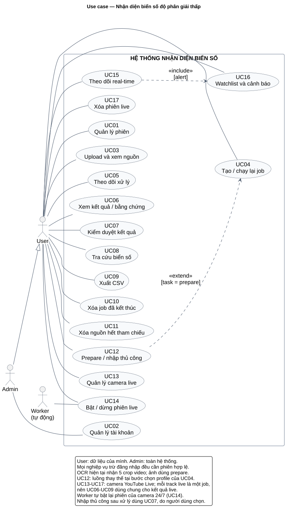

# Phân tích nghiệp vụ hệ thống nhận diện biển số độ phân giải thấp

**Phiên bản:** 1.0 · **Ngày hoàn thiện tài liệu:** 10/10/2026 · **Mốc kiểm chứng triển khai tham chiếu:** 09/10/2026 · **Phạm vi:** backend NestJS, PostgreSQL và worker inference Python. Tài liệu mô tả nghiệp vụ và đối chiếu mã nguồn hiện hành; giao diện người dùng trong các luồng là yêu cầu cho client, chưa phải xác nhận đã xây frontend.

## 1. Mục tiêu, bối cảnh và thuật ngữ

### 1.1. Bài toán

Ảnh biển số nhỏ, mờ hoặc xuất hiện ngắn trong video khiến việc đọc tự động thiếu ổn định. Hệ thống tiếp nhận ảnh/video, tìm vùng biển số, lưu bằng chứng, nhận diện khi có model phù hợp, cho phép con người kiểm duyệt và tra cứu kết quả. Mỗi lần chạy phải giữ cấu hình và dự đoán gốc để giải thích, đối chiếu và đánh giá đồ án.

Đơn vị quản lý là **một lần xuất hiện của biển số trong một job**. Đây không phải hồ sơ phương tiện. Hai lần xuất hiện có cùng chuỗi biển số vẫn là hai kết quả; hệ thống không suy ra chủ xe hay hành trình liên camera.

### 1.2. Mục tiêu nghiệp vụ

- Giảm thao tác tìm/cắt biển số và đọc thủ công trên dữ liệu tải lên.
- Tách dự đoán máy khỏi kết luận người kiểm duyệt, có lịch sử sửa đổi.
- Tái sử dụng nguồn để chạy cấu hình khác, truy lại bằng chứng và phiên bản model.
- Phân quyền dữ liệu theo tài khoản, hỗ trợ xuất kết quả và đánh giá có nhãn chuẩn.

Pipeline và model OCR được tích hợp theo notebook Kaggle của nhóm `trnvnhun/pbl6-pipeline` (checkpoint SE-ResNet34-C `single_model_best.pt`, dataset `trnvnhun/icpr-2026-model`); miền huấn luyện là biển số Brazil/Mercosul. Chất lượng trên Việt Nam cần đánh giá riêng. Tài liệu này không đặt mục tiêu accuracy hoặc thời gian đáp ứng khi chưa có phép đo và điều kiện nghiệm thu thống nhất.

### 1.3. Thuật ngữ

| Thuật ngữ | Ý nghĩa trong dự án |
|---|---|
| Media | Một ảnh/video nguồn do tài khoản upload; có thể dùng cho nhiều job. |
| Job | Một lượt xử lý nguồn với cấu hình đã đóng băng. |
| Appearance | Một biển số phát hiện trong ảnh hoặc một track đủ điều kiện trong video. |
| Detection / crop | Một quan sát biển số và ảnh cắt tương ứng; bbox gốc có thể khác crop có padding. |
| Track | Chuỗi quan sát được tracker liên kết trong một job; không phải danh tính xe. |
| Joint-five OCR | Model nhận đồng thời năm crop để tạo một dự đoán cho track. |
| Prepare | Chỉ chuẩn bị detection/tracking và bằng chứng, chưa chạy OCR. |
| Machine text | Chuỗi máy dự đoán, không bị ghi đè khi kiểm duyệt. |
| Effective text | Chuỗi có hiệu lực để hiển thị/tra cứu sau quy tắc kiểm duyệt. |
| Review / revision | Một thao tác kiểm duyệt / số phiên bản để phát hiện sửa đồng thời. |
| Pipeline snapshot | Phiên bản, checksum và cấu hình thực tế của lượt chạy. |
| Camera (stream source) | Một URL YouTube Live thuộc về người tạo, kèm vùng loại trừ, chế độ 24/7 và thời hạn lưu bằng chứng. |
| Phiên live (live session) | Một lần chạy tiến trình nhận diện trên camera, từ lúc bật đến khi dừng/kết thúc/lỗi. |
| Track live | Một track đã chốt của phiên live; mỗi track được lưu thành một job `succeeded` có một appearance. |
| Lượt xuất hiện (sighting) | Nhóm các track live cùng biển (hoặc lệch một ký tự) trên một camera trong vài phút; gợi ý, không phải danh tính xe. |
| Watchlist | Danh sách biển số người dùng muốn được cảnh báo khi camera đọc được. |
| Vùng loại trừ | Hình chữ nhật chuẩn hóa trên khung hình; detection có tâm nằm trong vùng bị bỏ qua (biển tên đường, bảng cố định). |

## 2. Bên liên quan và phân quyền

**User** chuẩn bị nguồn, theo dõi job, đối chiếu bằng chứng và xử lý kết quả thuộc dữ liệu của mình. **Admin** có các chức năng đó trên toàn hệ thống và quản lý tài khoản. Người vận hành triển khai API/worker, backup và chuẩn bị checkpoint; đây là trách nhiệm vận hành, không phải một vai trò đăng nhập bổ sung. Nhóm nghiên cứu chuẩn bị nhãn chuẩn và thực hiện đánh giá offline.

| Chức năng | Chưa đăng nhập | User | Admin |
|---|---|---|---|
| Đăng nhập | Có, nếu được cấp tài khoản | Có | Có |
| Đăng xuất, xem tài khoản hiện tại | Không | Phiên của mình | Phiên của mình |
| Upload, xem danh sách/nguồn | Không | Dữ liệu của mình | Toàn hệ thống |
| Xem pipeline được phép chạy | Không | Có | Có |
| Tạo/chạy lại, theo dõi, xóa job | Không | Nguồn của mình | Toàn hệ thống |
| Xem bằng chứng, kiểm duyệt | Không | Dữ liệu của mình | Toàn hệ thống |
| Tra cứu, xuất CSV, xóa nguồn | Không | Dữ liệu của mình | Toàn hệ thống |
| Tạo, khóa, đổi vai trò/reset mật khẩu | Không | Không | Có |
| Sửa checkpoint, interpreter qua API | Không | Không | Không |

Quyền kế thừa từ `media_assets.owner_id` sang job, appearance, detection và export. Admin được xử lý nguồn của người khác nhưng quyền sở hữu nguồn không đổi. Request truy cập ID không thuộc quyền trả `404`; truy cập chức năng quản trị bằng User trả `403`.

## 3. Phạm vi và trạng thái triển khai

### 3.1. Phạm vi bản đầu

Đã có các nhóm chức năng tài khoản, upload, pipeline/job, bằng chứng, kiểm duyệt, tra cứu và CSV: **21 endpoint v2** cùng health check vận hành. API và worker tách tiến trình; PostgreSQL giữ metadata, filesystem riêng giữ nguồn và bằng chứng. Không mở đăng ký công khai.

| Nội dung | Kế hoạch ban đầu | Hiện trạng áp dụng |
|---|---|---|
| Ảnh scene/plate_crop | Phát hiện và đọc từng crop | Prepare hỗ trợ ảnh; OCR ảnh đơn cần adapter/checkpoint phù hợp. |
| Video | Detection/tracking, chọn 5 crop | Adaptive Sampling → empty-scene gate → YOLO11l → BoT-SORT, không ReID → 5 crop khác frame, chọn theo chất lượng. |
| Tổng hợp OCR video | Đọc từng crop, đa số 3/5 | Model Kaggle đọc đồng thời 5 crop; một dự đoán joint, không bỏ phiếu 3/5. |
| Thực hiện thủ công | Xác nhận/sửa kết quả | Có; prepare cho phép nhập bằng `correct`, không `confirm` khi chưa có text máy. |
| Dự đoán từng ảnh | Lưu prediction theo detection | Hợp đồng mở rộng vẫn hỗ trợ; profile OCR hiện hành dùng prediction cấp appearance. |
| Tăng độ phân giải | Tùy model | Chưa có nhánh SR thực trong profile Kaggle; không tạo ảnh enhanced giả. |
| Camera YouTube Live | Ngoài phạm vi ban đầu | Đã bổ sung: camera, phiên live, tiến trình `app.live` trong worker, mỗi track thành một job; 17 endpoint live (camera, phiên, SSE, watchlist, lượt xuất hiện). |
| Theo dõi real-time | Poll trạng thái | SSE `GET /live-events/stream` qua PostgreSQL LISTEN/NOTIFY, phát lại theo id. |
| Vận hành lâu dài | Không có | Camera 24/7 tự bật lại, dọn bằng chứng theo thời hạn, xóa phiên, chia GPU giữa job upload và live. |

### 3.2. Ngoài phạm vi

Camera CCTV/RTSP, nhiều camera live đồng thời trên một GPU 8 GB, bãi xe, vé/thu phí, chủ phương tiện, xử phạt, nhận dạng danh tính xe, chia sẻ dữ liệu công khai, huấn luyện model và tự động sửa biển số theo luật quốc gia không thuộc bản đầu. Không có API hủy job đang chạy hoặc retry tại chỗ; chạy lại tạo job mới. Frontend hoàn chỉnh, OCR ảnh đơn và thẩm định accuracy trên tập nhãn độc lập là các hạng mục riêng cần tiếp tục khi triển khai sản phẩm/đánh giá.

## 4. Yêu cầu chức năng và phi chức năng

### 4.1. Yêu cầu chức năng

| Mã | Yêu cầu và tiêu chí chấp nhận | Use case |
|---|---|---|
| FR01 | Đăng nhập tài khoản hoạt động; cấp phiên có hạn; logout thu hồi phiên; xem thông tin hiện tại. | UC01 |
| FR02 | Admin tạo/cập nhật/khóa tài khoản, đặt lại mật khẩu; bảo vệ Admin hoạt động cuối cùng. | UC02 |
| FR03 | Kiểm tra quyền trên metadata, file, bằng chứng, review và CSV. | UC02–UC12 |
| FR04 | Upload một file, kiểm tra loại/dung lượng/giải mã, ghi owner và metadata. | UC03 |
| FR05 | Liệt kê nguồn, đọc nội dung có xác thực, hỗ trợ byte range cho video. | UC03, UC06 |
| FR06 | Liệt kê profile và khả năng xử lý; client chỉ chọn ID được cấu hình trên server. | UC04 |
| FR07 | Tạo job bất đồng bộ từ nguồn có sẵn; mỗi lần chạy tạo ID và snapshot riêng. | UC04 |
| FR08 | Worker nhận job, cập nhật trạng thái/giai đoạn/thống kê; lỗi không thành kết quả thành công. | UC05 |
| FR09 | Prepare ảnh scene phát hiện nhiều biển số; plate_crop bỏ qua detector. | UC12 |
| FR10 | Video tracking, chọn đúng 5 crop từ 5 frame khác nhau theo thời gian; thống kê track bị loại. | UC04, UC12 |
| FR11 | OCR Kaggle nhận 5 crop thật, trả prediction joint có provenance; score không có thì để null. | UC04, UC06 |
| FR12 | Xem kết quả job thành công, crop/keyframe, dự đoán và lịch sử review. | UC06 |
| FR13 | Confirm/correct/unreadable/reject với expected_revision; lưu lịch sử và text hiệu lực nguyên tử. | UC07 |
| FR14 | Tra cứu khớp text chuẩn hóa, lọc nguồn/trạng thái duyệt/thời gian upload, có phân trang. | UC08 |
| FR15 | Mặc định tra cứu job v2 thành công mới nhất mỗi nguồn; giữ khả năng xem job cũ. | UC08 |
| FR16 | Xuất CSV job thành công, có kết quả máy, hiệu lực, trạng thái và vị trí xuất hiện. | UC09 |
| FR17 | Xóa job kết thúc, giữ nguồn; xóa nguồn chỉ khi hết tham chiếu job. | UC10, UC11 |
| FR18 | Quản lý phiên bản schema bằng migration có checksum; dữ liệu lịch sử (job `detect_only` cũ) vẫn đọc được qua API hiện hành, không suy diễn OCR. | UC05, UC06; vận hành |
| FR19 | Tạo/sửa/xóa camera YouTube Live theo chủ sở hữu; vùng loại trừ tối đa 16 hình chữ nhật; cung cấp `embed_url` và ảnh khung hình mới nhất để vẽ vùng. | UC13 |
| FR20 | Bật phiên live với profile joint; mỗi camera chỉ một phiên hoạt động; dừng phiên chốt và OCR các track đang mở. | UC14 |
| FR21 | Camera 24/7: worker tự bật phiên mới khi không có phiên, kể cả sau khi khởi động lại; lùi dần khi phiên liên tục lỗi. | UC14 |
| FR22 | Mỗi track live đủ 5 frame thành một job succeeded có bằng chứng, giờ chụp, mức tin cậy và gợi ý trùng; dùng chung xem, kiểm duyệt, tra cứu, CSV. | UC06–UC09, UC14 |
| FR23 | Đẩy trạng thái, stats, track và cảnh báo real-time qua SSE; nối lại không mất sự kiện bằng `Last-Event-ID`. | UC15 |
| FR24 | Watchlist theo người dùng; biển khớp (giống hệt hoặc lệch 1 ký tự) tạo cảnh báo chỉ gửi người đặt. | UC16 |
| FR25 | Gộp track thành lượt xuất hiện khi tra cứu; xóa phiên đã kết thúc cùng bằng chứng; dọn bằng chứng theo thời hạn của camera. | UC08, UC17 |

### 4.2. Yêu cầu phi chức năng

| Mã | Yêu cầu | Cách kiểm chứng / giới hạn |
|---|---|---|
| NFR01 | Bảo mật truy cập và bí mật xác thực | Test tài khoản chéo; mật khẩu hash scrypt, DB chỉ lưu hash token; không lộ đường dẫn nội bộ. |
| NFR02 | Toàn vẹn dữ liệu và cập nhật đồng thời | FK, unique/check, transaction; test hai review cùng revision chỉ một lần thành công. |
| NFR03 | Tái lập và truy vết | Giữ snapshot/checksum, raw/normalized text, input crop và lịch sử; đối chiếu lại một lượt chạy. |
| NFR04 | Xử lý dài không giữ request HTTP | Tạo job trả 202; inference trong worker riêng; đo thời gian theo thiết bị và nguồn thực. Chưa cam kết SLA. |
| NFR05 | Phục hồi lỗi có trạng thái rõ | Worker khởi động lại đánh dấu job running cũ là failed/WORKER_INTERRUPTED; người dùng tạo lượt mới. |
| NFR06 | Giới hạn tài nguyên và đầu vào | Upload mặc định 500 MiB, ảnh tối đa 25 MP; limit tối đa 200; cấu hình timeout phía server. |
| NFR07 | Khả năng vận hành/bảo trì | Migration có checksum, health DB/schema, tách API/worker, hướng dẫn backup và log; health không thay kiểm tra inference. |
| NFR08 | Đánh giá khoa học | Nhãn độc lập, chia tập theo nguồn/identity khi biết; đo exact accuracy, CER, unreadable và latency; báo riêng lỗi bỏ sót. |
| NFR09 | Live gần thời gian thực | Bài chạy 60 phút: bỏ 0,6% frame, lag xử lý p95 0,86 s; track đến client sau khoảng 3,5–4,2 s khi luồng ổn định; đuổi kịp sau khi kẹt tối đa 1,3× mà không bỏ frame. |
| NFR10 | Live bền và tự phục hồi | Kết nối lại khi mất luồng; watchdog `LIVE_STALLED`; worker khởi động lại thì phiên `interrupted` và track trên đĩa vẫn được nhập; camera 24/7 tự bật lại. |
| NFR11 | Tài nguyên live có giới hạn | Một phiên khoảng 4,4 GB VRAM; job upload và live không chạy cùng lúc trên GPU 8 GB; bằng chứng khoảng 2,6 GB/giờ, giảm khoảng 80% sau khi bỏ bớt keyframe. |

Giới hạn upload có thể cấu hình; giới hạn 25 MP hiện được kiểm tra trong mã probe ảnh. Đây là các giới hạn đầu vào, không phải kết quả benchmark. Mục tiêu concurrency, p95 latency, thời gian phục hồi và accuracy cần chốt sau khi xác định phần cứng, dữ liệu và quy mô vận hành. Bản đầu vận hành một worker xử lý hàng đợi tuần tự; không diễn giải kiến trúc này là đã hỗ trợ nhiều worker đồng thời.

## 5. Quy tắc nghiệp vụ

| Mã | Quy tắc |
|---|---|
| BR01 | Chỉ tài khoản được cấp và đang hoạt động được dùng nghiệp vụ; không đăng ký công khai. |
| BR02 | User chỉ thao tác dữ liệu mình; Admin toàn hệ thống; kiểm tra quyền cả file và export. |
| BR03 | Email trim/chữ thường, duy nhất; API tạo/reset mật khẩu nhận 12–1024 ký tự. Khóa/reset thu hồi phiên; không khóa/hạ quyền Admin hoạt động cuối cùng. |
| BR04 | Upload tạo nguồn độc lập theo owner; hash chỉ kiểm tra nội dung, không gộp sở hữu giữa tài khoản. |
| BR05 | JPG/PNG/MP4/AVI/MOV được kiểm tra nội dung thực; nguồn lỗi không tạo job thành công. Upload time khác capture time. |
| BR06 | Một nguồn có nhiều job; snapshot của job giữ nguyên. Client không truyền interpreter/checkpoint/path tùy ý. |
| BR07 | Video chỉ dùng scene. Ảnh prepare dùng scene hoặc plate_crop; crop sẵn bỏ detector, detector score có thể null. |
| BR08 | Mỗi detection ảnh hoặc track video hợp lệ tạo appearance riêng; không unique text biển số; track ID chỉ có nghĩa trong job. |
| BR09 | Video cần 5 crop thật, 5 frame khác nhau, theo thứ tự thời gian. Thiếu frame thì loại track và ghi thống kê; không nhân bản ảnh. |
| BR10 | Video upload thông thường dùng toàn khung hình; không tự áp ROI/bộ lọc màu riêng của camera Captures. |
| BR11 | Profile Kaggle tạo một prediction joint từ 5 input; không contact sheet, không phiếu 3/5; agreement_count=null. |
| BR12 | Prepare chưa chạy OCR: machine_status=not_run, machine_text=null, predictions rỗng; cho phép correct để nhập thủ công. |
| BR13 | Raw text và normalized text được giữ riêng; chuẩn hóa chữ hoa, bỏ khoảng trắng/dấu gạch nối; không tự đổi O↔0 hoặc I↔1. |
| BR14 | Detector score, OCR score và frame_weights khác nghĩa. Không suy diễn confidence/accuracy; score model không cung cấp là null. |
| BR15 | Succeeded chỉ nghĩa xử lý/lưu hoàn tất; có thể không phát hiện hoặc đọc sai. Không tự xác nhận kết quả theo confidence. |
| BR16 | Kết quả mới pending. Confirm lấy text máy; correct nhận text mới; unreadable/reject đặt effective_text=null. Machine text/prediction không đổi. |
| BR17 | Mỗi review tăng revision, thêm lịch sử và cập nhật effective_text trong cùng transaction. Revision cũ trả 409, không ghi đè âm thầm. |
| BR18 | Tra cứu dùng effective_text của job succeeded mới nhất theo created_at rồi ID mỗi nguồn. Job queued/failed không che job thành công cũ. |
| BR19 | Chỉ xóa job succeeded/failed; xóa job v2 giữ nguồn. Nguồn còn job tham chiếu trả 409; bằng chứng chia sẻ trong job được xử lý theo thư mục job. |
| BR20 | CSV và truy vấn không phải bộ nhãn đánh giá. Accuracy dùng nhãn độc lập; dữ liệu lịch sử `detect_only` không được tạo OCR/track giả. |
| BR21 | Camera và phiên live thuộc chủ camera; Admin xem tất cả. Mỗi job có đúng một nguồn: media upload hoặc phiên live. |
| BR22 | Mỗi camera tối đa một phiên hoạt động (queued/starting/running/reconnecting/stopping). Người dùng dừng phiên thì chế độ 24/7 của camera tắt. |
| BR23 | `confidence_status` (readable/low_confidence/unreadable), `duplicate_of_job_id` và `sighting_id` chỉ để tham khảo; không track nào bị loại vì chúng. |
| BR24 | Cảnh báo watchlist chỉ gửi người đặt mục watchlist, kể cả Admin; watchlist không quét lại lịch sử khi thêm mục mới. |
| BR25 | Giờ chụp live lấy theo giờ của luồng (`#EXT-X-PROGRAM-DATE-TIME`) khi xác định được, nếu không theo giờ nhận frame; job ghi rõ nguồn giờ. |
| BR26 | Dọn bằng chứng không đụng track đã kiểm duyệt hoặc đã có cảnh báo; crop luôn được giữ khi bỏ bớt keyframe. |
| BR27 | Mặc định job upload và phiên live không chạy cùng lúc trên một GPU; camera 24/7 làm job upload chờ đến khi tắt camera. |
| BR28 | Ngưỡng `min_confidence` chỉ được hiệu chỉnh bằng nhãn độc lập; review trong ứng dụng không phải ground truth. |

## 6. Use case

### 6.1. Sơ đồ và quy ước

Nguồn chỉnh sửa: [01-use-case.puml](diagrams/01-use-case.puml). Admin kế thừa các khả năng của User, đồng thời được quản lý tài khoản; phạm vi dữ liệu khác nhau như mục 2. Worker và DB là thành phần nội bộ, không phải actor nghiệp vụ. UC12 mở rộng UC04 tại bước chọn profile nếu chọn `task=prepare`; đây là luồng thay thế OCR. Sau khi job hoàn tất, nhập thủ công là lựa chọn của người dùng qua UC07, không phải bước bắt buộc để tạo job thành công.

**Quy ước chung:** UC03–UC12 yêu cầu phiên còn hiệu lực và quyền trên tài nguyên; lỗi xác thực `401`, ngoài quyền tài nguyên `404`. Danh sách phân trang mặc định 50, tối đa 200. Các bước “mở”, “chọn”, “hiển thị” mô tả tương tác client với API, không xác nhận frontend đã xây.

### UC01 — Đăng nhập, đăng xuất và xem tài khoản

- **Actor:** User, Admin.
- **Tiền điều kiện:** Được cấp tài khoản; logout/me cần phiên hợp lệ.
- **Luồng chính:** (1) Gửi email/mật khẩu. (2) Hệ thống kiểm tra tài khoản và tạo phiên. (3) Client nhận token, hạn dùng; dùng token gọi me/nghiệp vụ. (4) Logout thu hồi phiên hiện tại.
- **Thay thế/lỗi:** Sai mật khẩu, tài khoản khóa hoặc hết phiên trả 401; dữ liệu sai cấu trúc trả 422. Các phiên khác không bị logout theo thao tác này.
- **Hậu điều kiện:** Phiên mới được lưu dạng hash hoặc phiên hiện tại bị thu hồi; không trả password_hash.
- **Truy vết:** FR01; BR01, BR03; `/auth/login`, `/auth/logout`, `/auth/me`.

### UC02 — Quản lý tài khoản

- **Actor:** Admin.
- **Tiền điều kiện:** Admin đang hoạt động; bootstrap Admin đầu tiên bằng CLI vận hành.
- **Luồng chính:** (1) Xem danh sách. (2) Tạo tài khoản hoặc chọn người cần cập nhật. (3) Gửi tên, vai trò, trạng thái/mật khẩu theo thao tác. (4) Hệ thống kiểm tra, lưu và trả dữ liệu công khai.
- **Thay thế/lỗi:** Email trùng hoặc khóa/hạ quyền Admin cuối cùng: 409; mật khẩu không hợp lệ: 422; User thực hiện: 403. Khóa/reset mật khẩu thu hồi toàn bộ phiên của đối tượng.
- **Hậu điều kiện:** Tài khoản có trạng thái/quyền mới; không tự xóa dữ liệu đã upload.
- **Truy vết:** FR02–03; BR02–03; `/users`, `/users/{id}`.

### UC03 — Quản lý nguồn tải lên

- **Actor:** User, Admin.
- **Tiền điều kiện:** Có file ảnh/video hỗ trợ, dung lượng trong giới hạn.
- **Luồng chính:** (1) Gửi một file multipart. (2) Kiểm tra loại, dung lượng và giải mã. (3) Tính hash/metadata, lưu file và owner. (4) Trả media_id. (5) Người dùng xem danh sách hoặc đọc nguồn khi cần.
- **Thay thế/lỗi:** Quá lớn 413; sai loại 415; file hỏng 422; môi trường probe chưa sẵn sàng 503; byte range ngoài file 416. Thất bại upload không để lại nguồn nghiệp vụ hợp lệ.
- **Hậu điều kiện:** Có media tái sử dụng; chưa tự tạo job.
- **Truy vết:** FR03–05; BR04–05; `/media`, `/media/{id}/content`.

### UC04 — Tạo hoặc chạy lại job

- **Actor:** User, Admin.
- **Tiền điều kiện:** Có media thuộc quyền, profile sẵn sàng và phù hợp loại nguồn.
- **Luồng chính:** (1) Xem pipeline. (2) Chọn media/profile/input_mode. (3) Hệ thống kiểm tra và đóng băng cấu hình. (4) Lưu job queued, trả 202/job_id/status_url. (5) Worker lấy job để xử lý. Chạy lại lặp bước 2 với nguồn cũ.
- **Thay thế/lỗi:** Profile thiếu file/checksum không đúng: 503; gửi ảnh vào Kaggle joint-five hoặc video plate_crop: 422. Job cũ không bị thay thế.
- **Hậu điều kiện:** Tạo lượt chạy độc lập; nguồn vẫn dùng được cho job khác.
- **Truy vết:** FR06–11; BR06–11; `/pipelines`, `/recognition-jobs`.

### UC05 — Theo dõi xử lý

- **Actor:** User, Admin.
- **Tiền điều kiện:** Có job thuộc quyền.
- **Luồng chính:** (1) Xem lịch sử/lọc job. (2) Đọc trạng thái. (3) Worker chuyển queued → running, báo giai đoạn và thống kê quan sát được. (4) Job kết thúc succeeded hoặc failed; client tải kết quả khi succeeded.
- **Thay thế/lỗi:** Không phát hiện biển số vẫn succeeded với danh sách rỗng. Worker/model lỗi trả failed và mã lỗi an toàn; restart đánh dấu running cũ WORKER_INTERRUPTED. Không dựng % khi thiếu số liệu.
- **Hậu điều kiện:** Biết trạng thái, thời gian và kết quả xử lý; failed có thể chạy lại qua UC04.
- **Truy vết:** FR08, FR18; BR15; `/recognition-jobs`, `/recognition-jobs/{id}`.

### UC06 — Xem kết quả và bằng chứng

- **Actor:** User, Admin.
- **Tiền điều kiện:** Job succeeded, dữ liệu thuộc quyền.
- **Luồng chính:** (1) Lấy danh sách appearances của job. (2) Mở chi tiết. (3) Xem crop, frame, vị trí xuất hiện, machine/effective text, trạng thái và review. (4) Với joint-five, xem một prediction cùng năm detection theo thứ tự đầu vào.
- **Thay thế/lỗi:** Job chưa succeeded: kết quả job trả 409; bằng chứng không có: 404. Prepare có predictions rỗng; enhanced chỉ tồn tại nếu pipeline thực sự tạo.
- **Hậu điều kiện:** Người dùng có bằng chứng đối chiếu; dữ liệu không bị sửa.
- **Truy vết:** FR12; BR08, BR11–15; `/recognition-jobs/{id}/results`, `/recognition-results/{id}`, `/detections/{id}/artifacts/{kind}`.

### UC07 — Kiểm duyệt kết quả

- **Actor:** User, Admin.
- **Tiền điều kiện:** Xem được kết quả succeeded và biết revision hiện tại.
- **Luồng chính:** (1) Đối chiếu bằng chứng. (2) Chọn confirm, correct, unreadable hoặc reject. (3) Gửi expected_revision, note và corrected_text chỉ khi correct. (4) Hệ thống khóa bản ghi, kiểm phiên bản, ghi lịch sử và cập nhật effective_text/revision. (5) Trả review mới.
- **Thay thế/lỗi:** Revision đã đổi: 409, tải lại trước khi sửa tiếp. Confirm khi không có machine_text, correction rỗng sau chuẩn hóa: 422. Track ghép sai hoặc không phải biển số dùng reject; không tự sửa cấu trúc track.
- **Hậu điều kiện:** Text hiệu lực/trạng thái thay đổi; dự đoán máy giữ nguyên, lịch sử được thêm.
- **Truy vết:** FR13; BR13, BR16–17; `/recognition-results/{id}/reviews`.

### UC08 — Tra cứu biển số

- **Actor:** User, Admin.
- **Tiền điều kiện:** Phiên hợp lệ; không cần có kết quả để thực hiện truy vấn.
- **Luồng chính:** (1) Nhập biển số hoặc lọc nguồn/trạng thái duyệt/thời gian upload. (2) Chuẩn hóa truy vấn và áp quyền. (3) Chọn job v2 succeeded mới nhất mỗi nguồn. (4) Trả kết quả phân trang và nhãn review_status.
- **Thay thế/lỗi:** Không khớp trả danh sách rỗng; truy vấn text rỗng sau chuẩn hóa/thời gian sai trả 422. Kết quả pending có machine_text vẫn là dự đoán chưa xác nhận; pending của prepare có thể chưa có text. Job prepare thành công mới hơn cũng được chọn, kể cả khi chưa nhập thủ công hoặc không có appearance. Job cũ xem qua UC06, không trộn vào tìm kiếm mặc định; lịch sử review không tự chuyển sang lượt chạy mới.
- **Hậu điều kiện:** Có danh sách theo effective_text hiện hành; không gộp các appearances cùng biển số.
- **Truy vết:** FR14–15; BR13, BR16, BR18; `/recognition-results`.

### UC09 — Xuất CSV

- **Actor:** User, Admin.
- **Tiền điều kiện:** Job succeeded và thuộc quyền.
- **Luồng chính:** (1) Chọn export CSV. (2) Hệ thống kiểm quyền/trạng thái. (3) Xuất các appearances với text máy, hiệu lực, review, recognition_method và vị trí. (4) Trả file UTF-8 BOM, escape ô có tiền tố công thức.
- **Thay thế/lỗi:** Chưa succeeded: 409; format khác csv: 422; không có appearance thì chỉ có dòng tiêu đề.
- **Hậu điều kiện:** Có bản xuất tại thời điểm request; DB không đổi, file không phải nhãn chuẩn tự động.
- **Truy vết:** FR16; BR02, BR20; `/recognition-jobs/{id}/export?format=csv`.

### UC10 — Xóa job đã kết thúc

- **Actor:** User, Admin.
- **Tiền điều kiện:** Job succeeded/failed, thuộc quyền.
- **Luồng chính:** (1) Gửi yêu cầu xóa. (2) Hệ thống kiểm trạng thái/quyền. (3) Xóa job, appearances, detections, predictions/reviews và bằng chứng phát sinh theo cơ chế lưu trữ. (4) Trả 204.
- **Thay thế/lỗi:** Queued/running: 409; ID không tồn tại/ngoài quyền: 404. Nếu xóa lượt thành công mới nhất, tìm kiếm sẽ chọn lượt thành công còn lại nếu có.
- **Hậu điều kiện:** Job v2 và lịch sử của nó không còn; file nguồn và các job khác được giữ.
- **Truy vết:** FR17; BR19; `/recognition-jobs/{id}`.

### UC11 — Xóa nguồn không còn sử dụng

- **Actor:** User, Admin.
- **Tiền điều kiện:** Media thuộc quyền, không còn job tham chiếu.
- **Luồng chính:** (1) Gửi yêu cầu xóa nguồn. (2) Hệ thống kiểm quyền/tham chiếu trong transaction. (3) Xóa metadata và file nguồn theo cơ chế lưu trữ. (4) Trả 204.
- **Thay thế/lỗi:** Còn bất kỳ job nào kể cả failed: 409; cần xử lý các job qua UC10 trước. Không tồn tại/ngoài quyền: 404.
- **Hậu điều kiện:** Nguồn không còn; không ảnh hưởng file độc lập của người khác dù hash giống nhau.
- **Truy vết:** FR17; BR04, BR19; `/media/{id}`.

### UC12 — Chuẩn bị bằng chứng và nhập thủ công

- **Actor:** User, Admin.
- **Tiền điều kiện:** Có nguồn, profile prepare sẵn sàng; không yêu cầu checkpoint OCR.
- **Điểm mở rộng của UC04:** Tại bước chọn profile, chọn `task=prepare` để tạo bằng chứng mà không chạy nhận diện ký tự.
- **Luồng chính:** (1) Tạo job prepare. (2) Ảnh scene chạy detector; plate_crop dùng crop nguồn; video tracking chọn năm frame. (3) Lưu appearances/evidence với machine_status=not_run. (4) Người dùng có thể xem và nhập biển số bằng correct hoặc đánh dấu unreadable/reject qua UC07 sau khi job hoàn tất.
- **Thay thế/lỗi:** Ảnh không phát hiện hoặc video không có track đủ frame trả succeeded với kết quả rỗng/thống kê. Không cho confirm khi chưa có chuỗi máy.
- **Hậu điều kiện:** Job lưu bằng chứng của các appearance hợp lệ; nếu người dùng kiểm duyệt thì kết luận thủ công có lịch sử. Không tạo prediction OCR giả.
- **Truy vết:** FR09–10, FR12–13; BR07, BR09, BR12, BR16; sử dụng API media/job/results/reviews hiện có, không thêm endpoint riêng.

### UC13 — Quản lý camera live

- **Actor:** User, Admin.
- **Tiền điều kiện:** Đã đăng nhập; có URL YouTube Live.
- **Luồng chính:** (1) Tạo camera với tên, URL và vùng loại trừ. (2) Hệ thống kiểm URL YouTube và vùng hợp lệ, trả camera kèm `embed_url`. (3) Người dùng xem ảnh khung hình mới nhất (`snapshot`) để vẽ vùng loại trừ, bật chế độ 24/7 và chỉnh thời hạn lưu qua `PATCH`.
- **Thay thế/lỗi:** URL không phải YouTube hoặc vùng sai: 422. Bật 24/7 không kèm profile joint: 422. Camera ngoài quyền: 404. Xóa camera còn phiên: 409.
- **Hậu điều kiện:** Cấu hình áp dụng từ phiên kế tiếp; phiên đang chạy giữ cấu hình lúc bật.
- **Truy vết:** FR19, FR21; BR21; `/stream-sources`.

### UC14 — Bật và dừng phiên live

- **Actor:** User, Admin; Worker (tự bật lại camera 24/7).
- **Tiền điều kiện:** Camera thuộc quyền, profile joint sẵn sàng, camera chưa có phiên hoạt động.
- **Luồng chính:** (1) Gửi yêu cầu bật phiên; hệ thống chụp snapshot pipeline và trả 202 `queued`. (2) Worker nhận phiên khi GPU rảnh, chạy tiến trình live. (3) Mỗi track đủ 5 frame được nhập thành job. (4) Người dùng gửi yêu cầu dừng; tiến trình chốt và OCR track đang mở rồi phiên chuyển `stopped`.
- **Thay thế/lỗi:** Hết live/video bị gỡ: `ended`. Mất luồng: tự kết nối lại; quá số lần: `failed`. Tiến trình im lặng quá giới hạn: `failed`/`LIVE_STALLED`. Worker dừng: `interrupted`; camera 24/7 được worker bật phiên mới.
- **Hậu điều kiện:** Các track đã nhập là job succeeded; lịch sử phiên nằm trong `live_session_events`.
- **Truy vết:** FR20–FR22; BR22, BR25, BR27; `/stream-sources/{id}/sessions`, `/live-sessions`.

### UC15 — Theo dõi real-time

- **Actor:** User, Admin.
- **Tiền điều kiện:** Đã đăng nhập.
- **Luồng chính:** (1) Mở stream SSE (lọc theo phiên/camera hoặc toàn bộ camera của mình). (2) Nhận trạng thái và stats của phiên mỗi khi thay đổi. (3) Nhận từng track vừa nhập (biển, mức tin cậy, id crop) và cảnh báo watchlist. (4) Mất kết nối thì nối lại với id sự kiện cuối cùng.
- **Thay thế/lỗi:** Phiên/camera ngoài quyền: 404. Quá số stream cho phép: 503. Stream lọc theo phiên gửi `end` khi phiên kết thúc.
- **Hậu điều kiện:** Không thay đổi dữ liệu.
- **Truy vết:** FR23; BR24; `/live-events/stream`.

### UC16 — Watchlist và cảnh báo

- **Actor:** User, Admin.
- **Tiền điều kiện:** Đã đăng nhập.
- **Luồng chính:** (1) Thêm biển số vào watchlist (được chuẩn hóa). (2) Khi camera mình xem được đọc ra biển giống hệt hoặc lệch một ký tự, hệ thống ghi sự kiện `alert` trong cùng transaction nhập track. (3) Người đặt nhận cảnh báo qua SSE.
- **Thay thế/lỗi:** Trùng biển trong watchlist của mình: 409. Xóa mục của người khác: 404.
- **Hậu điều kiện:** Track có cảnh báo được đánh dấu `alerted` và được giữ khi dọn dữ liệu.
- **Truy vết:** FR24; BR24, BR26; `/watchlist`.

### UC17 — Xóa phiên live và dọn dữ liệu

- **Actor:** User, Admin; Worker (dọn theo thời hạn).
- **Tiền điều kiện:** Phiên đã kết thúc và thuộc quyền.
- **Luồng chính:** (1) Gửi yêu cầu xóa phiên. (2) Hệ thống xóa job, kết quả và lịch sử của phiên trong một transaction, sau đó xóa thư mục bằng chứng. (3) Định kỳ, worker bỏ bớt keyframe và xóa track quá hạn theo cấu hình camera.
- **Thay thế/lỗi:** Phiên đang hoạt động: 409. Thư mục xóa lỗi được dọn sau như thư mục mồ côi.
- **Hậu điều kiện:** Xóa hết phiên thì xóa được camera.
- **Truy vết:** FR25; BR26; `DELETE /live-sessions/{id}`.

## 7. Tiêu chí nghiệm thu nghiệp vụ

Các tình huống dưới đây là tiêu chí để nghiệm thu hệ thống. Chúng không thay thế báo cáo chạy test và không khẳng định đã đo chất lượng OCR trên tập nhãn chuẩn.

| Mã | Tình huống | Kết quả cần quan sát | Truy vết |
|---|---|---|---|
| AC01 | User A biết ID nguồn/job/result của User B | Metadata, file, bằng chứng và CSV đều bị chặn; Admin hợp lệ xem được theo quyền. | FR03; UC03, UC05–UC11 |
| AC02 | Admin khóa hoặc đặt lại mật khẩu; hạ quyền Admin cuối cùng | Các phiên đối tượng bị thu hồi khi khóa/reset; thao tác làm mất Admin hoạt động cuối cùng bị từ chối. | FR01–02; UC01–UC02 |
| AC03 | File hợp lệ, quá dung lượng, sai loại và hỏng | Chỉ nguồn hợp lệ được ghi nhận; các lỗi lần lượt trả mã theo UC03, không tự tạo job. | FR04–05; UC03 |
| AC04 | Ảnh không có, một, nhiều biển số và ảnh crop sẵn chạy prepare | Số appearance theo detection; plate_crop bỏ detector; không có OCR giả; có thể nhập tay trên appearance hợp lệ. | FR09; UC12 |
| AC05 | Video có track đủ/thiếu năm frame hoặc track ghép sai | Chỉ track đủ năm frame khác nhau đi tiếp; track thiếu có thống kê loại; người kiểm duyệt có thể reject track sai. | FR10, FR13; UC04, UC07 |
| AC06 | Chạy Kaggle joint-five | Lưu một prediction theo appearance, liên kết đúng năm crop; agreement_count và OCR score không được model cung cấp đều null. | FR11–12; UC04, UC06 |
| AC07 | Chạy lại cùng nguồn hoặc model/worker lỗi giữa lượt chạy | ID/snapshot mới độc lập; job lỗi có trạng thái failed; không làm mất kết quả cũ; running bị gián đoạn được phục hồi thành failed khi worker khởi động lại. | FR07–08; UC04–UC05 |
| AC08 | Hai người gửi review từ cùng revision | Chỉ một thao tác thành công; thao tác còn lại 409; machine text và predictions giữ nguyên. | FR13; UC07 |
| AC09 | Confirm, correct, unreadable, reject rồi tra cứu | effective_text và review_status đúng hành động; text được chuẩn hóa mà không đổi O/0; lịch sử chứa từng revision. | FR13–14; UC07–UC08 |
| AC10 | Nguồn có nhiều lượt succeeded/queued/failed | Tìm kiếm chỉ dùng lượt v2 succeeded mới nhất theo created_at rồi ID, bao gồm prepare; job khác trạng thái không che lượt thành công cũ. | FR15; UC08 |
| AC11 | Export có ký tự phân cách, dấu nháy, tiền tố công thức hoặc không có kết quả | CSV đọc được, escape đúng, có các cột nguồn kết quả/vị trí; không có kết quả vẫn có header. | FR16; UC09 |
| AC12 | Xóa job kết thúc và nguồn còn/không còn tham chiếu | Không xóa queued/running; xóa job giữ nguồn; nguồn còn job bị chặn 409; xóa hợp lệ không ảnh hưởng nguồn độc lập khác. | FR17; UC10–UC11 |
| AC13 | Tạo camera, bật phiên, dừng phiên | Camera theo chủ sở hữu; phiên thứ hai trên cùng camera bị 409; dừng phiên chốt track đang mở, không còn tiến trình con. | FR19–FR20; UC13–UC14 |
| AC14 | Track live đủ 5 frame | Thành job succeeded có 5 crop, giờ chụp và mức tin cậy; xem, kiểm duyệt, tra cứu và CSV dùng như kết quả upload; người khác không thấy. | FR22; UC06–UC09 |
| AC15 | Mở stream SSE, nối lại bằng `Last-Event-ID` | Nhận trạng thái/stats/track theo thời gian thực; nối lại không thiếu, không trùng sự kiện. | FR23; UC15 |
| AC16 | Watchlist khớp biển đọc được | Cảnh báo đến người đặt; người khác (kể cả Admin không đặt) không nhận. | FR24; UC16 |
| AC17 | Camera 24/7, worker bị kill rồi khởi động lại | Phiên cũ `interrupted`; worker tự bật phiên mới; dừng qua API thì 24/7 tắt và không bật lại. | FR21; UC14 |
| AC18 | Dọn dữ liệu và xóa phiên | Keyframe giảm còn 1/track, crop còn; track đã review/có cảnh báo được giữ; xóa phiên đang chạy bị 409. | FR25; UC17 |

Với nghiệm thu low-resolution, cần thêm tập ground truth độc lập, danh sách split và cấu hình thiết bị. Báo cáo riêng chất lượng OCR trên crop và chất lượng toàn pipeline; checkpoint đã chạy được không đồng nghĩa đã đạt accuracy mục tiêu. Các yêu cầu tương lai về OCR ảnh đơn, SR, client hoàn chỉnh hoặc vận hành đa worker cần được bổ sung thành phạm vi và tiêu chí riêng trước khi nghiệm thu.

## 8. Nguồn đối chiếu

- [Hợp đồng API](../API.md), [hướng dẫn OCR](../OCR_KAGGLE.md), [tích hợp model](../MODEL_INTEGRATION.md), [đánh giá offline](../EVALUATION.md).
- Mã nguồn: `src/auth/auth.controller.ts`, `src/common/ownership.ts`, `src/media/media.controller.ts`, `src/jobs/jobs.controller.ts`, `src/results/results.controller.ts`, `src/worker.ts`.
- Schema thực: `src/database/migrations/0001_business.sql` đến `0006_live_ops.sql`; thiết kế DB chi tiết nằm ở phần DB của bộ tài liệu này.
- Live: `src/live/` (camera, phiên, manager, ingest, SSE hub, watchlist, retention), `app/live/` (tiến trình live), kết quả đo trong [TESTING.md](../../TESTING.md).
