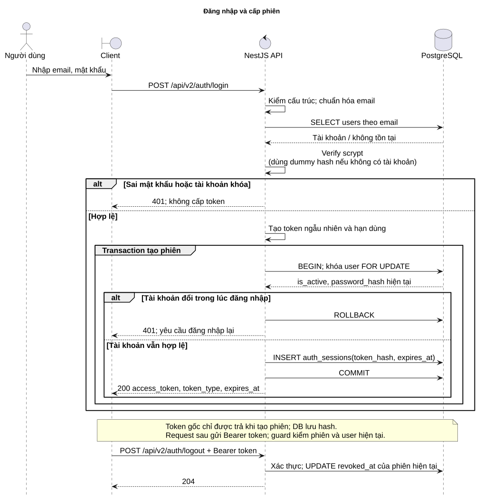
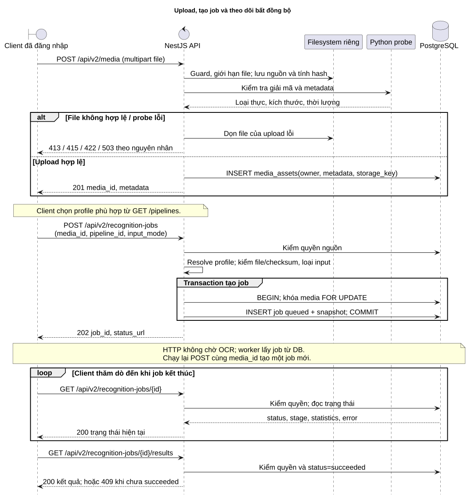
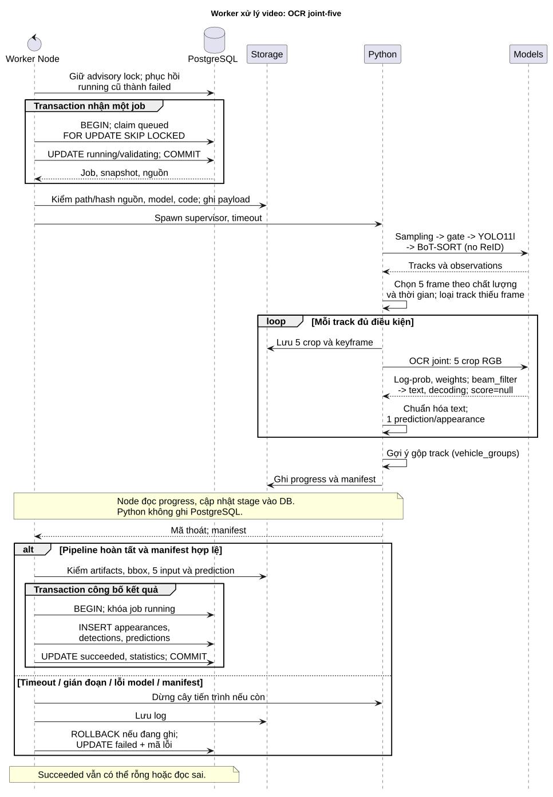
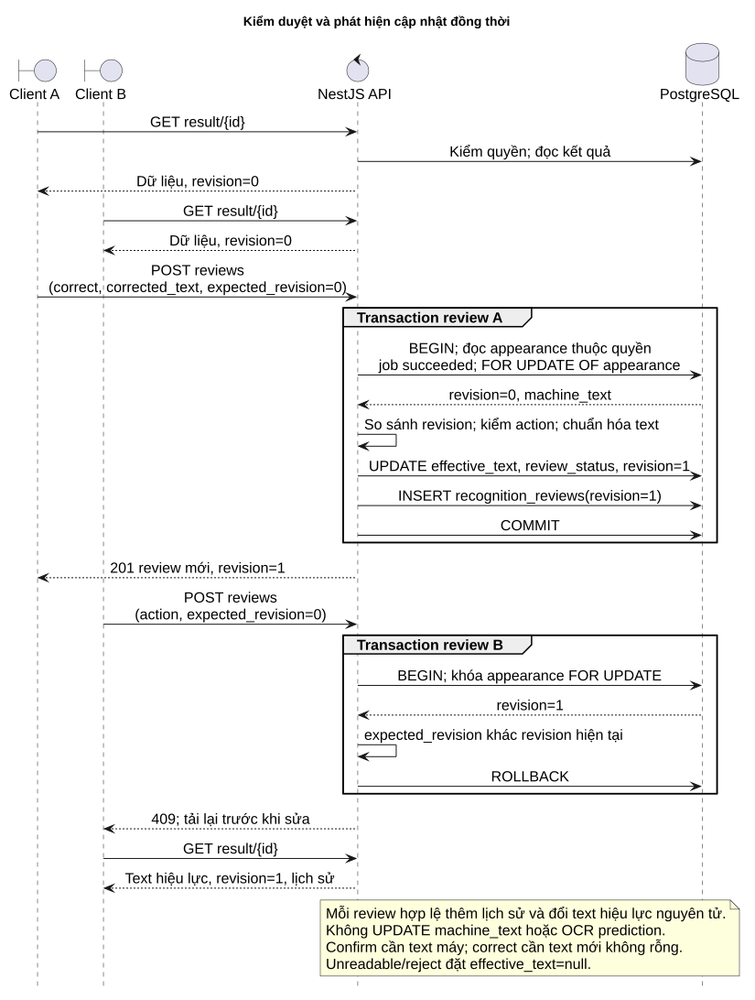
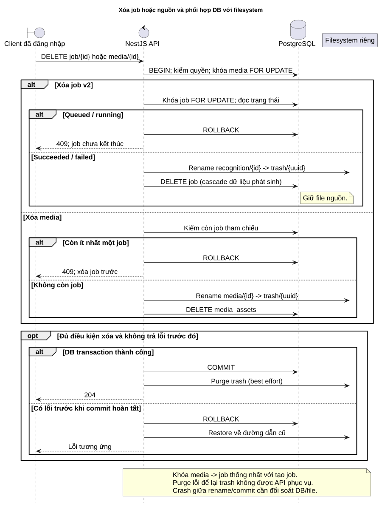

# Tương tác hệ thống, hợp đồng API và nghiệm thu

**Ngày đối chiếu:** 14/10/2026. Phần này tiếp nối [nghiệp vụ và use case](01-nghiep-vu.md), dùng cùng các mã FR01–FR18, NFR01–NFR08, BR01–BR20, UC01–UC12. Nguồn quyết định hành vi hiện tại là controller, worker và migration trong repository; không coi mọi yêu cầu ban đầu là chức năng đã có.

## 8. Sơ đồ sequence và ranh giới transaction

### 8.1. Đăng nhập và thu hồi phiên — UC01

Nguồn chỉnh sửa: [06-seq-login.puml](diagrams/06-seq-login.puml).

Client gửi email/mật khẩu qua API. Backend chuẩn hóa email, xác minh mật khẩu bằng scrypt và từ chối tài khoản không hoạt động. Sau khi tạo token ngẫu nhiên, backend khóa bản ghi tài khoản trong transaction và kiểm tra lại trạng thái/password hash trước khi ghi phiên. Bước kiểm tra lần hai ngăn một lần đăng nhập đồng thời với thao tác khóa hoặc reset mật khẩu tạo ra phiên dựa trên thông tin cũ.

Token trả về client là bí mật để sử dụng trong header Bearer; PostgreSQL chỉ lưu hash token. Guard đọc phiên còn hạn/chưa thu hồi và quyền hiện tại của tài khoản ở mỗi request. Logout thu hồi phiên đang dùng; khóa tài khoản hoặc reset mật khẩu thu hồi toàn bộ phiên của tài khoản đó. Đổi vai trò có hiệu lực khi guard đọc lại user, không đòi client đăng nhập lại để cập nhật role.

### 8.2. Upload, tạo lượt chạy và theo dõi — UC03, UC04, UC05

Nguồn chỉnh sửa: [07-seq-submit.puml](diagrams/07-seq-submit.puml).

Upload và tạo job là hai giao dịch nghiệp vụ tách biệt. Upload hợp lệ tạo `media_id`; nguồn này có thể tồn tại mà chưa được xử lý. API kiểm dung lượng, loại file, khả năng giải mã, ghi metadata và hash, rồi trả `201`. Python probe chỉ kiểm nguồn; đây không phải lần chạy detector/OCR.

Khi tạo job, API kiểm quyền nguồn trước khi resolve profile để hạn chế lộ thông tin tài nguyên. Profile chỉ được chọn bằng ID cấu hình trên server. Trong transaction tạo job, khóa `media_assets` đồng bộ với xóa nguồn, sau đó chèn job `queued` kèm snapshot. API trả `202` khi việc xếp hàng hoàn tất; không giữ HTTP request đến khi ML xử lý xong. Client dùng `status_url` để thăm dò; retry nghiệp vụ là một POST tạo job mới trên cùng nguồn.

Kaggle joint-five chỉ nhận video `scene`. Ảnh sử dụng prepare `scene` hoặc `plate_crop`; ảnh đưa vào profile joint-five trả `422`. Những nhánh lỗi này không tạo job mới. `pipelines.ready` là kiểm cấu hình/file/checksum, không thay thế việc chạy thử model thực.

### 8.3. Worker và công bố kết quả — UC04, UC05, UC06, UC12

Nguồn chỉnh sửa: [08-seq-worker.puml](diagrams/08-seq-worker.puml).

Worker Node giữ một PostgreSQL advisory lock cho toàn vòng đời để bảo đảm bản đầu chỉ có một worker quản lý queue trên DB. Khi khởi động, worker đánh dấu job `running` còn lại là `failed/WORKER_INTERRUPTED`. Nhận job dùng `FOR UPDATE SKIP LOCKED` trong một transaction ngắn; transaction đó hoàn tất trước khi chạy inference. Không giữ khóa hàng job suốt thời gian xử lý video.

Worker xác minh hash nguồn, checkpoint, mã tích hợp và interpreter của snapshot rồi chạy Python supervisor. Python thực hiện Adaptive Sampling → empty-scene gate → YOLO11l → BoT-SORT không ReID → chọn năm crop theo chất lượng và thời gian → OCR joint một lần cho mỗi track → decoder `beam_filter` → gợi ý gộp track. Track thiếu năm frame hợp lệ bị loại và ghi thống kê. Runner ghi bằng chứng, progress và manifest vào thư mục riêng của job; **Python ML không trực tiếp ghi PostgreSQL**.

Node nhận manifest, kiểm tra đường dẫn nằm trong job, file bằng chứng tồn tại, kích thước/bbox hợp lệ, năm frame và timestamp khác nhau theo thứ tự, liên kết prediction với đúng năm input. Sau đó Node mở transaction thứ hai, khóa job còn `running`, chèn toàn bộ appearance/detection/prediction và chuyển job sang `succeeded`. Nếu ghi dữ liệu lỗi, transaction rollback nên không công bố một phần kết quả.

Kết quả joint có `recognition_method=joint_multiframe`, `agreement_count=null` và một prediction cấp appearance. `frame_weights` là trọng số kết hợp đặc trưng; `ocr_score=null` vì model không có xác suất đã hiệu chuẩn; `decoding` ghi decoder, greedy text, `format_valid` và beam score chỉ để xếp hạng. Profile prepare không gọi OCR, giữ `machine_status=not_run`, `machine_text=null`, predictions rỗng. Nhánh adapter đọc từng crop còn được hỗ trợ về hợp đồng nhưng quy tắc đa số 3/5 không áp dụng cho model Kaggle hiện hành.

Timeout, gián đoạn, nguồn thay đổi, model lỗi hoặc manifest sai làm job `failed` với mã lỗi an toàn; stack trace nằm trong log máy chủ. Supervisor/dừng cây tiến trình tránh inference tiếp tục chạy khi worker mất quyền điều khiển. Không có retry tự động hoặc API hủy job trong bản đầu.

### 8.4. Kiểm duyệt và xung đột phiên bản — UC07

Nguồn chỉnh sửa: [09-seq-review.puml](diagrams/09-seq-review.puml).

Hai client có thể cùng đọc revision 0. Request review đầu khóa appearance bằng `FOR UPDATE OF a`, kiểm quyền và job thành công, so sánh `expected_revision`, cập nhật `effective_text`, `review_status`, tăng revision, rồi thêm lịch sử trong cùng transaction. Request tiếp theo đọc revision mới sau khi lấy được khóa; nếu vẫn gửi revision cũ thì nhận `409`.

Client phải tải lại kết quả và chủ động gửi quyết định mới. Không nên tự động gửi lại review với revision tăng lên vì có thể ghi đè một kết luận chưa được người dùng xem. `confirm` cần `machine_text` đọc được; `correct` cần chuỗi mới còn nội dung sau chuẩn hóa; `unreadable` hoặc `reject` đặt `effective_text=null`. Mọi action giữ nguyên dự đoán máy. Track ghép sai dùng `reject`; bản đầu chưa có công cụ tách/gộp lại track.

### 8.5. Xóa dữ liệu và phối hợp lưu trữ — UC10, UC11

Nguồn chỉnh sửa: [10-seq-delete.puml](diagrams/10-seq-delete.puml).

Xóa job v2 khóa media rồi khóa job, chỉ cho `succeeded` hoặc `failed`. Xóa nguồn khóa media và chỉ tiếp tục khi không còn job tham chiếu, kể cả job failed. Cùng thứ tự khóa giúp phối hợp với tạo job mới. FK/cascade xử lý metadata phát sinh; source của job v2 được giữ để tái sử dụng.

Trong transaction, backend rename thư mục cần xóa sang `trash/<uuid>` trước khi DELETE metadata. Nếu giao dịch lỗi, backend cố khôi phục thư mục; nếu commit thành công, purge trash là bước dọn sau cùng. Lỗi purge không biến một lần xóa đã commit thành thất bại và file trong trash không được endpoint nghiệp vụ phục vụ. Không xóa từng file frame theo detection vì nhiều detection có thể tham chiếu cùng frame.

**Giới hạn vận hành:** PostgreSQL và filesystem không tham gia transaction phân tán. Crash đúng giữa rename và commit/restore có thể cần đối chiếu DB với thư mục trash; bản đầu chưa có bộ đối soát tự động cho mọi trạng thái crash. Backup cần chứa cả DB và file tại thời điểm nhất quán.

## 11. Thiết kế API nghiệp vụ

### 11.1. Quy ước chung

- Prefix nghiệp vụ mới là `/api/v2`. Các đường dẫn rút gọn ở bảng dưới được ghép với prefix này.
- Login và health không cần token. Mọi endpoint dữ liệu đều xác thực `Authorization: Bearer <access_token>`.
- User thao tác nguồn của mình; Admin toàn hệ thống. Kiểm quyền áp dụng cả metadata, media, crop/frame, review và CSV. Tài nguyên không tồn tại hoặc không thuộc quyền trả `404`; chức năng chỉ Admin trả `403` khi User gọi.
- List phân trang trả `{total, limit, offset, items}`; `limit` mặc định 50, miền 1–200; `offset>=0`. `/pipelines` là danh mục cấu hình trả `{items}`, không phải list phân trang.
- Filter thời gian dùng ISO 8601 có timezone. Lịch sử job lọc theo `created_at`; tìm kết quả lọc theo `uploaded_at` của nguồn. Timestamp trong video là vị trí tương đối, không phải ngày giờ camera quay.
- Chuẩn hóa biển số: uppercase, bỏ khoảng trắng và dấu gạch nối; không tự đổi `O/0`, `I/1`. Tìm `plate` khớp chính xác chuỗi đã chuẩn hóa, chưa có fuzzy search.
- JSON công khai không trả storage key, đường dẫn model/interpreter, password hash hoặc token hash. Các API đặt `Cache-Control: private, no-store` và `X-Content-Type-Options: nosniff`.
- Body sai cấu trúc/giá trị trả `422`. Không nhận checkpoint hoặc đường dẫn nội bộ tùy ý từ client.

### 11.2. Danh mục 21 endpoint v2

Quyền “chủ sở hữu/Admin” trong bảng được tính theo owner của nguồn; các lần chạy và bằng chứng kế thừa quyền này.

| Mã | Method và đường dẫn | Input chính | Kết quả thành công | Quyền / use case |
|---|---|---|---|---|
| API01 | `POST /auth/login` | `email`, `password` | `200` token Bearer, hạn dùng | Tài khoản hoạt động; UC01 |
| API02 | `POST /auth/logout` | Bearer hiện tại | `204`, thu hồi phiên hiện tại | Đã đăng nhập; UC01 |
| API03 | `GET /auth/me` | Bearer hiện tại | `200` user công khai, role, trạng thái | Đã đăng nhập; UC01 |
| API04 | `GET /users` | `limit`, `offset` | `200` danh sách tài khoản | Admin; UC02 |
| API05 | `POST /users` | `email`, `password`, `display_name`, `role` tùy chọn | `201` tài khoản mới | Admin; UC02 |
| API06 | `PATCH /users/{id}` | Ít nhất một trường `display_name`, `role`, `is_active`, `password` | `200` tài khoản sau cập nhật | Admin; UC02 |
| API07 | `POST /media` | Multipart một `file` | `201` `media_id`, metadata, `content_url` | Đã đăng nhập, nguồn mới gán cho người upload; UC03 |
| API08 | `GET /media` | `limit`, `offset` | `200` danh sách nguồn | Chủ sở hữu/Admin; UC03 |
| API09 | `GET /media/{id}/content` | ID, header `Range` tùy chọn | `200` file hoặc `206` byte range | Chủ sở hữu/Admin; UC06 |
| API10 | `DELETE /media/{id}` | ID | `204` khi hết tham chiếu | Chủ sở hữu/Admin; UC11 |
| API11 | `GET /pipelines` | Không cần body | `200` profile, task, media_types, version, ready | Đã đăng nhập; UC04, UC12 |
| API12 | `POST /recognition-jobs` | `media_id`, `pipeline_id`, `input_mode=scene\|plate_crop` | `202` job_id, queued, status_url | Chủ sở hữu/Admin; UC04, UC12 |
| API13 | `GET /recognition-jobs` | `media_id`, `status`, `created_from/to`, phân trang | `200` lịch sử lượt chạy | Chủ sở hữu/Admin; UC05 |
| API14 | `GET /recognition-jobs/{id}` | ID | `200` status, stage, statistics, thời gian, lỗi | Chủ sở hữu/Admin; UC05 |
| API15 | `GET /recognition-jobs/{id}/results` | ID, phân trang | `200` danh sách appearance của lượt thành công | Chủ sở hữu/Admin; UC06 |
| API16 | `DELETE /recognition-jobs/{id}` | ID | `204`, xóa lượt đã kết thúc, giữ nguồn | Chủ sở hữu/Admin; UC10 |
| API17 | `GET /recognition-results` | `plate`, `media_id`, `review_status`, `uploaded_from/to`, phân trang | `200` kết quả ở job v2 thành công mới nhất mỗi nguồn | Chủ sở hữu/Admin; UC08 |
| API18 | `GET /recognition-results/{id}` | Appearance ID | `200` kết quả, detections, predictions, reviews | Chủ sở hữu/Admin; UC06 |
| API19 | `GET /detections/{id}/artifacts/{kind}` | Detection ID, `kind=crop\|frame\|enhanced` | `200` file đúng MIME nếu có | Chủ sở hữu/Admin; UC06 |
| API20 | `POST /recognition-results/{id}/reviews` | `action`, `expected_revision`, `note?`, `corrected_text` chỉ khi correct | `201` bản ghi lịch sử/revision mới | Chủ sở hữu/Admin; UC07 |
| API21 | `GET /recognition-jobs/{id}/export` | ID, `format=csv` mặc định | `200` file CSV UTF-8 BOM | Chủ sở hữu/Admin; UC09 |

`role` khi tạo user mặc định `user`; không có API đăng ký công khai, xóa tài khoản hoặc quên mật khẩu qua email. Admin bootstrap bằng CLI, reset bằng API06. Email chuẩn hóa unique; mật khẩu tạo/reset dài 12–1024 ký tự; `display_name` không rỗng, tối đa 120 ký tự.

Upload hỗ trợ JPG/PNG/MP4/AVI/MOV; mặc định tối đa 500 MiB theo cấu hình, ảnh tối đa 25 MP. API07 kiểm giải mã thực, không chỉ tin extension/MIME client. `size_bytes`, width/height và duration là metadata của nguồn; crop_width/height nằm ở detection để đánh giá độ phân giải biển số.

### 11.3. Hợp đồng kết quả và review

Appearance chứa `machine_text`, `machine_status`, `recognition_method`, `agreement_count`, `effective_text`, `review_status`, `revision` và vị trí xuất hiện. `machine_text` là kết luận máy của lượt chạy; `effective_text` ban đầu bằng machine_text nếu có, sau đó theo review. `pending` có nghĩa chưa được con người xác nhận, dù chuỗi đang xuất hiện trong kết quả tìm kiếm.

Detail joint-five trả một prediction trong `predictions[]` cấp appearance, với `raw_text`, `normalized_text`, `ocr_score`, `frame_weights`, `decoding`, `latency_ms` và `detection_ids` theo thứ tự input. Mỗi detection có `crop_url`, `frame_url`, bbox, crop_bbox, detection_score và vị trí frame; không sinh năm prediction độc lập từ một output joint. Prepare có predictions rỗng; enhanced_url chỉ có khi pipeline thực sự sinh nhánh đó, profile hiện tại chưa có SR.

Review đầu tiên gửi `expected_revision=0`. `corrected_text` bắt buộc và chỉ được phép xuất hiện khi `action=correct`; `note` tối đa 2000 ký tự, corrected_text tối đa 64 ký tự trước chuẩn hóa. Response API20 là bản ghi lịch sử mới; client có thể gọi API18 để lấy toàn bộ trạng thái hiệu lực và lịch sử.

| Action | Điều kiện riêng | Text hiệu lực sau review | review_status |
|---|---|---|---|
| `confirm` | Có machine_text | Machine text | `confirmed` |
| `correct` | Chuỗi sửa không rỗng sau chuẩn hóa | Chuỗi sửa đã chuẩn hóa | `corrected` |
| `unreadable` | Không yêu cầu chuỗi | `null` | `unreadable` |
| `reject` | Kết quả không phải biển số hoặc track ghép sai | `null` | `rejected` |

Tra cứu mặc định chỉ chọn job `succeeded` mới nhất mỗi nguồn theo `created_at DESC, id DESC`; prepare cũng là job hợp lệ. Một job queued hoặc failed mới hơn không che kết quả thành công cũ. Nếu một lượt mới thành công nhưng không có appearance, tìm kiếm nguồn đó không trả lại appearances của lượt cũ. Lượt cũ vẫn truy cập theo ID job. Quy tắc này tránh trộn kết quả rerun nhưng không có nghĩa toàn bộ source đã được nhận diện đúng.

CSV gồm ID appearance/job/track, machine/effective text, machine/review status, recognition_method, agreement_count, first/last frame, start/end seconds. Joint-five xuất agreement rỗng do DB NULL. CSV escape dấu nháy và tiền tố có thể trở thành công thức bảng tính; xuất file không thay đổi review hoặc tạo ground truth.

### 11.4. Endpoint vận hành

`GET /` trả thông tin dịch vụ; `GET /health` là liveness; `GET /health/ready` kiểm kết nối PostgreSQL và toàn bộ version/checksum migration, trả `503` khi thiếu/sai schema. Các endpoint này không tính trong 21 API nghiệp vụ. Swagger được phục vụ ở `/docs`; tài liệu API không chứng minh frontend đã xây hoặc worker/model đang chạy.

### 11.5. Mã phản hồi và lỗi

| Mã | Ý nghĩa / ví dụ |
|---|---|
| `200` | Đọc/cập nhật thành công, login hoặc download toàn file. |
| `201` | Tạo tài khoản/media/review. |
| `202` | Job đã được xếp hàng, chưa có kết quả inference. |
| `204` | Logout/xóa thành công, không có body. |
| `206` | Trả một phần file nguồn theo Range hợp lệ. |
| `401` | Thiếu/sai/hết hạn/thu hồi phiên hoặc sai thông tin đăng nhập. |
| `403` | Tài khoản không có role Admin cho API quản trị. |
| `404` | Không tồn tại hoặc không thuộc quyền; artifact chưa có. |
| `409` | Revision cũ; kết quả job chưa succeeded; job chưa kết thúc; media còn tham chiếu; email trùng; khóa/hạ quyền Admin cuối cùng. |
| `413` | File vượt giới hạn upload. |
| `415` | Loại file/extension không hỗ trợ. |
| `416` | Range nằm ngoài file; kèm `Content-Range: bytes */<size>`. |
| `422` | Body/filter sai; file hỏng; input mode không phù hợp; ảnh đơn vào joint-five; confirm khi chưa có text; correction rỗng. |
| `503` | Model/config chưa sẵn sàng; probe không chạy được; readiness DB/schema lỗi. |
| `500` | Lỗi máy chủ ngoài các trường hợp đã ánh xạ; không trả stack trace/đường dẫn nội bộ. |

Body lỗi có dạng `{detail: ...}`. Lỗi xử lý sau khi đã nhận job không đổi response POST cũ: client quan sát `status=failed` cùng `error_code`, `error_message` qua API14. Các mã worker hiện gồm `INPUT_CHANGED`, `CHECKPOINT_MISSING`, `ENVIRONMENT_ERROR`, `JOB_TIMEOUT`, `WORKER_INTERRUPTED`, `INVALID_VIDEO`, `CUDA_ERROR`, `CUDA_UNAVAILABLE`, `RESULT_INVALID`, `PIPELINE_FAILED`.

## 13. Nghiệm thu, truy vết và đánh giá đề tài

### 13.1. Ma trận nghiệm thu chức năng

Các tình huống dưới đây là tiêu chí có thể thực hiện lại; một dòng không đồng nghĩa có một test tự động riêng. Test API có fixture không thay thế nghiệm thu model trên nguồn thật.

| Mã | Tình huống / dữ liệu | Kết quả mong đợi | Truy vết |
|---|---|---|---|
| AT01 | Login đúng, sai, tài khoản khóa; logout và dùng lại token | Chỉ phiên hợp lệ được dùng; token sau logout bị từ chối | UC01; FR01; NFR01 |
| AT02 | Admin tạo email trùng, reset, đổi vai trò, khóa Admin cuối | Unique 409; reset/khóa thu hồi phiên; không mất Admin cuối | UC02; FR02; NFR02 |
| AT03 | User B truy cập media/job/result/crop/review/CSV của A | Từ chối cả metadata và file; Admin đọc được | UC02–UC12; FR03; NFR01 |
| AT04 | Upload ảnh/video hợp lệ, file rỗng/hỏng/giả loại/quá lớn | Metadata đúng; 413/415/422 tương ứng; không để nguồn hợp lệ giả | UC03; FR04–05 |
| AT05 | Đọc nguồn toàn bộ, Range hợp lệ, Range ngoài file | 200/206 đúng MIME; 416 đúng Content-Range | UC06; FR05 |
| AT06 | Tạo job khi model thiếu; gửi đường dẫn lạ, mode sai | Không xếp hàng cấu hình tùy ý; 503/422 theo nguyên nhân | UC04; FR06–07 |
| AT07 | Chạy lại cùng media với profile/snapshot khác | Hai ID và kết quả độc lập; nguồn không upload lại | UC04; FR07; NFR03 |
| AT08 | Prepare ảnh không/một/nhiều biển số; plate_crop | 0/1/n appearances theo detector; plate_crop bỏ detector; chưa có OCR | UC12; FR09 |
| AT09 | Video track đủ/thiếu 5 frame; frame lặp hoặc sai thứ tự | Đủ 5 crop thật được xử lý; thiếu bị loại có thống kê; manifest sai bị từ chối | UC04, UC12; FR10 |
| AT10 | Model joint-five đọc được hoặc trả chuỗi rỗng | Một prediction/appearance; readable/unreadable; agreement NULL; không có OCR từng crop giả | UC04, UC06; FR11–12 |
| AT11 | Ảnh đơn gửi profile Kaggle; ảnh prepare nhập tay | OCR joint từ chối 422; prepare cho correct, chưa có model ảnh đơn | UC04, UC12; FR09, FR13 |
| AT12 | Worker timeout/crash/restart, source hoặc checkpoint thay đổi | Failed với mã lỗi; không công bố một phần; tạo job mới để chạy lại | UC05; FR08; NFR05 |
| AT13 | Xem crop, frame, position, prediction, lịch sử | Đúng appearance/track; giữ thứ tự input; enhanced thiếu trả 404 | UC06; FR12; NFR03 |
| AT14 | Confirm/correct/unreadable/reject rồi tìm kiếm | Prediction/machine không đổi; text hiệu lực và lịch sử đúng action | UC07–08; FR13–14 |
| AT15 | Hai review cùng expected_revision | Chỉ một revision được chấp nhận; bên còn lại 409 | UC07; FR13; NFR02 |
| AT16 | Latest succeeded, queued/failed mới hơn, prepare | Tra cứu chọn đúng job thành công mới nhất; ID cũ vẫn xem được | UC08; FR15 |
| AT17 | CSV có ký tự Unicode, dấu nháy, tiền tố công thức, 0 kết quả | UTF-8 BOM; escape đúng; không lộ nguồn khác; 0 kết quả còn header | UC09; FR16 |
| AT18 | Xóa job running, terminal và nguồn còn/hết tham chiếu | Running 409; terminal xóa dữ liệu phát sinh; v2 giữ nguồn; media có job 409 | UC10–11; FR17 |
| AT19 | Chạy migration, FK/cascade, rollback | Schema đúng checksum; migration đã áp dụng không bị sửa; rollback không để dữ liệu dở | FR18; NFR02–03 |
| AT20 | DB mất kết nối/thiếu migration và API còn chạy | Liveness 200, readiness 503; không suy ra model đã sẵn sàng | NFR07 |

### 13.2. Ma trận liên kết yêu cầu với thành phần thực hiện

| Nhóm yêu cầu | API liên quan | Dữ liệu chính | Nơi kiểm chứng |
|---|---|---|---|
| FR01–02: phiên, quản trị tài khoản | API01–06 | users, auth_sessions | `tests/api.test.ts`, `src/auth` |
| FR03: phân quyền xuyên tài nguyên | API04–10, API12–21 | owner nguồn và quan hệ FK | `tests/api.test.ts`, `src/common/ownership.ts` |
| FR04–05: nguồn và file | API07–10 | media_assets, source filesystem | `tests/api.test.ts`, `scripts/probe_media.py` |
| FR06–08: cấu hình, queue, vòng đời | API11–16 | recognition_jobs, snapshot, statistics | `tests/recognition.test.ts`, registry/engine/worker |
| FR09–11: prepare, tracking, OCR | API12, API15, API18 | appearances, detections, predictions | `tests/test_ml_adapter.py`, `tests/test_icpr_adapter.py`, joint worker tests |
| FR12–13: bằng chứng và review | API15, API18–20 | detections, predictions, reviews, revision | `tests/joint-results.test.ts`, `tests/api.test.ts` |
| FR14–16: tra cứu và CSV | API17, API21 | effective_text, latest job | `tests/api.test.ts`, `tests/joint-results.test.ts` |
| FR17–18: xóa, migration | API10, API16 | FK/cascade, storage, schema_migrations | `tests/db.test.ts`, `tests/api.test.ts` |
| NFR07: hợp đồng API/schema | Health, Swagger | schema_migrations | `tests/openapi.test.ts`, `tests/db.test.ts` |
| NFR08: chất lượng nghiên cứu | Đánh giá offline | Ground truth độc lập, output đã cố định | [EVALUATION.md](../EVALUATION.md), evaluator tests |

### 13.3. Mức bằng chứng kiểm thử đã có

Baseline đã ghi nhận trong các lượt triển khai là **48 test Node và 98 test Python đạt**; một lượt kiểm tra API/OpenAPI tiếp theo ghi nhận **24 test có mục tiêu đạt**, kèm build/format. Hai số Node không cộng thành 72 vì lượt 24 là chạy lại một phần phạm vi. Đây là bằng chứng đã ghi nhận của các lượt trước, không phải tuyên bố vừa chạy lại toàn bộ test khi soạn tài liệu.

Test Node dùng NestJS/HTTP và PostgreSQL thật trong DB/cluster tạm; nhiều kết quả ML hoàn tất được tạo bằng fixture để kiểm quyền, transaction và hợp đồng. Test adapter/runner kiểm số frame, preprocessing, output và lỗi nhưng không đo accuracy. Đã ghi nhận smoke inference checkpoint/video thực trong quá trình tích hợp; smoke chứng minh đường chạy thực hiện được trên mẫu đó, không chứng minh chất lượng toàn tập hoặc khả năng tổng quát sang biển số Việt Nam.

Để tái lập xác minh kỹ thuật, dùng [TESTING_NEST.md](../TESTING_NEST.md) và lệnh trong [README](../../README.md). Cần lưu commit, dependency, cấu hình, phần cứng, ngày chạy và log từng đợt nếu dùng các con số này trong báo cáo nghiệm thu. Sau một thay đổi runtime mới, chỉ báo test là hiện hành khi đã chạy lại phạm vi chịu ảnh hưởng.

### 13.4. Thiết kế đánh giá low-resolution

Đánh giá recognizer trên crop và toàn pipeline trên ảnh/video nguồn là hai thí nghiệm khác nhau. Trong thí nghiệm recognizer, đầu vào đã có crop và đúng nhóm năm frame. Trong thí nghiệm toàn pipeline, việc bỏ sót detection, không đủ frame hoặc ghép sai track cũng là lỗi nghiệp vụ cần đếm/báo cáo; không chỉ chấm các appearance pipeline đã tạo thành công.

Các metric tối thiểu:

- **Exact plate accuracy:** số mẫu có chuỗi dự đoán chuẩn hóa khớp toàn bộ nhãn / số mẫu hợp lệ trong tập đánh giá đã định nghĩa. Chốt trước cách xử lý nhãn mơ hồ và ký tự ngoài alphabet.
- **Character error rate (CER):** tổng khoảng cách Levenshtein trên chuỗi dự đoán/nhãn chia tổng số ký tự nhãn. Không coi detector score, frame weight hoặc tỷ lệ review confirm là accuracy.
- **Unreadable rate và coverage:** tỷ lệ dự đoán rỗng/không đọc được; tỷ lệ mẫu tạo được kết quả. Với pipeline cần báo riêng số nguồn/biển số bỏ sót, track bị loại vì thiếu frame và track ghép sai.
- **Latency:** thời gian recognizer và end-to-end tách riêng; ghi cả thời gian chờ queue nếu báo thời gian người dùng phải đợi. Báo thiết bị, batch, độ dài video, số track và warm-up, thay vì một số thời gian thiếu điều kiện.
- **Chất lượng theo kích thước crop:** nhóm theo crop width/height hoặc quy tắc phân nhóm đã công bố. Độ phân giải toàn video không đủ mô tả độ khó của vùng biển số.

Thí nghiệm chính hiện phù hợp là checkpoint Kaggle joint-five trên đúng nhóm năm crop thật và toàn pipeline đã tích hợp. So sánh một ảnh với năm ảnh cần recognizer/baseline một ảnh có preprocessing/checkpoint hợp lệ; không lặp một crop năm lần rồi gọi đó là baseline ảnh đơn của model hiện tại. Nếu bổ sung SR thật, so sánh cùng mẫu trước/sau SR; hiện tại chưa có nhánh SR nên không ghi kết quả SR giả định.

Train/validation/test nên tách theo nguồn và danh tính biển số khi có metadata; các frame gần nhau/crop của cùng track không được chia ngẫu nhiên sang hai tập. Nhãn chuẩn phải độc lập với output máy và lịch sử người dùng xác nhận. Chốt rule chuẩn hóa, ghép output với ground truth, xử lý bỏ sót và khoảng tin cậy trước khi xem test set. Các rule/threshold mới chỉ điều chỉnh trên validation; test dùng cho lần báo cáo cuối.

Model đang phục vụ biển số Brazil. Dữ liệu Việt Nam cần tập đánh giá và công bố riêng; không diễn giải việc model trả được một chuỗi là xác nhận hỗ trợ đúng biển số Việt Nam. Tài liệu này không đặt một mục tiêu accuracy/SLA chưa được đo hoặc phê duyệt.

## 14. Nguồn đối chiếu, giới hạn và hướng mở rộng

### 14.1. Sổ nguồn dùng để lập tài liệu

| Nguồn | Vai trò / mức sử dụng |
|---|---|
| [auth.controller.ts](../../src/auth/auth.controller.ts), [auth.guard.ts](../../src/auth/auth.guard.ts), [security.ts](../../src/auth/security.ts) | Hành vi login/logout, quản trị, khóa tài khoản, token/password và role thực. |
| [media.controller.ts](../../src/media/media.controller.ts), [storage.ts](../../src/media/storage.ts), [probe_media.py](../../scripts/probe_media.py) | Upload, metadata, file access, giới hạn/giải mã, quarantine/restore/purge. |
| [jobs.controller.ts](../../src/jobs/jobs.controller.ts), [ownership.ts](../../src/common/ownership.ts) | Queue request, snapshot, scope sở hữu, readiness kết quả và điều kiện xóa. |
| [registry.ts](../../src/recognition/registry.ts), [engine.ts](../../src/recognition/engine.ts), [worker.ts](../../src/worker.ts) | Profile được phép, kiểm hash, claim/recover, supervisor, manifest validation, atomic persist. |
| [runner.py](../../app/recognition/runner.py), [icpr_adapter.py](../../app/recognition/icpr_adapter.py), [icpr_model.py](../../app/recognition/icpr_model.py) | Tích hợp ML, preprocessing và inference joint-five hiện hành. |
| [results.controller.ts](../../src/results/results.controller.ts) | Prediction detail, thứ tự detection_ids, review/revision, latest succeeded search và CSV. |
| [video_tracking.py](../../app/recognition/video_tracking.py), [icpr_adapter.py](../../app/recognition/icpr_adapter.py), [ctc_decoders.py](../../app/recognition/ctc_decoders.py) | Tracking, chọn 5 crop, model OCR và decoder port từ notebook. |
| [0001_business.sql](../../src/database/migrations/0001_business.sql), [0002_joint_ocr.sql](../../src/database/migrations/0002_joint_ocr.sql), [0003_ocr_decoding.sql](../../src/database/migrations/0003_ocr_decoding.sql) | Schema và ràng buộc vật lý; nguồn chính cho phần thiết kế DB. |
| [main.ts](../../src/main.ts), [app.module.ts](../../src/app.module.ts), [http.ts](../../src/common/http.ts) | Bootstrap, Swagger, response headers, health và ánh xạ lỗi. |
| [API.md](../API.md), [MODEL_INTEGRATION.md](../MODEL_INTEGRATION.md), [OCR_KAGGLE.md](../OCR_KAGGLE.md), [OPERATIONS.md](../OPERATIONS.md) | Hướng dẫn tích hợp/vận hành hỗ trợ; đối chiếu với mã nguồn khi có khác biệt. |
| [Notebook PBL6 PIPELINE](https://www.kaggle.com/code/trnvnhun/pbl6-pipeline) | Nguồn pipeline, model, preprocessing và decoder; đã đối chiếu checksum checkpoint với báo cáo lần chạy 13/10/2026; không dùng chỉ số trong notebook như accuracy của backend. Provenance cục bộ ở [icpr-source.json](../../models/icpr-source.json). |

Các sơ đồ PlantUML và SVG đi kèm là sản phẩm mô hình hóa mã nguồn; người đọc có thể chỉnh `.puml` rồi render lại. Vai trò client thể hiện hợp đồng cần cho frontend, không xác nhận đã triển khai giao diện. Phần DB phải đọc cùng migration, vì business rule như đúng năm frame và tổng frame_weights còn có kiểm tra trong worker, không được bảo đảm hoàn toàn chỉ bằng FK/JSONB check.

### 14.2. Các giới hạn đã xác định

1. **OCR ảnh đơn chưa có model tương thích được cấu hình.** Endpoint ảnh và prepare hoạt động; người dùng kiểm duyệt thủ công. Model joint-five hiện có không được ép đọc bằng cách nhân bản ảnh.
2. **Tracking không phải định danh xe.** Track có thể ghép sai; reject ghi lại kết luận nhưng không tự sửa track. Cùng biển số ở nhiều nguồn vẫn là nhiều appearance.
3. **Một worker và filesystem riêng.** Advisory lock chủ động giới hạn một worker trên DB. Chưa có hàng đợi phân tán, object storage, scale nhiều worker hoặc cơ chế tự reconcile mọi crash giữa DB/file.
4. **Readiness có phạm vi.** Health kiểm DB/schema, pipelines.ready kiểm file/config/checksum; chỉ job thực mới kiểm được toàn runtime/model/thiết bị. Chưa có endpoint xác nhận heartbeat worker đang sống.
5. **Đánh giá chất lượng còn tách riêng.** Test và smoke không thay ground truth độc lập; chưa xác nhận accuracy Việt Nam, SLA hoặc tải đồng thời production.
6. **Phạm vi nghiệp vụ giới hạn.** Chưa có camera live, bãi xe, chủ phương tiện, xử phạt, hủy job, chia sẻ dữ liệu, public signup, email reset, giao diện đầy đủ hoặc SR. Đây không phải các API bị bỏ sót trong 21 endpoint đã thống nhất cho bản đầu.

### 14.3. Thứ tự mở rộng đề xuất

Trước hết hoàn thiện client theo use case, triển khai API/worker/DB cùng chính sách backup và kiểm chứng với bộ dữ liệu Brazil có nhãn chuẩn. Tiếp theo bổ sung adapter/checkpoint ảnh đơn nếu nghiệp vụ cần, giữ nguyên cách lưu dự đoán máy/lịch sử kiểm duyệt. Khi có số đo tải và độ trễ, mới quyết định nhiều worker/queue riêng/object storage; thay đổi kiến trúc đó cần thiết kế lại quyền nhận job, heartbeat/recovery và lưu artifact. SR hoặc dữ liệu Việt Nam là thí nghiệm mới cần validation riêng, không là điều kiện ngầm để đánh dấu endpoint hoàn thành.
