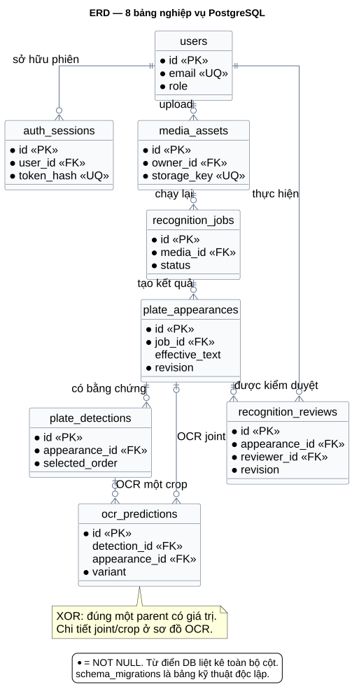
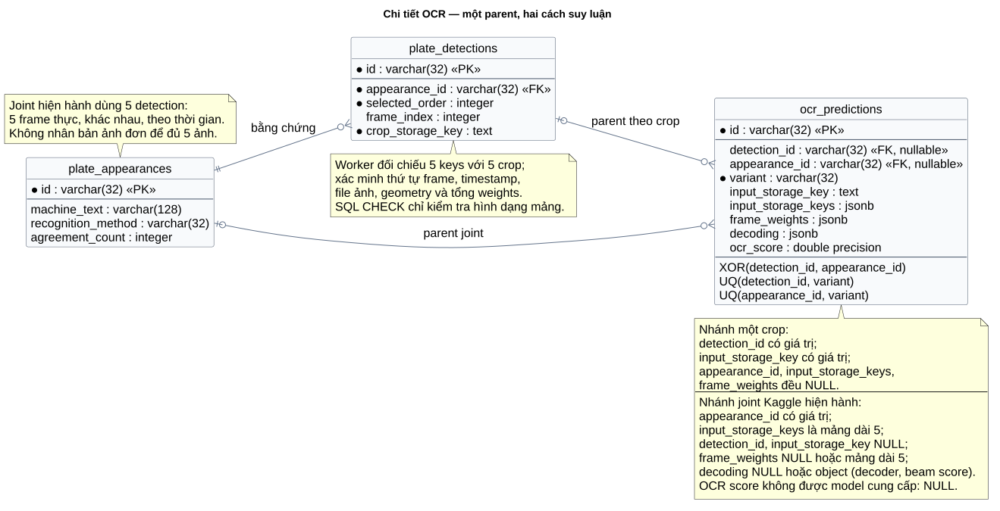

# 10. Thiết kế cơ sở dữ liệu PostgreSQL

**Ngày đối chiếu:** 14/10/2026. Đây là thiết kế vật lý đang được mã nguồn sử dụng sau ba migration, không phải một schema đề xuất chưa triển khai. Có **8 bảng nghiệp vụ và 1 bảng kỹ thuật**. Các bảng dùng tên tiếng Anh; ý nghĩa và quy tắc được giải thích bằng tiếng Việt.

## 10.1. Nguyên tắc mô hình hóa

Đơn vị nghiệp vụ trung tâm là `plate_appearances`: một lần biển số xuất hiện trong **một job cụ thể**. Ảnh tạo một appearance cho mỗi detection; video tạo một appearance cho mỗi track đủ điều kiện. Cùng văn bản biển số xuất hiện ở hai nguồn hoặc hai lượt chạy vẫn là hai bản ghi khác nhau. Không đặt unique trên `machine_text`, `effective_text` hoặc `source_track_id` toàn hệ thống.

`media_assets` tách khỏi `recognition_jobs` để chạy lại một nguồn với cấu hình khác. Quyền sở hữu đặt ở nguồn: appearance, detection và prediction truy ngược qua job đến `media_assets.owner_id`. `reviewer_id` là người thực hiện kiểm duyệt, có thể là Admin và không nhất thiết là chủ nguồn. Không có bảng phương tiện, chủ xe, giao dịch bãi xe hoặc liên kết danh tính giữa các track.

Ảnh/video/crop nằm trên filesystem; DB giữ metadata và storage key tương đối. Hash nguồn phục vụ đối chiếu nội dung, **không** là khóa sở hữu dùng chung giữa tài khoản. DB không chứa Base64. Snapshot pipeline là dữ liệu nội bộ và có thể chứa đường dẫn checkpoint; API lọc thông tin đó trước khi trả về client.

ID nghiệp vụ được ứng dụng sinh bằng UUID bỏ dấu gạch nối, lưu trong `varchar(32)`; cột không có default UUID và DB không có CHECK định dạng hex. `timestamptz` lưu một thời điểm tuyệt đối; client có thể hiển thị theo múi giờ người dùng. `uploaded_at` là lúc upload, không phải lúc quay. `frame_index` và `timestamp_seconds` mô tả vị trí tương đối trong video. Giá trị chưa biết để `NULL`, không thay bằng 0.

## 10.2. ERD và quan hệ



Nguồn chỉnh sửa: [12-erd.puml](diagrams/12-erd.puml). Sơ đồ thể hiện các khóa và trường chính; từ điển bên dưới là danh sách đầy đủ. Bảng kỹ thuật `schema_migrations` độc lập, không tham gia quan hệ nghiệp vụ.

- Một user có nhiều session và nguồn; mỗi nguồn có đúng một chủ sở hữu.
- Một nguồn có nhiều job; một job có từ 0 đến nhiều appearance. Job thành công có thể không phát hiện biển số nào.
- Một appearance có nhiều detection và lịch sử review; luồng hiện hành dùng một detection cho ảnh, năm detection được chọn cho video.
- OCR theo crop tham chiếu một detection. OCR joint tham chiếu một appearance và danh sách năm đầu vào có thứ tự. **Mỗi prediction chỉ thuộc đúng một nhánh**, không đồng thời cả hai.
- Một user có thể tạo nhiều review; mỗi review có đúng một người thực hiện.

## 10.3. Quy ước từ điển dữ liệu

Cột **NULL** ghi “Không” nếu NOT NULL/PK, “Có” nếu được phép NULL. **PK** là khóa chính; **FK →** là khóa ngoại; **UQ** là unique. `D=...` là default của PostgreSQL. Nếu không ghi `D`, cột không có default khai báo; ứng dụng phải cung cấp giá trị cho cột bắt buộc. CHECK không làm một cột nullable thành NOT NULL: PostgreSQL chấp nhận kết quả CHECK là NULL.

### 10.3.1. `users` — tài khoản

| Trường | Kiểu PostgreSQL | NULL | Ràng buộc và ý nghĩa |
|---|---|---|---|
| `id` | `varchar(32)` | Không | PK; ID tài khoản. |
| `email` | `varchar(320)` | Không | UQ; CHECK `email = lower(btrim(email))`. API chuẩn hóa email trước khi lưu. |
| `password_hash` | `text` | Không | Hash mật khẩu có salt; không lưu mật khẩu rõ. |
| `display_name` | `varchar(200)` | Không | D=`''`; tên hiển thị. |
| `role` | `varchar(16)` | Không | D=`'user'`; CHECK trong `admin`, `user`. |
| `is_active` | `boolean` | Không | D=`true`; trạng thái được phép đăng nhập/truy cập. |
| `created_at` | `timestamptz` | Không | D=`now()`; thời điểm tạo. |

Khóa tài khoản là cập nhật `is_active=false`, không xóa user. Runtime ngăn vô hiệu hóa/hạ quyền Admin hoạt động cuối cùng; không có CHECK hoặc trigger tương ứng trong DB. Email unique theo chuỗi chuẩn hóa, không dùng `citext`.

### 10.3.2. `auth_sessions` — phiên đăng nhập

| Trường | Kiểu PostgreSQL | NULL | Ràng buộc và ý nghĩa |
|---|---|---|---|
| `id` | `varchar(32)` | Không | PK; ID phiên. |
| `user_id` | `varchar(32)` | Không | FK → `users.id`, ON DELETE CASCADE. |
| `token_hash` | `varchar(64)` | Không | UQ; SHA-256 của bearer token ngẫu nhiên, không lưu token rõ. DB không CHECK dạng hex. |
| `expires_at` | `timestamptz` | Không | Hạn phiên do ứng dụng tính. |
| `revoked_at` | `timestamptz` | Có | Lúc thu hồi; NULL nghĩa là chưa được thu hồi, không bảo đảm phiên chưa hết hạn. |
| `created_at` | `timestamptz` | Không | D=`now()`. |

Phiên có hiệu lực khi chưa thu hồi, chưa hết hạn và user còn hoạt động. Không có CHECK `expires_at > created_at`; đây là quy tắc ứng dụng. Đăng xuất thu hồi phiên hiện tại; khóa tài khoản hoặc đặt lại mật khẩu thu hồi các phiên của tài khoản trong transaction quản lý user.

### 10.3.3. `media_assets` — nguồn ảnh/video

| Trường | Kiểu PostgreSQL | NULL | Ràng buộc và ý nghĩa |
|---|---|---|---|
| `id` | `varchar(32)` | Không | PK; `media_id` dùng cho API tạo job. |
| `owner_id` | `varchar(32)` | Không | FK → `users.id`, ON DELETE RESTRICT. |
| `original_name` | `varchar(255)` | Không | Tên file lúc upload; không dùng trực tiếp làm đường dẫn lưu. |
| `media_type` | `varchar(16)` | Không | CHECK trong `image`, `video`. |
| `storage_key` | `text` | Không | UQ; khóa file tương đối trong vùng lưu trữ quản lý. |
| `mime_type` | `varchar(100)` | Không | MIME được kiểm tra; dùng khi phục vụ file nguồn. |
| `size_bytes` | `bigint` | Không | CHECK `>= 0`; dung lượng byte. |
| `sha256` | `varchar(64)` | Không | Hash nội dung; không UQ và không CHECK dạng hex. |
| `width` | `integer` | Có | CHECK `> 0`; chiều rộng pixel khi xác định được. |
| `height` | `integer` | Có | CHECK `> 0`; chiều cao pixel khi xác định được. |
| `duration_seconds` | `double precision` | Có | CHECK `>= 0`; thời lượng video; ảnh không áp dụng. |
| `uploaded_at` | `timestamptz` | Không | D=`now()`; dùng lọc thời gian upload. |

Luồng upload hiện hành kiểm tra giải mã và metadata; các cột kích thước nullable để hỗ trợ dữ liệu lịch sử thiếu metadata. DB không tự kiểm tra MIME với nội dung file hoặc bắt buộc thời lượng NULL khi là ảnh.

### 10.3.4. `recognition_jobs` — lượt xử lý

| Trường | Kiểu PostgreSQL | NULL | Ràng buộc và ý nghĩa |
|---|---|---|---|
| `id` | `varchar(32)` | Không | PK; ID lượt chạy. |
| `media_id` | `varchar(32)` | Không | FK → `media_assets.id`, ON DELETE RESTRICT. |
| `job_kind` | `varchar(16)` | Không | D=`'recognize'`; CHECK trong `detect_only`, `recognize`. Prepare và job lịch sử dùng `detect_only`. |
| `input_mode` | `varchar(16)` | Không | D=`'scene'`; CHECK trong `scene`, `plate_crop`. |
| `pipeline_snapshot` | `jsonb` | Không | D=`'{}'::jsonb`; CHECK kiểu JSON là object. Cấu hình và phiên bản/checksum lúc chạy. |
| `status` | `varchar(16)` | Không | D=`'queued'`; CHECK trong `queued`, `running`, `succeeded`, `failed`. |
| `stage` | `varchar(32)` | Không | D=`'queued'`; giai đoạn hiện tại. DB không CHECK tập giá trị stage. |
| `statistics` | `jsonb` | Không | D=`'{}'::jsonb`; CHECK kiểu JSON là object. Số frame/track, loại bỏ và số kết quả. |
| `created_at` | `timestamptz` | Không | D=`now()`. |
| `started_at` | `timestamptz` | Có | Thời điểm worker nhận và bắt đầu xử lý. |
| `finished_at` | `timestamptz` | Có | Thời điểm kết thúc thành công/thất bại. |
| `error_code` | `varchar(100)` | Có | Mã lỗi khi có. |
| `error_message` | `text` | Có | Thông báo lỗi phù hợp để API hiển thị. |

Video chỉ dùng `scene`; profile Kaggle joint chỉ nhận video. Hai điều kiện này được API/worker kiểm tra, không phải CHECK xuyên bảng. `succeeded` chỉ xác nhận xử lý hoàn tất, không xác nhận accuracy. DB chưa có CHECK ghép trạng thái với các mốc thời gian.

### 10.3.5. `plate_appearances` — kết quả trung tâm

| Trường | Kiểu PostgreSQL | NULL | Ràng buộc và ý nghĩa |
|---|---|---|---|
| `id` | `varchar(32)` | Không | PK; ID kết quả để kiểm duyệt/tra cứu. |
| `job_id` | `varchar(32)` | Không | FK → `recognition_jobs.id`, ON DELETE CASCADE. |
| `source_track_id` | `varchar(100)` | Có | ID tracker trong job; ảnh/dữ liệu lịch sử có thể NULL. Không UQ ở DB. |
| `first_frame` | `integer` | Có | CHECK `>= 0`; frame đầu phạm vi track. |
| `last_frame` | `integer` | Có | CHECK `>= first_frame`; DB không bắt buộc hai đầu cùng NULL hoặc cùng có giá trị. |
| `start_seconds` | `double precision` | Có | CHECK `>= 0`; đầu phạm vi track theo thời gian tương đối. |
| `end_seconds` | `double precision` | Có | CHECK `>= start_seconds`; cùng lưu ý NULL như hai đầu frame. |
| `machine_text` | `varchar(128)` | Có | Kết luận máy chuẩn hóa; NULL nếu không có kết luận đọc được. Không UQ. |
| `machine_status` | `varchar(16)` | Không | D=`'not_run'`; CHECK trong `readable`, `ambiguous`, `unreadable`, `not_run`. |
| `agreement_count` | `integer` | Có | D=`0` vẫn được giữ sau migration 0002; CHECK từ 0 đến 5 khi có giá trị. Joint bắt buộc NULL. |
| `effective_text` | `varchar(128)` | Có | Chuỗi đang có hiệu lực để tra cứu; lưu cùng transaction kiểm duyệt. Không UQ. |
| `review_status` | `varchar(16)` | Không | D=`'pending'`; CHECK trong `pending`, `confirmed`, `corrected`, `unreadable`, `rejected`. |
| `revision` | `integer` | Không | D=`0`; CHECK `>= 0`; tăng mỗi lần review. |
| `recognition_method` | `varchar(32)` | Có | Thêm ở 0002; CHECK trong `single_image`, `per_crop_majority`, `joint_multiframe`; NULL cho chưa OCR/dữ liệu lịch sử. |

CHECK `plate_appearances_joint_agreement` yêu cầu `recognition_method='joint_multiframe'` thì `agreement_count IS NULL`. Vì default của count vẫn là 0, thao tác insert joint phải truyền NULL rõ ràng. Kết quả joint là **một suy luận từ năm ảnh**, không có số phiếu 3/5. Không thêm ràng buộc giả định mọi appearance đều đã chạy OCR; prepare có `not_run`, text NULL và count 0.

### 10.3.6. `plate_detections` — bằng chứng

| Trường | Kiểu PostgreSQL | NULL | Ràng buộc và ý nghĩa |
|---|---|---|---|
| `id` | `varchar(32)` | Không | PK; dùng URL artifact sau kiểm tra quyền. |
| `appearance_id` | `varchar(32)` | Không | FK → `plate_appearances.id`, ON DELETE CASCADE. |
| `selected_order` | `integer` | Không | D=`0`; CHECK `>= 0`; UQ ghép `(appearance_id, selected_order)`. Runtime mới dùng 1..N. |
| `frame_index` | `integer` | Có | CHECK `>= 0`; runtime video mới dùng chỉ số bắt đầu 1; ảnh NULL. |
| `timestamp_seconds` | `double precision` | Có | CHECK `>= 0`; timestamp video tương đối; ảnh NULL. |
| `timestamp_source` | `varchar(32)` | Có | Nguồn timestamp: runtime dùng `video_pts`, `still_image`; dữ liệu lịch sử có thể là `legacy`. DB không enum. |
| `bbox` | `jsonb` | Có | Bbox detector `[x1,y1,x2,y2]`; DB không CHECK cấu trúc JSON. |
| `crop_bbox` | `jsonb` | Có | Vùng crop thực tế, gồm padding nếu có; DB không CHECK cấu trúc JSON. |
| `detection_score` | `double precision` | Có | CHECK từ 0 đến 1; confidence detector, không phải confidence OCR. |
| `crop_storage_key` | `text` | Không | Khóa ảnh crop; không UQ ở DB. |
| `frame_storage_key` | `text` | Có | Khóa frame nguồn; nhiều detection có thể dùng chung frame. |
| `crop_width` | `integer` | Có | CHECK `> 0`; kích thước crop trước resize OCR. |
| `crop_height` | `integer` | Có | CHECK `> 0`; dùng phân nhóm chất lượng low-resolution. |
| `legacy_crop_id` | `varchar(100)` | Có | ID crop của dữ liệu lịch sử (bản FastAPI đầu); runtime hiện hành để NULL. Có index, không UQ. |

Frame nguồn không có bảng riêng trong bản đầu. Runtime lưu/xóa theo thư mục job nên không xóa file frame dùng chung theo từng detection. DB không thể xác nhận storage key trỏ tới file tồn tại; worker xác minh đường dẫn an toàn, kích thước ảnh và hình học crop trước lưu.

### 10.3.7. `ocr_predictions` — dự đoán máy và provenance

| Trường | Kiểu PostgreSQL | NULL | Ràng buộc và ý nghĩa |
|---|---|---|---|
| `id` | `varchar(32)` | Không | PK; ID dự đoán. |
| `detection_id` | `varchar(32)` | Có | FK → `plate_detections.id`, ON DELETE CASCADE; parent của OCR một crop. Nullable từ 0002. |
| `variant` | `varchar(32)` | Không | D=`'original'`; UQ ghép `(detection_id, variant)` và `(appearance_id, variant)`. DB không CHECK tập variant. |
| `raw_text` | `text` | Có | Văn bản OCR nguyên gốc. |
| `normalized_text` | `varchar(128)` | Có | Chữ hoa, bỏ khoảng trắng/dấu gạch nối; không tự đổi `O` và `0`. |
| `ocr_score` | `double precision` | Có | Confidence nếu model cung cấp; model Kaggle hiện để NULL. DB không CHECK khoảng xác suất. |
| `character_scores` | `jsonb` | Có | Score từng ký tự khi có; DB không CHECK cấu trúc JSON. |
| `input_storage_key` | `text` | Có | Khóa một đầu vào cho OCR theo detection; nullable từ 0002 và buộc NULL cho joint. |
| `latency_ms` | `double precision` | Có | CHECK `>= 0`; thời gian suy luận được adapter đo. |
| `created_at` | `timestamptz` | Không | D=`now()`. |
| `appearance_id` | `varchar(32)` | Có | Thêm ở 0002; FK → `plate_appearances.id`, ON DELETE CASCADE; parent của joint OCR. |
| `input_storage_keys` | `jsonb` | Có | Thêm ở 0002; mảng đúng 5 khóa đầu vào cho joint, theo thứ tự thời gian. |
| `frame_weights` | `jsonb` | Có | Thêm ở 0002; NULL hoặc mảng đúng 5 phần tử. Trọng số hợp nhất model, không phải accuracy hoặc số phiếu. |
| `decoding` | `jsonb` | Có | Thêm ở 0003; NULL hoặc object: `decoder`, `beam_width`, `use_tta`, `plate_text`, `greedy_text`, `format_valid`, `greedy_symbol_confidence`, `beam_log_score`, `beam_confidence_proxy`. Score là heuristic, không phải xác suất đúng. |

Bốn CHECK bổ sung tạo hợp đồng rõ ràng:

1. `ocr_predictions_one_parent`: `(detection_id IS NOT NULL) <> (appearance_id IS NOT NULL)`; đúng một parent có giá trị.
2. `ocr_predictions_input_provenance`: nhánh detection phải có `input_storage_key`, hai trường `input_storage_keys`/`frame_weights` phải NULL. Nhánh appearance phải có mảng `input_storage_keys` dài 5 và `input_storage_key` NULL.
3. `ocr_predictions_frame_weights`: nếu có weights thì phải là mảng dài 5. DB chưa kiểm tra phần tử là số, khoảng [0,1], tổng bằng 1 hay alignment với đầu vào; worker kiểm tra các điều kiện này.
4. `ocr_predictions_decoding_object`: nếu có `decoding` thì phải là object JSON. Worker kiểm tra đủ khóa, decoder hợp lệ, `plate_text` trùng `raw_text` và các score hữu hạn.

Hai UQ ghép cho phép mỗi parent có tối đa một dự đoán cho mỗi variant. Với XOR, giá trị NULL ở khóa của nhánh còn lại không gây trùng giả. Runtime joint hiện ghi một bản ghi `variant='joint'` ở appearance; danh sách prediction của từng detection rỗng. API trả `detection_ids` có thứ tự thay storage key nội bộ.



Nguồn chỉnh sửa: [13-erd-ocr.puml](diagrams/13-erd-ocr.puml).

### 10.3.8. `recognition_reviews` — lịch sử kiểm duyệt

| Trường | Kiểu PostgreSQL | NULL | Ràng buộc và ý nghĩa |
|---|---|---|---|
| `id` | `varchar(32)` | Không | PK; ID thao tác. |
| `appearance_id` | `varchar(32)` | Không | FK → `plate_appearances.id`, ON DELETE CASCADE. |
| `reviewer_id` | `varchar(32)` | Không | FK → `users.id`, ON DELETE RESTRICT. |
| `action` | `varchar(16)` | Không | CHECK trong `confirm`, `correct`, `unreadable`, `reject`. |
| `corrected_text` | `varchar(128)` | Có | Nội dung sửa đã chuẩn hóa; runtime chỉ lưu khi action=`correct`. |
| `note` | `text` | Có | Ghi chú; API giới hạn 2.000 ký tự, DB không giới hạn riêng. |
| `revision` | `integer` | Không | CHECK `> 0`; UQ ghép `(appearance_id, revision)`. |
| `created_at` | `timestamptz` | Không | D=`now()`. |

DB không có CHECK ghép action với corrected_text hoặc FK ghép revision đến appearance. API yêu cầu `corrected_text` chỉ cho action `correct`, giới hạn đầu vào 64 ký tự trước chuẩn hóa, đồng thời đồng bộ revision trong transaction. Không có endpoint sửa/xóa riêng lịch sử review.

### 10.3.9. `schema_migrations` — quản lý phiên bản schema

| Trường | Kiểu PostgreSQL | NULL | Ràng buộc và ý nghĩa |
|---|---|---|---|
| `version` | `text` | Không | PK; tên file migration như `0003_ocr_decoding.sql`. |
| `checksum` | `char(64)` | Không | SHA-256 nội dung SQL đã áp dụng. |
| `applied_at` | `timestamptz` | Không | D=`now()`; thời điểm áp dụng. |

Bảng này được tạo bởi `migrate.ts`, không nằm trong file 0001. Migration chạy dưới transaction và advisory lock, chỉ áp dụng phiên bản chưa có; checksum phát hiện việc sửa một migration đã chạy. Readiness kiểm tra đủ tập phiên bản/checksum và báo lỗi nếu schema lệch. Không sửa nội dung migration đã dùng cho môi trường triển khai; thay đổi tiếp theo cần file migration mới.

## 10.4. Thiết kế JSONB và dữ liệu bất biến

`pipeline_snapshot` lưu cấu hình server đã resolve: ID/version/task pipeline, detector, tracker, recognizer, preprocessing/fusion, device, interpreter và checksum checkpoint/code tùy nhánh. Snapshot hiện hành gồm thêm `sampling`, `tracking`, `empty_scene_gate` và `recognizer.config` (decoder, beam_width, use_tta); job lịch sử có cấu trúc riêng, không chạy lại được. Mặc dù SQL chỉ CHECK object, registry và worker xác minh cấu hình, file và checksum khi nhận/chạy job. Client gửi `pipeline_id`, không được gửi đường dẫn checkpoint hoặc interpreter tùy ý.

`statistics` là object thống kê của lần chạy, có thể chứa số frame lấy mẫu, track đủ/thiếu điều kiện và lý do loại bỏ. Không có cột phần trăm suy đoán. `bbox`/`crop_bbox` dùng tọa độ pixel của frame, không phải ảnh OCR đã resize; worker kiểm tra bốn số hữu hạn, vùng hợp lệ trong frame và kích thước crop thực tế. `character_scores` để NULL nếu model không cung cấp.

`input_storage_keys` và `frame_weights` là hai mảng đồng thứ tự với năm detection được chọn. Chẳng hạn khóa số 1 và trọng số số 1 đều nói về crop ở `selected_order=1`. Tính duy nhất, thứ tự thời gian và sự trùng khớp giữa keys với bằng chứng được worker xác minh trước transaction lưu. PostgreSQL chỉ kiểm tra hình dạng mảng cơ bản như đã liệt kê.

Prediction và snapshot được coi là bất biến qua luồng API. Đây là chính sách ứng dụng, **không phải trigger chống UPDATE** hay quyền DB chỉ append. Review cập nhật kết luận hiệu lực và tạo lịch sử mới, không sửa `raw_text`, `normalized_text`, `machine_text` hay prediction joint. Người vận hành có quyền SQL vẫn phải tuân thủ quy trình này.

## 10.5. Index đang triển khai

Mỗi PK/UQ nêu trong từ điển được PostgreSQL bảo vệ bằng unique index. Các index không unique được khai báo riêng:

| Tên index | Cột / điều kiện | Truy vấn được hỗ trợ |
|---|---|---|
| `auth_sessions_user_expiry` | `(user_id, expires_at)` | Tra phiên theo user; phục vụ quản lý/thu hồi phiên. |
| `media_assets_owner_uploaded` | `(owner_id, uploaded_at DESC)` | Danh sách nguồn theo chủ và thời gian. |
| `recognition_jobs_queue` | `(status, created_at, id)` | Claim job chờ theo thứ tự ổn định. |
| `recognition_jobs_media_created` | `(media_id, created_at DESC, id DESC)` | Lịch sử và job mới nhất của một nguồn. |
| `plate_appearances_job` | `(job_id)` | Kết quả/CSV theo job; xóa theo cascade. |
| `plate_appearances_effective_text` | `(effective_text)` | Tìm kiếm chuỗi chuẩn hóa chính xác. |
| `plate_appearances_review_status` | `(review_status)` | Lọc trạng thái duyệt. |
| `plate_detections_legacy_crop` | `(legacy_crop_id)` | Giữ từ 0001 cho dữ liệu lịch sử; API hiện hành không truy vấn. |
| `ocr_predictions_appearance` | `(appearance_id) WHERE appearance_id IS NOT NULL` | Truy vấn dự đoán joint theo appearance. |
| `recognition_reviews_reviewer` | `(reviewer_id)` | Truy vết người kiểm duyệt. |

UQ `(appearance_id, selected_order)` hỗ trợ tải detection có thứ tự. UQ `(appearance_id, revision)` hỗ trợ lịch sử review; UQ `(detection_id, variant)` hỗ trợ OCR từng crop. Không giả định PostgreSQL tự tạo index cho mọi FK. Chưa có GIN cho JSONB hoặc trigram để tìm gần đúng; chức năng hiện hành tìm bằng `effective_text = giá_trị_chuẩn_hóa`. Tối ưu thêm phải dựa trên dữ liệu và execution plan, không chỉ số lượng endpoint.

## 10.6. Transaction và cạnh tranh cập nhật

**Tạo job:** API kiểm tra quyền, resolve profile, sau đó khóa nguồn để tạo job. Nhiều job được phép tham chiếu cùng media. Bản snapshot thuộc job mới, không ghi đè lượt chạy cũ.

**Hàng đợi và lưu kết quả:** worker dùng khóa advisory cho mô hình một worker, claim queued job bằng khóa hàng với `FOR UPDATE SKIP LOCKED`. Sau inference và kiểm tra bằng chứng, transaction khóa job đang running, insert toàn bộ appearance/detection/prediction rồi chuyển sang succeeded. Nếu lưu lỗi, transaction rollback; không công bố một nửa tập kết quả thành công. Việc ghi file và commit SQL không phải distributed transaction; xử lý lỗi và dọn thư mục do runtime đảm nhiệm.

**Kiểm duyệt:** client đọc `revision=r` và gửi `expected_revision=r`. API khóa appearance bằng `FOR UPDATE`, kiểm tra quyền và trạng thái job, so sánh revision, tính kết luận mới, cập nhật appearance rồi insert review revision `r+1` trong cùng transaction. Hai người cùng sửa từ revision r: chỉ lần đầu thành công, lần sau nhận 409 và cần tải lại kết quả.

`effective_text` là dữ liệu lưu sẵn có kiểm soát, giúp tra cứu không phải tổng hợp toàn bộ review mỗi lần. Lúc tạo kết quả, nó bằng `machine_text`, `review_status='pending'`, revision 0. Các action tạo trạng thái sau:

- `confirm`: lấy lại machine_text; yêu cầu máy có chuỗi đọc được; trạng thái `confirmed`.
- `correct`: lấy corrected_text đã chuẩn hóa và không rỗng; trạng thái `corrected`.
- `unreadable`: effective_text NULL; trạng thái `unreadable`.
- `reject`: effective_text NULL; trạng thái `rejected`.

Vì confirm luôn xác nhận **kết quả máy**, thực hiện confirm sau một lần correct sẽ đưa effective_text về machine_text. Kết luận mới nhất quyết định hiển thị/tra cứu; toàn bộ review cũ vẫn còn.

## 10.7. Quy tắc xóa và vòng đời dữ liệu

FK từ nguồn đến job là RESTRICT: phải xóa tất cả job tham chiếu rồi mới xóa nguồn. API chỉ cho xóa job đã succeeded/failed. Xóa job cascade đến appearances, detections, reviews và prediction ở cả hai nhánh; không xóa media. Người gọi phải có quyền trên nguồn.

Runtime khóa media theo cùng thứ tự khi tạo/xóa job hoặc xóa nguồn, đưa thư mục cần xóa vào vùng cách ly, rồi xóa dữ liệu trong transaction. Nếu SQL thất bại thì phục hồi thư mục; nếu commit thành công nhưng purge file lỗi, phần tồn dư nằm ở vùng rác không được API phục vụ và cần dọn theo quy trình vận hành. Không mô tả cơ chế này là giao dịch nguyên tử tuyệt đối giữa DB và filesystem.

Không có API xóa tài khoản trong bản đầu. FK owner/reviewer RESTRICT bảo vệ chủ nguồn và người đã kiểm duyệt; session CASCADE chỉ áp dụng nếu một user thực sự bị xóa bằng thao tác quản trị phù hợp. Sao lưu cần gồm **PostgreSQL và cây file bằng chứng tương ứng**, vì backup DB đơn lẻ không tái tạo ảnh/video.

## 10.8. Kiểm tra tại DB và tại API/worker

DB bảo đảm quan hệ FK, PK/UQ, tập status/role/action, các CHECK số cơ bản, hai object JSON, XOR parent OCR, số lượng phần tử mảng joint và count NULL cho joint. DB không tự thực hiện phân quyền theo tài khoản bằng Row Level Security trong schema này; `AuthGuard`/`Ownership` và câu truy vấn lọc owner thực thi quyền truy cập.

API/worker bảo đảm tài khoản còn hoạt động, Admin cuối cùng, kiểu file hợp lệ, path nằm trong storage, pipeline sẵn sàng, five-frame-joint chỉ nhận video, năm frame **khác nhau theo thứ tự thời gian**, track không bị lặp trong một job, crop/frame đúng geometry, normalized_text khớp raw_text, weights hữu hạn trong [0,1] với tổng xấp xỉ 1, và kết luận tổng hợp nhất quán với prediction. Không có CHECK đếm đúng năm detection hoặc FK từ từng phần tử `input_storage_keys` đến crop. Mọi công cụ import/ghi DB trực tiếp phải giữ những bất biến này.

Số frame ở DB cho phép 0 để tương thích dữ liệu cũ; worker video mới yêu cầu >=1. Số lần xuất hiện, thứ tự selected_order và trạng thái review không nên được suy ra từ giới hạn rộng hơn của SQL. Đây là khác biệt chủ ý giữa schema lưu trữ và hợp đồng đầu vào hiện hành.

## 10.9. Dữ liệu lịch sử

Bản FastAPI/SQLite đầu và API v1 `/api/v1/plate-jobs` đã ngừng sử dụng; công cụ nhập SQLite đã được gỡ. Job đã nhập trước đó vẫn nằm trong cùng schema với `job_kind='detect_only'`, mỗi crop là một appearance `machine_status='not_run'`, `legacy_crop_id` giữ ID crop cũ. Các bản ghi này vẫn xem, kiểm duyệt và xuất CSV qua API v2; worker từ chối chạy lại snapshot không có `task` (`PIPELINE_FAILED`). Schema giữ nguyên cột/index lịch sử vì migration đã áp dụng không được sửa.

## 10.10. Ví dụ SQL chỉ đọc

Các truy vấn sau minh họa nghiệp vụ cho công cụ backend hoặc tài khoản DB có quyền đọc. `$1`, `$2` là tham số bind, không nối trực tiếp chuỗi do người dùng nhập. Đây không phải API thay thế và không tự cấp quyền Admin.

**Nguồn của một tài khoản và số lần chạy:**

```sql
SELECT m.id, m.original_name, m.media_type, m.uploaded_at,
       count(j.id) AS job_count
FROM media_assets m
LEFT JOIN recognition_jobs j ON j.media_id = m.id
WHERE m.owner_id = $1
GROUP BY m.id
ORDER BY m.uploaded_at DESC, m.id
LIMIT 50;
```

**Tra biển số trên job thành công mới nhất của từng nguồn thuộc user:**

```sql
WITH latest AS (
    SELECT DISTINCT ON (j.media_id) j.id, j.media_id
    FROM recognition_jobs j
    JOIN media_assets m ON m.id = j.media_id
    WHERE m.owner_id = $1 AND j.status = 'succeeded'
      AND (j.job_kind = 'recognize' OR j.pipeline_snapshot->>'task' = 'prepare')
    ORDER BY j.media_id, j.created_at DESC, j.id DESC
)
SELECT a.id, a.machine_text, a.effective_text, a.review_status,
       a.recognition_method, a.revision, l.media_id
FROM latest l
JOIN plate_appearances a ON a.job_id = l.id
WHERE a.effective_text = $2
ORDER BY a.id
LIMIT 50;
```

`$2` đã được chuẩn hóa bởi cùng hàm ứng dụng. Bộ lọc `effective_text` đặt **sau** việc chọn job mới nhất: không lấy job cũ chỉ vì job mới không còn biển số cần tìm. Prepare thành công cũng được tính là lần xử lý mới nhất; dữ liệu lịch sử luôn xem được qua job cụ thể.

**Kiểm tra lịch sử một kết quả trong phạm vi user:**

```sql
SELECT r.revision, r.action, r.corrected_text, r.note, r.created_at,
       u.display_name AS reviewer_name
FROM recognition_reviews r
JOIN plate_appearances a ON a.id = r.appearance_id
JOIN recognition_jobs j ON j.id = a.job_id
JOIN media_assets m ON m.id = j.media_id
JOIN users u ON u.id = r.reviewer_id
WHERE m.owner_id = $1 AND a.id = $2
ORDER BY r.revision;
```

## 10.11. Nguồn đối chiếu và giới hạn

- [Migration 0001](../../src/database/migrations/0001_business.sql): tám bảng, FK/UQ/CHECK và index gốc.
- [Migration 0002](../../src/database/migrations/0002_joint_ocr.sql): joint OCR, nullable count, parent XOR và provenance.
- [Migration 0003](../../src/database/migrations/0003_ocr_decoding.sql): bằng chứng decoder CTC `decoding`.
- [Migration runner](../../src/database/migrate.ts): bảng schema_migrations, checksum và readiness.
- [Worker engine](../../src/recognition/engine.ts): claim, validation năm crop, lưu kết quả trong transaction.
- [Results controller](../../src/results/results.controller.ts): review, effective_text, tìm kiếm mới nhất, CSV và lọc storage key.
- [Jobs controller](../../src/jobs/jobs.controller.ts), [Media controller](../../src/media/media.controller.ts): tạo/xóa và khóa nguồn.
- [Ownership](../../src/common/ownership.ts): quyền truy cập xuyên quan hệ.

Tài liệu ghi nhận schema hiện tại, không khẳng định đã có chính sách retention tự động, mã hóa từng file, tìm kiếm gần đúng, RLS, audit mọi hành động Admin, hay benchmark tải lớn. Khi bổ sung các yêu cầu này, cần cập nhật nghiệp vụ, migration và kiểm thử tương ứng.
