# Phân tích nghiệp vụ và thiết kế hệ thống

Nhận diện biển số độ phân giải thấp

Phiên bản 1.9 · 28/10/2026

## 1. Mục tiêu, bối cảnh và thuật ngữ

### 1.1. Bài toán

Ảnh biển số nhỏ, mờ hoặc xuất hiện ngắn trong video khiến việc đọc tự động thiếu ổn định. Hệ thống tiếp nhận ảnh/video, tìm vùng biển số, lưu bằng chứng, nhận diện khi có model phù hợp, cho phép con người kiểm duyệt và tra cứu kết quả. Mỗi lần chạy phải giữ cấu hình và dự đoán gốc để giải thích, đối chiếu và đánh giá đồ án.

Đơn vị quản lý là **một lần xuất hiện của biển số trong một job**. Đây không phải hồ sơ phương tiện. Hai lần xuất hiện có cùng chuỗi biển số vẫn là hai kết quả; hệ thống không suy ra chủ xe hay hành trình liên camera.

### 1.2. Mục tiêu nghiệp vụ

- Giảm thao tác tìm/cắt biển số và đọc thủ công trên dữ liệu tải lên.
- Tách dự đoán máy khỏi kết luận người kiểm duyệt, có lịch sử sửa đổi.
- Tái sử dụng nguồn để chạy cấu hình khác, truy lại bằng chứng và phiên bản model.
- Phân quyền dữ liệu theo tài khoản, hỗ trợ xuất kết quả và đánh giá có nhãn chuẩn.

Pipeline và model OCR được tích hợp theo notebook Kaggle của nhóm `trnvnhun/pbl6-pipeline` (checkpoint SE-ResNet34-C `single_model_best.pt`, dataset `trnvnhun/icpr-2026-model`); miền huấn luyện là biển số Brazil/Mercosul. Chất lượng trên Việt Nam cần đánh giá riêng. Tài liệu này không đặt mục tiêu accuracy hoặc thời gian đáp ứng khi chưa có phép đo và điều kiện nghiệm thu thống nhất.

### 1.3. Thuật ngữ

| Thuật ngữ | Ý nghĩa trong dự án |
|---|---|
| Media | Một ảnh/video nguồn do tài khoản upload; có thể dùng cho nhiều job. |
| Job | Một lượt xử lý nguồn với cấu hình đã đóng băng. |
| Appearance | Một biển số phát hiện trong ảnh hoặc một track đủ điều kiện trong video. |
| Detection / crop | Một quan sát biển số và ảnh cắt tương ứng; bbox gốc có thể khác crop có padding. |
| Track | Chuỗi quan sát được tracker liên kết trong một job; không phải danh tính xe. |
| Joint-five OCR | Model nhận đồng thời năm crop để tạo một dự đoán cho track. |
| Prepare | Chỉ chuẩn bị detection/tracking và bằng chứng, chưa chạy OCR. |
| Machine text | Chuỗi máy dự đoán, không bị ghi đè khi kiểm duyệt. |
| Effective text | Chuỗi có hiệu lực để hiển thị/tra cứu sau quy tắc kiểm duyệt. |
| Review / revision | Một thao tác kiểm duyệt / số phiên bản để phát hiện sửa đồng thời. |
| Pipeline snapshot | Phiên bản, checksum và cấu hình thực tế của lượt chạy. |
| Camera (stream source) | Một URL YouTube Live thuộc về người tạo, kèm vùng loại trừ, chế độ 24/7 và thời hạn lưu bằng chứng. |
| Phiên live (live session) | Một lần chạy tiến trình nhận diện trên camera, từ lúc bật đến khi dừng/kết thúc/lỗi. |
| Track live | Một track đã chốt của phiên live; mỗi track được lưu thành một job `succeeded` có một appearance. |
| Lượt xuất hiện (sighting) | Nhóm các track live cùng biển (hoặc lệch một ký tự) trên một camera trong vài phút; gợi ý, không phải danh tính xe. |
| Watchlist | Danh sách biển số người dùng muốn được cảnh báo khi camera đọc được. |
| Vùng loại trừ | Hình chữ nhật chuẩn hóa trên khung hình; detection có tâm nằm trong vùng bị bỏ qua (biển tên đường, bảng cố định). |
| Camera demo | Camera phát lại một video có sẵn trong thư mục `demo-videos` theo vòng lặp, với tốc độ thật, để demo không phụ thuộc mạng. |
| Bộ mẫu gán nhãn | Tập track live được lấy mẫu phân tầng theo khoảng confidence để người gán nhãn đọc biển độc lập, phục vụ hiệu chỉnh ngưỡng. |
| Gán nhãn mù | Người gán chỉ thấy crop và keyframe, không thấy biển máy đọc, confidence hay trạng thái review. |
| Host live dùng chung | Một tiến trình Python chạy nhiều phiên live, dùng chung một bản detector và OCR. |

## 2. Bên liên quan và phân quyền

**User** chuẩn bị nguồn, theo dõi job, đối chiếu bằng chứng và xử lý kết quả thuộc dữ liệu của mình. **Admin** có các chức năng đó trên toàn hệ thống và quản lý tài khoản. Người vận hành triển khai API/worker, backup và chuẩn bị checkpoint; đây là trách nhiệm vận hành, không phải một vai trò đăng nhập bổ sung. Nhóm nghiên cứu chuẩn bị nhãn chuẩn và thực hiện đánh giá offline.

| Chức năng | Chưa đăng nhập | User | Admin |
|---|---|---|---|
| Đăng nhập | Có, nếu được cấp tài khoản | Có | Có |
| Đăng xuất, xem tài khoản hiện tại | Không | Phiên của mình | Phiên của mình |
| Upload, xem danh sách/nguồn | Không | Dữ liệu của mình | Toàn hệ thống |
| Xem pipeline được phép chạy | Không | Có | Có |
| Tạo/chạy lại, theo dõi, xóa job | Không | Nguồn của mình | Toàn hệ thống |
| Xem bằng chứng, kiểm duyệt | Không | Dữ liệu của mình | Toàn hệ thống |
| Tra cứu, xuất CSV, xóa nguồn | Không | Dữ liệu của mình | Toàn hệ thống |
| Tạo, khóa, đổi vai trò/reset mật khẩu | Không | Không | Có |
| Sửa checkpoint, interpreter qua API | Không | Không | Không |
| Tạo camera demo từ `demo-videos` | Không | Không | Có |
| Gán nhãn độc lập trên bộ mẫu | Không | Có | Có |
| Tạo/xóa bộ mẫu, xem báo cáo ngưỡng | Không | Không | Có |

Quyền kế thừa từ `media_assets.owner_id` sang job, appearance, detection và export. Admin được xử lý nguồn của người khác nhưng quyền sở hữu nguồn không đổi. Request truy cập ID không thuộc quyền trả `404`; truy cập chức năng quản trị bằng User trả `403`.

## 3. Phạm vi và trạng thái triển khai

### 3.1. Phạm vi bản đầu

Đã có các nhóm chức năng tài khoản, upload, pipeline/job, bằng chứng, kiểm duyệt, tra cứu và CSV: **21 endpoint v2** cùng health check vận hành. API và worker tách tiến trình; PostgreSQL giữ metadata, filesystem riêng giữ nguồn và bằng chứng. Không mở đăng ký công khai.

| Nội dung | Kế hoạch ban đầu | Hiện trạng áp dụng |
|---|---|---|
| Ảnh scene/plate_crop | Phát hiện và đọc từng crop | Prepare hỗ trợ ảnh; OCR ảnh đơn cần adapter/checkpoint phù hợp. |
| Video | Detection/tracking, chọn 5 crop | Adaptive Sampling → empty-scene gate → YOLO11l → BoT-SORT, không ReID → 5 crop khác frame, chọn theo chất lượng. |
| Tổng hợp OCR video | Đọc từng crop, đa số 3/5 | Model Kaggle đọc đồng thời 5 crop; một dự đoán joint, không bỏ phiếu 3/5. |
| Thực hiện thủ công | Xác nhận/sửa kết quả | Có; prepare cho phép nhập bằng `correct`, không `confirm` khi chưa có text máy. |
| Dự đoán từng ảnh | Lưu prediction theo detection | Hợp đồng mở rộng vẫn hỗ trợ; profile OCR hiện hành dùng prediction cấp appearance. |
| Tăng độ phân giải | Tùy model | Chưa có nhánh SR thực trong profile Kaggle; không tạo ảnh enhanced giả. |
| Camera YouTube Live | Ngoài phạm vi ban đầu | Đã bổ sung: camera, phiên live, tiến trình `app.live` trong worker, mỗi track thành một job; 17 endpoint live (camera, phiên, SSE, watchlist, lượt xuất hiện). |
| Theo dõi real-time | Poll trạng thái | SSE `GET /live-events/stream` qua PostgreSQL LISTEN/NOTIFY, phát lại theo id. |
| Vận hành lâu dài | Không có | Camera 24/7 tự bật lại, dọn bằng chứng theo thời hạn, xóa phiên, chia GPU giữa job upload và live. |
| Nhiều camera cùng lúc | Ngoài phạm vi | Đã bổ sung: các phiên chạy chung một host Python với một bản model; hai camera trên GPU 8 GB. |
| Demo không cần mạng | Không có | Camera demo phát lại video có sẵn theo vòng lặp (chỉ Admin). |
| Hiệu chỉnh ngưỡng | Công cụ dòng lệnh | Trang gán nhãn mù trong ứng dụng, báo cáo precision/coverage theo ngưỡng; 9 endpoint `/evaluation-sets`. Ngưỡng mặc định 0,96 được hiệu chỉnh offline trên tập ICPR có nhãn người (`scripts/calibrate_icpr.py`). |

### 3.2. Ngoài phạm vi

Hơn ba camera live đồng thời trên một GPU 8 GB, lưu video toàn thời gian (chỉ có ghi đệm vài giờ và clip cho track quan trọng), bãi xe, vé/thu phí, chủ phương tiện, xử phạt, nhận dạng danh tính xe, chia sẻ dữ liệu công khai, huấn luyện model và tự động sửa biển số theo luật quốc gia không thuộc bản đầu. Không có API hủy job đang chạy hoặc retry tại chỗ; chạy lại tạo job mới. Frontend hoàn chỉnh, OCR ảnh đơn và thẩm định accuracy trên tập nhãn của người gán độc lập là các hạng mục riêng cần tiếp tục khi triển khai sản phẩm/đánh giá.

## 4. Yêu cầu chức năng và phi chức năng

### 4.1. Yêu cầu chức năng

| Mã | Yêu cầu và tiêu chí chấp nhận | Use case |
|---|---|---|
| FR01 | Đăng nhập tài khoản hoạt động; cấp phiên có hạn; logout thu hồi phiên; xem thông tin hiện tại. | UC01 |
| FR02 | Admin tạo/cập nhật/khóa tài khoản, đặt lại mật khẩu; bảo vệ Admin hoạt động cuối cùng. | UC02 |
| FR03 | Kiểm tra quyền trên metadata, file, bằng chứng, review và CSV. | UC02-UC12 |
| FR04 | Upload một file, kiểm tra loại/dung lượng/giải mã, ghi owner và metadata. | UC03 |
| FR05 | Liệt kê nguồn, đọc nội dung có xác thực, hỗ trợ byte range cho video. | UC03, UC06 |
| FR06 | Liệt kê profile và khả năng xử lý; client chỉ chọn ID được cấu hình trên server. | UC04 |
| FR07 | Tạo job bất đồng bộ từ nguồn có sẵn; mỗi lần chạy tạo ID và snapshot riêng. | UC04 |
| FR08 | Worker nhận job, cập nhật trạng thái/giai đoạn/thống kê; lỗi không thành kết quả thành công. | UC05 |
| FR09 | Prepare ảnh scene phát hiện nhiều biển số; plate_crop bỏ qua detector. | UC12 |
| FR10 | Video tracking, chọn đúng 5 crop từ 5 frame khác nhau theo thời gian; thống kê track bị loại. | UC04, UC12 |
| FR11 | OCR Kaggle nhận 5 crop thật, trả prediction joint có provenance; score không có thì để null. | UC04, UC06 |
| FR12 | Xem kết quả job thành công, crop/keyframe, dự đoán và lịch sử review. | UC06 |
| FR13 | Confirm/correct/unreadable/reject với expected_revision; lưu lịch sử và text hiệu lực nguyên tử. | UC07 |
| FR14 | Tra cứu khớp text chuẩn hóa, lọc nguồn/trạng thái duyệt/thời gian upload, có phân trang. | UC08 |
| FR15 | Mặc định tra cứu job v2 thành công mới nhất mỗi nguồn; giữ khả năng xem job cũ. | UC08 |
| FR16 | Xuất CSV job thành công, có kết quả máy, hiệu lực, trạng thái và vị trí xuất hiện. | UC09 |
| FR17 | Xóa job kết thúc, giữ nguồn; xóa nguồn chỉ khi hết tham chiếu job. | UC10, UC11 |
| FR18 | Quản lý phiên bản schema bằng migration có checksum; dữ liệu lịch sử (job `detect_only` cũ) vẫn đọc được qua API hiện hành, không suy diễn OCR. | UC05, UC06; vận hành |
| FR19 | Tạo/sửa/xóa camera YouTube Live hoặc camera IP (RTSP) theo chủ sở hữu; mật khẩu trong URL RTSP không bao giờ được trả ra API, sự kiện hay lỗi; vùng loại trừ tối đa 16 hình chữ nhật; cung cấp `embed_url` và ảnh khung hình mới nhất để vẽ vùng. | UC13 |
| FR20 | Bật phiên live với profile joint; mỗi camera chỉ một phiên hoạt động; dừng phiên chốt và OCR các track đang mở. | UC14 |
| FR21 | Camera 24/7: worker tự bật phiên mới khi không có phiên, kể cả sau khi khởi động lại; lùi dần khi phiên liên tục lỗi. | UC14 |
| FR22 | Mỗi track live đủ 5 frame thành một job succeeded có bằng chứng, giờ chụp, mức tin cậy và gợi ý trùng; dùng chung xem, kiểm duyệt, tra cứu, CSV. | UC06-UC09, UC14 |
| FR23 | Đẩy trạng thái, stats, track và cảnh báo real-time qua SSE; nối lại không mất sự kiện bằng `Last-Event-ID`. | UC15 |
| FR24 | Watchlist theo người dùng; biển khớp (giống hệt hoặc lệch 1 ký tự) tạo cảnh báo chỉ gửi người đặt. | UC16 |
| FR25 | Gộp track thành lượt xuất hiện khi tra cứu; xóa phiên đã kết thúc cùng bằng chứng; dọn bằng chứng theo thời hạn của camera. | UC08, UC17 |
| FR26 | Admin tạo camera demo phát lại video trong `demo-videos` theo vòng lặp với tốc độ thật; liệt kê video dùng được. | UC18 |
| FR27 | Admin tạo bộ mẫu gán nhãn từ một camera hoặc phiên (lấy mẫu phân tầng theo 7 khoảng confidence); mọi người dùng gán nhãn mù, sửa được nhãn của mình. | UC19 |
| FR28 | Báo cáo hiệu chỉnh ngưỡng: precision/coverage của trạng thái `readable` theo từng ngưỡng 0,50-0,99 trên các mẫu người gán đồng thuận, ngưỡng đề xuất theo precision mục tiêu, độ đồng thuận và độ chính xác theo khoảng; xuất file cho script đánh giá. | UC20 |
| FR29 | Chạy nhiều phiên live cùng lúc trong một host dùng chung model khi cấu hình cho phép; lỗi một phiên không ảnh hưởng phiên khác. | UC14 |
| FR30 | Ghi đệm liên tục camera live (giữ có hạn) và cho xem video của từng kết quả: clip lưu lâu dài cho track đọc rõ hoặc có cảnh báo, cắt theo yêu cầu từ bản ghi cho track khác khi còn giữ; xem bản ghi camera theo giờ. | UC21 |

### 4.2. Yêu cầu phi chức năng

| Mã | Yêu cầu | Cách kiểm chứng / giới hạn |
|---|---|---|
| NFR01 | Bảo mật truy cập và bí mật xác thực | Test tài khoản chéo; mật khẩu hash scrypt, DB chỉ lưu hash token; không lộ đường dẫn nội bộ. Đăng nhập sai 5 lần (cùng email, cùng địa chỉ) hoặc 30 lần (cùng địa chỉ) trong 15 phút thì bị chặn tạm với `429`, kể cả khi lần sau đúng mật khẩu. |
| NFR02 | Toàn vẹn dữ liệu và cập nhật đồng thời | FK, unique/check, transaction; test hai review cùng revision chỉ một lần thành công. |
| NFR03 | Tái lập và truy vết | Giữ snapshot/checksum, raw/normalized text, input crop và lịch sử; đối chiếu lại một lượt chạy. |
| NFR04 | Xử lý dài không giữ request HTTP | Tạo job trả 202; inference trong worker riêng; đo thời gian theo thiết bị và nguồn thực. Chưa cam kết SLA. |
| NFR05 | Phục hồi lỗi có trạng thái rõ | Worker khởi động lại đánh dấu job running cũ là failed/WORKER_INTERRUPTED; người dùng tạo lượt mới. |
| NFR06 | Giới hạn tài nguyên và đầu vào | Upload mặc định 500 MiB, ảnh tối đa 25 MP; limit tối đa 200; cấu hình timeout phía server. Đầu vào sai không gây lỗi 500: body JSON quá lớn `413`, JSON hỏng `400`, giá trị PostgreSQL không lưu được (ký tự NUL, chuỗi dài hơn cột sau khi viết hoa) `422`, ảnh khai kích thước khổng lồ `422`. |
| NFR07 | Khả năng vận hành/bảo trì | Migration có checksum, health DB/schema, tách API/worker, hướng dẫn backup và log; health không thay kiểm tra inference. |
| NFR08 | Đánh giá khoa học | Nhãn độc lập, chia tập theo nguồn/identity khi biết; đo exact accuracy, CER, unreadable và latency; báo riêng lỗi bỏ sót. |
| NFR09 | Live gần thời gian thực | Bài chạy 60 phút: bỏ 0,6% frame, lag xử lý p95 0,86 s; track đến client sau khoảng 3,5-4,2 s khi luồng ổn định; đuổi kịp sau khi kẹt tối đa 1,3× mà không bỏ frame. |
| NFR10 | Live bền và tự phục hồi | Kết nối lại khi mất luồng; watchdog `LIVE_STALLED`; worker khởi động lại thì phiên `interrupted` và track trên đĩa vẫn được nhập; camera 24/7 tự bật lại. |
| NFR11 | Tài nguyên live có giới hạn | Mỗi tiến trình live riêng giữ khoảng 4,4 GB VRAM (phần lớn là CUDA context và bộ đệm allocator; PyTorch thực dùng khoảng 1,9 GB); job upload và live không chạy cùng lúc trên GPU 8 GB; bằng chứng khoảng 2,6 GB/giờ, giảm khoảng 80% sau khi bỏ bớt keyframe. |
| NFR12 | Nhiều camera trên một GPU | RTX 4060 8 GB, host dùng chung: hai camera tốn VRAM như một (tối đa 6,9 GB toàn GPU), GPU bận 31-38%; 30 phút hai camera 24/7 bỏ 0,12-0,13% frame, lag p95 dưới 0,75 s; host tự thoát khi hết phiên. Bật hai camera cùng lúc: không bỏ frame nào trong 60 s đầu. Môi trường thật 27/10: 2 camera bỏ 0,04-0,07% (30 phút), 3 camera 0,06-0,36% (lag p95 tới 1,2 s), 4 camera 4-30% nên khuyến nghị tối đa 3. |

Giới hạn upload có thể cấu hình; giới hạn 25 MP hiện được kiểm tra trong mã probe ảnh. Đây là các giới hạn đầu vào, không phải kết quả benchmark. Mục tiêu concurrency, p95 latency, thời gian phục hồi và accuracy cần chốt sau khi xác định phần cứng, dữ liệu và quy mô vận hành. Bản đầu vận hành một worker xử lý hàng đợi tuần tự; không diễn giải kiến trúc này là đã hỗ trợ nhiều worker đồng thời.

## 5. Quy tắc nghiệp vụ

| Mã | Quy tắc |
|---|---|
| BR01 | Chỉ tài khoản được cấp và đang hoạt động được dùng nghiệp vụ; không đăng ký công khai. |
| BR02 | User chỉ thao tác dữ liệu mình; Admin toàn hệ thống; kiểm tra quyền cả file và export. |
| BR03 | Email trim/chữ thường, duy nhất; API tạo/reset mật khẩu nhận 12-1024 ký tự. Khóa/reset thu hồi phiên; không khóa/hạ quyền Admin hoạt động cuối cùng. |
| BR04 | Upload tạo nguồn độc lập theo owner; hash chỉ kiểm tra nội dung, không gộp sở hữu giữa tài khoản. |
| BR05 | JPG/PNG/MP4/AVI/MOV được kiểm tra nội dung thực; nguồn lỗi không tạo job thành công. Upload time khác capture time. |
| BR06 | Một nguồn có nhiều job; snapshot của job giữ nguyên. Client không truyền interpreter/checkpoint/path tùy ý. |
| BR07 | Video chỉ dùng scene. Ảnh prepare dùng scene hoặc plate_crop; crop sẵn bỏ detector, detector score có thể null. |
| BR08 | Mỗi detection ảnh hoặc track video hợp lệ tạo appearance riêng; không unique text biển số; track ID chỉ có nghĩa trong job. |
| BR09 | Video cần 5 crop thật, 5 frame khác nhau, theo thứ tự thời gian. Thiếu frame thì loại track và ghi thống kê; không nhân bản ảnh. |
| BR10 | Video upload thông thường dùng toàn khung hình; không tự áp ROI/bộ lọc màu riêng của camera Captures. |
| BR11 | Profile Kaggle tạo một prediction joint từ 5 input; không contact sheet, không phiếu 3/5; agreement_count=null. |
| BR12 | Prepare chưa chạy OCR: machine_status=not_run, machine_text=null, predictions rỗng; cho phép correct để nhập thủ công. |
| BR13 | Raw text và normalized text được giữ riêng; chuẩn hóa chữ hoa, bỏ khoảng trắng/dấu gạch nối; không tự đổi O↔0 hoặc I↔1. |
| BR14 | Detector score, OCR score và frame_weights khác nghĩa. Không suy diễn confidence/accuracy; score model không cung cấp là null. |
| BR15 | Succeeded chỉ nghĩa xử lý/lưu hoàn tất; có thể không phát hiện hoặc đọc sai. Không tự xác nhận kết quả theo confidence. |
| BR16 | Kết quả mới pending. Confirm lấy text máy; correct nhận text mới; unreadable/reject đặt effective_text=null. Machine text/prediction không đổi. |
| BR17 | Mỗi review tăng revision, thêm lịch sử và cập nhật effective_text trong cùng transaction. Revision cũ trả 409, không ghi đè âm thầm. |
| BR18 | Tra cứu dùng effective_text của job succeeded mới nhất theo created_at rồi ID mỗi nguồn. Job queued/failed không che job thành công cũ. |
| BR19 | Chỉ xóa job succeeded/failed; xóa job v2 giữ nguồn. Nguồn còn job tham chiếu trả 409; bằng chứng chia sẻ trong job được xử lý theo thư mục job. |
| BR20 | CSV và truy vấn không phải bộ nhãn đánh giá. Accuracy dùng nhãn độc lập; dữ liệu lịch sử `detect_only` không được tạo OCR/track giả. |
| BR21 | Camera và phiên live thuộc chủ camera; Admin xem tất cả. Mỗi job có đúng một nguồn: media upload hoặc phiên live. |
| BR22 | Mỗi camera tối đa một phiên hoạt động (queued/starting/running/reconnecting/stopping). Người dùng dừng phiên thì chế độ 24/7 của camera tắt. |
| BR23 | `confidence_status` (readable/low_confidence/unreadable), `duplicate_of_job_id` và `sighting_id` chỉ để tham khảo; không track nào bị loại vì chúng. |
| BR24 | Cảnh báo watchlist chỉ gửi người đặt mục watchlist, kể cả Admin; watchlist không quét lại lịch sử khi thêm mục mới. |
| BR25 | Giờ chụp live lấy theo giờ của luồng (`#EXT-X-PROGRAM-DATE-TIME`) khi xác định được, nếu không theo giờ nhận frame; job ghi rõ nguồn giờ. |
| BR26 | Dọn bằng chứng không đụng track đã kiểm duyệt hoặc đã có cảnh báo; crop luôn được giữ khi bỏ bớt keyframe. |
| BR27 | Job video dùng pipeline joint chạy trong host live cùng camera (giữ ở tốc độ thời gian thực khi có camera); các job khác chạy bằng tiến trình riêng và mặc định không chạy cùng phiên live trên một GPU. |
| BR28 | Ngưỡng `min_confidence` chỉ được hiệu chỉnh bằng nhãn độc lập; review trong ứng dụng không phải ground truth. |
| BR29 | Chỉ Admin tạo camera demo; đường dẫn video phải nằm trong `PLATE_DATA_DIR/demo-videos` (resolve rồi so thư mục gốc), đúng đuôi video và tồn tại. |
| BR30 | Nhãn lưu tách khỏi review; mỗi người một nhãn mỗi mẫu; `NULL` nghĩa là người gán cũng không đọc được. Báo cáo chỉ dùng mẫu mọi người gán đồng ý; mẫu bất đồng bị loại và có đếm riêng. Khi công bố kết quả phải ghi rõ nguồn nhãn (người hay AI). |
| BR31 | Track nằm trong bộ mẫu không bị retention bỏ keyframe hay xóa; xóa bộ mẫu xóa nhãn nhưng giữ track. |
| BR32 | Các phiên chạy đồng thời trong host dùng chung phải dùng cùng một pipeline. Phiên treo hoặc quá thời gian dừng làm cả host bị kill, vì không hủy riêng được một lời gọi model. |
| BR33 | Bản ghi đệm giữ `PLATE_LIVE_RECORD_MINUTES` (mặc định 240 phút) rồi tự xóa; clip lâu dài theo vòng đời track (xóa track thì xóa clip, dọn keyframe không đụng clip). Video chỉ phục vụ người có quyền với camera/kết quả. |

## 6. Use case

### 6.1. Sơ đồ và quy ước


Nguồn chỉnh sửa: [01-use-case.puml](diagrams/01-use-case.puml). Admin kế thừa các khả năng của User, đồng thời được quản lý tài khoản; phạm vi dữ liệu khác nhau như mục 2. Worker và DB là thành phần nội bộ, không phải actor nghiệp vụ. UC12 mở rộng UC04 tại bước chọn profile nếu chọn `task=prepare`; đây là luồng thay thế OCR. Sau khi job hoàn tất, nhập thủ công là lựa chọn của người dùng qua UC07, không phải bước bắt buộc để tạo job thành công.

**Quy ước chung:** UC03-UC12 yêu cầu phiên còn hiệu lực và quyền trên tài nguyên; lỗi xác thực `401`, ngoài quyền tài nguyên `404`. Danh sách phân trang mặc định 50, tối đa 200. Các bước “mở”, “chọn”, “hiển thị” mô tả tương tác client với API, không xác nhận frontend đã xây.

### UC01 - Đăng nhập, đăng xuất và xem tài khoản

- **Actor:** User, Admin.
- **Tiền điều kiện:** Được cấp tài khoản; logout/me cần phiên hợp lệ.
- **Luồng chính:** (1) Gửi email/mật khẩu. (2) Hệ thống kiểm tra tài khoản và tạo phiên. (3) Client nhận token, hạn dùng; dùng token gọi me/nghiệp vụ. (4) Logout thu hồi phiên hiện tại.
- **Thay thế/lỗi:** Sai mật khẩu, tài khoản khóa hoặc hết phiên trả 401; dữ liệu sai cấu trúc trả 422; sai quá nhiều lần trong 15 phút trả 429 kèm `Retry-After`. Các phiên khác không bị logout theo thao tác này.
- **Hậu điều kiện:** Phiên mới được lưu dạng hash hoặc phiên hiện tại bị thu hồi; không trả password_hash.
- **Truy vết:** FR01; BR01, BR03; `/auth/login`, `/auth/logout`, `/auth/me`.

### UC02 - Quản lý tài khoản

- **Actor:** Admin.
- **Tiền điều kiện:** Admin đang hoạt động; bootstrap Admin đầu tiên bằng CLI vận hành.
- **Luồng chính:** (1) Xem danh sách. (2) Tạo tài khoản hoặc chọn người cần cập nhật. (3) Gửi tên, vai trò, trạng thái/mật khẩu theo thao tác. (4) Hệ thống kiểm tra, lưu và trả dữ liệu công khai.
- **Thay thế/lỗi:** Email trùng hoặc khóa/hạ quyền Admin cuối cùng: 409; mật khẩu không hợp lệ: 422; User thực hiện: 403. Khóa/reset mật khẩu thu hồi toàn bộ phiên của đối tượng.
- **Hậu điều kiện:** Tài khoản có trạng thái/quyền mới; không tự xóa dữ liệu đã upload.
- **Truy vết:** FR02-03; BR02-03; `/users`, `/users/{id}`.

### UC03 - Quản lý nguồn tải lên

- **Actor:** User, Admin.
- **Tiền điều kiện:** Có file ảnh/video hỗ trợ, dung lượng trong giới hạn.
- **Luồng chính:** (1) Gửi một file multipart. (2) Kiểm tra loại, dung lượng và giải mã. (3) Tính hash/metadata, lưu file và owner. (4) Trả media_id. (5) Người dùng xem danh sách hoặc đọc nguồn khi cần.
- **Thay thế/lỗi:** Quá lớn 413; sai loại 415; file hỏng 422; môi trường probe chưa sẵn sàng 503; byte range ngoài file 416. Thất bại upload không để lại nguồn nghiệp vụ hợp lệ.
- **Hậu điều kiện:** Có media tái sử dụng; chưa tự tạo job.
- **Truy vết:** FR03-05; BR04-05; `/media`, `/media/{id}/content`.

### UC04 - Tạo hoặc chạy lại job

- **Actor:** User, Admin.
- **Tiền điều kiện:** Có media thuộc quyền, profile sẵn sàng và phù hợp loại nguồn.
- **Luồng chính:** (1) Xem pipeline. (2) Chọn media/profile/input_mode. (3) Hệ thống kiểm tra và đóng băng cấu hình. (4) Lưu job queued, trả 202/job_id/status_url. (5) Worker lấy job để xử lý. Chạy lại lặp bước 2 với nguồn cũ.
- **Thay thế/lỗi:** Profile thiếu file/checksum không đúng: 503; gửi ảnh vào Kaggle joint-five hoặc video plate_crop: 422. Job cũ không bị thay thế.
- **Hậu điều kiện:** Tạo lượt chạy độc lập; nguồn vẫn dùng được cho job khác.
- **Truy vết:** FR06-11; BR06-11; `/pipelines`, `/recognition-jobs`.

### UC05 - Theo dõi xử lý

- **Actor:** User, Admin.
- **Tiền điều kiện:** Có job thuộc quyền.
- **Luồng chính:** (1) Xem lịch sử/lọc job. (2) Đọc trạng thái. (3) Worker chuyển queued → running, báo giai đoạn và thống kê quan sát được. (4) Job kết thúc succeeded hoặc failed; client tải kết quả khi succeeded.
- **Thay thế/lỗi:** Không phát hiện biển số vẫn succeeded với danh sách rỗng. Worker/model lỗi trả failed và mã lỗi an toàn; restart đánh dấu running cũ WORKER_INTERRUPTED. Không dựng % khi thiếu số liệu.
- **Hậu điều kiện:** Biết trạng thái, thời gian và kết quả xử lý; failed có thể chạy lại qua UC04.
- **Truy vết:** FR08, FR18; BR15; `/recognition-jobs`, `/recognition-jobs/{id}`.

### UC06 - Xem kết quả và bằng chứng

- **Actor:** User, Admin.
- **Tiền điều kiện:** Job succeeded, dữ liệu thuộc quyền.
- **Luồng chính:** (1) Lấy danh sách appearances của job. (2) Mở chi tiết. (3) Xem crop, frame, vị trí xuất hiện, machine/effective text, trạng thái và review. (4) Với joint-five, xem một prediction cùng năm detection theo thứ tự đầu vào.
- **Thay thế/lỗi:** Job chưa succeeded: kết quả job trả 409; bằng chứng không có: 404. Prepare có predictions rỗng; enhanced chỉ tồn tại nếu pipeline thực sự tạo.
- **Hậu điều kiện:** Người dùng có bằng chứng đối chiếu; dữ liệu không bị sửa.
- **Truy vết:** FR12; BR08, BR11-15; `/recognition-jobs/{id}/results`, `/recognition-results/{id}`, `/detections/{id}/artifacts/{kind}`.

### UC07 - Kiểm duyệt kết quả

- **Actor:** User, Admin.
- **Tiền điều kiện:** Xem được kết quả succeeded và biết revision hiện tại.
- **Luồng chính:** (1) Đối chiếu bằng chứng. (2) Chọn confirm, correct, unreadable hoặc reject. (3) Gửi expected_revision, note và corrected_text chỉ khi correct. (4) Hệ thống khóa bản ghi, kiểm phiên bản, ghi lịch sử và cập nhật effective_text/revision. (5) Trả review mới.
- **Thay thế/lỗi:** Revision đã đổi: 409, tải lại trước khi sửa tiếp. Confirm khi không có machine_text, correction rỗng sau chuẩn hóa: 422. Track ghép sai hoặc không phải biển số dùng reject; không tự sửa cấu trúc track.
- **Hậu điều kiện:** Text hiệu lực/trạng thái thay đổi; dự đoán máy giữ nguyên, lịch sử được thêm.
- **Truy vết:** FR13; BR13, BR16-17; `/recognition-results/{id}/reviews`.

### UC08 - Tra cứu biển số

- **Actor:** User, Admin.
- **Tiền điều kiện:** Phiên hợp lệ; không cần có kết quả để thực hiện truy vấn.
- **Luồng chính:** (1) Nhập biển số hoặc lọc nguồn/trạng thái duyệt/thời gian upload. (2) Chuẩn hóa truy vấn và áp quyền. (3) Chọn job v2 succeeded mới nhất mỗi nguồn. (4) Trả kết quả phân trang và nhãn review_status.
- **Thay thế/lỗi:** Không khớp trả danh sách rỗng; truy vấn text rỗng sau chuẩn hóa/thời gian sai trả 422. Kết quả pending có machine_text vẫn là dự đoán chưa xác nhận; pending của prepare có thể chưa có text. Job prepare thành công mới hơn cũng được chọn, kể cả khi chưa nhập thủ công hoặc không có appearance. Job cũ xem qua UC06, không trộn vào tìm kiếm mặc định; lịch sử review không tự chuyển sang lượt chạy mới.
- **Hậu điều kiện:** Có danh sách theo effective_text hiện hành; không gộp các appearances cùng biển số.
- **Truy vết:** FR14-15; BR13, BR16, BR18; `/recognition-results`.

### UC09 - Xuất CSV

- **Actor:** User, Admin.
- **Tiền điều kiện:** Job succeeded và thuộc quyền.
- **Luồng chính:** (1) Chọn export CSV. (2) Hệ thống kiểm quyền/trạng thái. (3) Xuất các appearances với text máy, hiệu lực, review, recognition_method và vị trí. (4) Trả file UTF-8 BOM, escape ô có tiền tố công thức.
- **Thay thế/lỗi:** Chưa succeeded: 409; format khác csv: 422; không có appearance thì chỉ có dòng tiêu đề.
- **Hậu điều kiện:** Có bản xuất tại thời điểm request; DB không đổi, file không phải nhãn chuẩn tự động.
- **Truy vết:** FR16; BR02, BR20; `/recognition-jobs/{id}/export?format=csv`.

### UC10 - Xóa job đã kết thúc

- **Actor:** User, Admin.
- **Tiền điều kiện:** Job succeeded/failed, thuộc quyền.
- **Luồng chính:** (1) Gửi yêu cầu xóa. (2) Hệ thống kiểm trạng thái/quyền. (3) Xóa job, appearances, detections, predictions/reviews và bằng chứng phát sinh theo cơ chế lưu trữ. (4) Trả 204.
- **Thay thế/lỗi:** Queued/running: 409; ID không tồn tại/ngoài quyền: 404. Nếu xóa lượt thành công mới nhất, tìm kiếm sẽ chọn lượt thành công còn lại nếu có.
- **Hậu điều kiện:** Job v2 và lịch sử của nó không còn; file nguồn và các job khác được giữ.
- **Truy vết:** FR17; BR19; `/recognition-jobs/{id}`.

### UC11 - Xóa nguồn không còn sử dụng

- **Actor:** User, Admin.
- **Tiền điều kiện:** Media thuộc quyền, không còn job tham chiếu.
- **Luồng chính:** (1) Gửi yêu cầu xóa nguồn. (2) Hệ thống kiểm quyền/tham chiếu trong transaction. (3) Xóa metadata và file nguồn theo cơ chế lưu trữ. (4) Trả 204.
- **Thay thế/lỗi:** Còn bất kỳ job nào kể cả failed: 409; cần xử lý các job qua UC10 trước. Không tồn tại/ngoài quyền: 404.
- **Hậu điều kiện:** Nguồn không còn; không ảnh hưởng file độc lập của người khác dù hash giống nhau.
- **Truy vết:** FR17; BR04, BR19; `/media/{id}`.

### UC12 - Chuẩn bị bằng chứng và nhập thủ công

- **Actor:** User, Admin.
- **Tiền điều kiện:** Có nguồn, profile prepare sẵn sàng; không yêu cầu checkpoint OCR.
- **Điểm mở rộng của UC04:** Tại bước chọn profile, chọn `task=prepare` để tạo bằng chứng mà không chạy nhận diện ký tự.
- **Luồng chính:** (1) Tạo job prepare. (2) Ảnh scene chạy detector; plate_crop dùng crop nguồn; video tracking chọn năm frame. (3) Lưu appearances/evidence với machine_status=not_run. (4) Người dùng có thể xem và nhập biển số bằng correct hoặc đánh dấu unreadable/reject qua UC07 sau khi job hoàn tất.
- **Thay thế/lỗi:** Ảnh không phát hiện hoặc video không có track đủ frame trả succeeded với kết quả rỗng/thống kê. Không cho confirm khi chưa có chuỗi máy.
- **Hậu điều kiện:** Job lưu bằng chứng của các appearance hợp lệ; nếu người dùng kiểm duyệt thì kết luận thủ công có lịch sử. Không tạo prediction OCR giả.
- **Truy vết:** FR09-10, FR12-13; BR07, BR09, BR12, BR16; sử dụng API media/job/results/reviews hiện có, không thêm endpoint riêng.

### UC13 - Quản lý camera live

- **Actor:** User, Admin.
- **Tiền điều kiện:** Đã đăng nhập; có URL YouTube Live hoặc URL `rtsp://` của camera IP.
- **Luồng chính:** (1) Tạo camera với tên, URL (YouTube, hoặc `source_type = rtsp` kèm URL RTSP) và vùng loại trừ. (2) Hệ thống kiểm URL và vùng hợp lệ, trả camera kèm `embed_url` (YouTube) hoặc URL đã che mật khẩu (RTSP); camera RTSP đổi được URL qua `PATCH` khi thay mật khẩu. (3) Người dùng xem ảnh khung hình mới nhất (`snapshot`) để vẽ vùng loại trừ, bật chế độ 24/7 và chỉnh thời hạn lưu qua `PATCH`.
- **Thay thế/lỗi:** URL không phải YouTube/RTSP hoặc vùng sai: 422; đổi URL của camera không phải RTSP: 422; camera RTSP sai mật khẩu: phiên kết thúc với lý do 401. Bật 24/7 không kèm profile joint: 422. Camera ngoài quyền: 404. Xóa camera còn phiên: 409.
- **Hậu điều kiện:** Cấu hình áp dụng từ phiên kế tiếp; phiên đang chạy giữ cấu hình lúc bật.
- **Truy vết:** FR19, FR21; BR21; `/stream-sources`.

### UC14 - Bật và dừng phiên live

- **Actor:** User, Admin; Worker (tự bật lại camera 24/7).
- **Tiền điều kiện:** Camera thuộc quyền, profile joint sẵn sàng, camera chưa có phiên hoạt động.
- **Luồng chính:** (1) Gửi yêu cầu bật phiên; hệ thống chụp snapshot pipeline và trả 202 `queued`. (2) Worker nhận phiên khi GPU rảnh, chạy tiến trình live. (3) Mỗi track đủ 5 frame được nhập thành job. (4) Người dùng gửi yêu cầu dừng; tiến trình chốt và OCR track đang mở rồi phiên chuyển `stopped`.
- **Thay thế/lỗi:** Hết live/video bị gỡ: `ended`. Mất luồng: tự kết nối lại; quá số lần: `failed`. Tiến trình im lặng quá giới hạn: `failed`/`LIVE_STALLED`. Worker dừng: `interrupted`; camera 24/7 được worker bật phiên mới.
- **Hậu điều kiện:** Các track đã nhập là job succeeded; lịch sử phiên nằm trong `live_session_events`.
- **Truy vết:** FR20-FR22; BR22, BR25, BR27; `/stream-sources/{id}/sessions`, `/live-sessions`.

### UC15 - Theo dõi real-time

- **Actor:** User, Admin.
- **Tiền điều kiện:** Đã đăng nhập.
- **Luồng chính:** (1) Mở stream SSE (lọc theo phiên/camera hoặc toàn bộ camera của mình). (2) Nhận trạng thái và stats của phiên mỗi khi thay đổi. (3) Nhận từng track vừa nhập (biển, mức tin cậy, id crop) và cảnh báo watchlist. (4) Mất kết nối thì nối lại với id sự kiện cuối cùng.
- **Thay thế/lỗi:** Phiên/camera ngoài quyền: 404. Quá số stream cho phép: 503. Stream lọc theo phiên gửi `end` khi phiên kết thúc.
- **Hậu điều kiện:** Không thay đổi dữ liệu.
- **Truy vết:** FR23; BR24; `/live-events/stream`.

### UC16 - Watchlist và cảnh báo

- **Actor:** User, Admin.
- **Tiền điều kiện:** Đã đăng nhập.
- **Luồng chính:** (1) Thêm biển số vào watchlist (được chuẩn hóa). (2) Khi camera mình xem được đọc ra biển giống hệt hoặc lệch một ký tự, hệ thống ghi sự kiện `alert` trong cùng transaction nhập track. (3) Người đặt nhận cảnh báo qua SSE.
- **Thay thế/lỗi:** Trùng biển trong watchlist của mình: 409. Xóa mục của người khác: 404.
- **Hậu điều kiện:** Track có cảnh báo được đánh dấu `alerted` và được giữ khi dọn dữ liệu.
- **Truy vết:** FR24; BR24, BR26; `/watchlist`.

### UC17 - Xóa phiên live và dọn dữ liệu

- **Actor:** User, Admin; Worker (dọn theo thời hạn).
- **Tiền điều kiện:** Phiên đã kết thúc và thuộc quyền.
- **Luồng chính:** (1) Gửi yêu cầu xóa phiên. (2) Hệ thống xóa job, kết quả và lịch sử của phiên trong một transaction, sau đó xóa thư mục bằng chứng. (3) Định kỳ, worker bỏ bớt keyframe và xóa track quá hạn theo cấu hình camera.
- **Thay thế/lỗi:** Phiên đang hoạt động: 409. Thư mục xóa lỗi được dọn sau như thư mục mồ côi.
- **Hậu điều kiện:** Xóa hết phiên thì xóa được camera.
- **Truy vết:** FR25; BR26; `DELETE /live-sessions/{id}`.

### UC18 - Camera demo

- **Actor:** Admin.
- **Tiền điều kiện:** Đã đăng nhập; video đã được chép vào `PLATE_DATA_DIR/demo-videos`.
- **Luồng chính:** (1) Xem danh sách video demo. (2) Tạo camera với `source_type = file` và đường dẫn video. (3) Bật phiên như UC14; video phát lại theo vòng lặp, PTS tăng liên tục nên tracking, lượt xuất hiện và watchlist hoạt động như luồng thật.
- **Thay thế/lỗi:** User thường: 403. Đường dẫn ra ngoài thư mục, sai đuôi hoặc không tồn tại: 422.
- **Hậu điều kiện:** Camera không có `embed_url`; client hiện khung hình mới nhất có biển số.
- **Truy vết:** FR26; BR29; `GET /demo-videos`, `POST /stream-sources`.

### UC19 - Gán nhãn độc lập

- **Actor:** Admin (tạo bộ mẫu); User, Admin (gán nhãn).
- **Tiền điều kiện:** Camera hoặc phiên đã có track live có confidence.
- **Luồng chính:** (1) Admin tạo bộ mẫu, chọn số mẫu mỗi khoảng confidence, có thể chỉ lấy track có crop đủ rộng để người đọc được (`min_crop_width`). (2) Người gán mở bộ mẫu, nhận mẫu kế tiếp theo thứ tự xáo trộn riêng của mình, chỉ thấy 5 crop và một keyframe. (3) Gõ biển đọc được, chọn không đọc được, hoặc bỏ qua. (4) Quay lại để sửa nhãn vừa gán.
- **Thay thế/lỗi:** User thường tạo bộ mẫu: 403. Camera chưa có track (hoặc không track nào đủ rộng): 422. Biển không phải 2-16 chữ/số: 422.
- **Hậu điều kiện:** Nhãn lưu trong `evaluation_labels`; track trong bộ mẫu được bảo vệ khỏi retention.
- **Truy vết:** FR27; BR30, BR31; `/evaluation-sets`.

### UC20 - Báo cáo hiệu chỉnh ngưỡng

- **Actor:** Admin.
- **Tiền điều kiện:** Bộ mẫu đã có nhãn.
- **Luồng chính:** (1) Chọn precision mục tiêu và số nhãn tối thiểu mỗi mẫu. (2) Hệ thống tính precision/coverage theo từng ngưỡng trên mẫu đồng thuận, ngưỡng đề xuất, độ đồng thuận giữa người gán và độ chính xác theo khoảng. (3) Admin áp ngưỡng mới qua `min_confidence` khi bật phiên hoặc trong `auto_settings`.
- **Thay thế/lỗi:** User thường: 403. Chưa có ngưỡng đạt mục tiêu: `recommended_threshold = null`.
- **Hậu điều kiện:** Không thay đổi dữ liệu; `format=files` xuất dữ liệu cho `scripts.calibrate_threshold`.
- **Truy vết:** FR28; BR28, BR30; `GET /evaluation-sets/{id}/report`.

### UC21 - Xem lại video của biển số và bản ghi camera

- **Actor:** User, Admin.
- **Tiền điều kiện:** Có kết quả live (hoặc upload) thuộc quyền xem; camera đang/đã chạy với ghi đệm bật.
- **Luồng chính:** (1) Tra biển số như UC08 hoặc mở một track trong feed/lịch sử. (2) Hệ thống cho biết video ở đâu: clip lưu cùng track, đoạn cắt từ bản ghi camera (nếu còn trong thời gian giữ), hoặc video upload. (3) Phát video, tua tới giây biển xuất hiện. (4) Tùy chọn mở bản ghi của camera quanh thời điểm đó và xem rộng hơn theo giờ.
- **Thay thế/lỗi:** Hết thời gian giữ và không có clip: báo không còn video (404). Khoảng xem bản ghi quá 10 phút: 400. Không có quyền: 404.
- **Hậu điều kiện:** Không đổi dữ liệu; đoạn cắt theo yêu cầu được giữ tạm 1 giờ.
- **Truy vết:** FR30; BR33; API49-API52.

## 7 Quy trình nghiệp vụ và sơ đồ hoạt động

Các activity diagram mô tả hành động, quyết định và nhánh kết thúc của backend hiện có. Trách nhiệm của từng thành phần được giải thích trong phần mô tả và sequence diagram. Tương tác trên màn hình là yêu cầu cho client; không xác nhận dự án đã có frontend hoàn chỉnh.

### 7.1 Xử lý video và nhận diện năm crop

Người dùng upload một video, chọn profile và tạo job. API kiểm tra phiên, quyền sở hữu và cấu hình trước khi ghi trạng thái `queued`, rồi trả `202`. Worker nhận việc độc lập. Một HTTP request không phải chờ hết quá trình chạy model.

Worker kiểm tra nguồn và snapshot; adaptive sampling (8/12/15 fps theo mức chuyển động) chọn frame, empty-scene gate (MOG2) bỏ qua frame nghi trống khi không còn track, YOLO11l phát hiện biển số và BoT-SORT nối các quan sát. Mỗi track đủ điều kiện cung cấp đúng năm crop từ năm frame khác nhau: chọn trong nhóm crop nét/lớn/tin cậy nhất rồi trải đều theo thời gian. Track thiếu bằng chứng bị loại khỏi nhánh nhận diện và được thống kê; không lặp ảnh để đủ năm.

Model SE-ResNet34-C nhận đồng thời năm crop RGB 192×48 để tạo một chuỗi cho track; decoder `beam_filter` ưu tiên chuỗi đúng định dạng biển Brazil/Mercosul. Chuỗi rỗng có trạng thái `unreadable`; chuỗi khác rỗng là `readable`, vẫn chưa được con người xác nhận. `agreement_count` để NULL vì không có năm phiếu OCR độc lập. Model không cung cấp confidence đã định nghĩa nên `ocr_score` là NULL. `frame_weights` chỉ mô tả trọng số tổng hợp đặc trưng. `decoding` lưu greedy text, `format_valid` và beam score heuristic; `statistics.vehicle_groups` gợi ý các track nhiều khả năng cùng một xe.

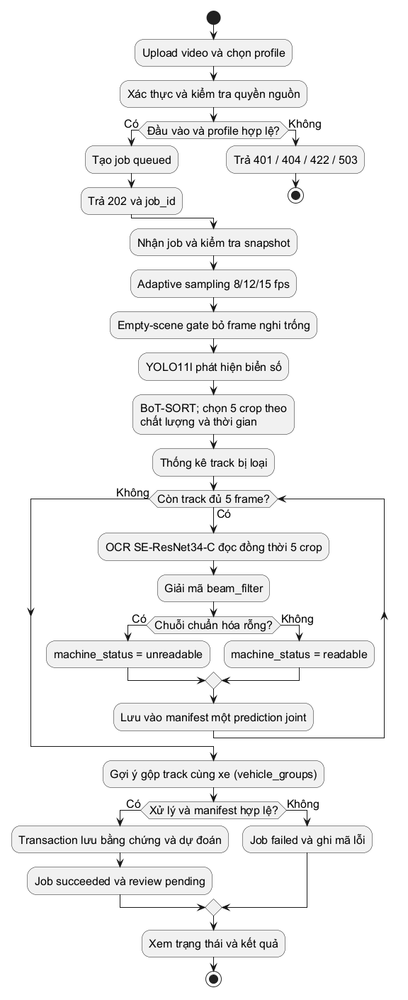

Nếu không có track hợp lệ, job vẫn `succeeded` với kết quả rỗng. Nếu checkpoint thay đổi, video không giải mã được, subprocess lỗi, timeout hoặc manifest không hợp lệ, job chuyển `failed`. Kết quả chỉ được công bố sau transaction lưu toàn bộ dữ liệu thành công.

### 7.2 Chuẩn bị ảnh và kiểm duyệt thủ công

Nguồn ảnh hỗ trợ `scene` và `plate_crop`. Với scene, mỗi detection tạo một appearance. Với plate_crop, hệ thống dùng toàn ảnh làm vùng biển số và bỏ qua detector. Profile prepare không gọi OCR: `machine_status=not_run`, `machine_text=null`, không có prediction. Người dùng có thể đọc bằng chứng rồi dùng `correct`, `unreadable` hoặc `reject`; không thể `confirm` khi chưa có text máy.

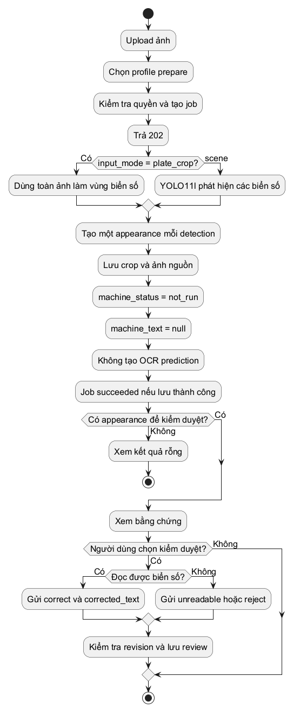

Nhận diện tự động ảnh đơn là một phần của phạm vi mục tiêu ban đầu nhưng chưa được checkpoint Kaggle hiện tại hỗ trợ. Backend đã có hợp đồng adapter một crop để mở rộng; cấu hình mẫu chưa phải model ảnh đang sẵn sàng sử dụng.

### 7.3 Kiểm duyệt kết quả

Tại thời điểm mở chi tiết, client nhận bằng chứng, dự đoán và `revision`. Mọi thao tác kiểm duyệt phải gửi lại `expected_revision`. API khóa appearance trong transaction; nếu revision đã đổi, trả `409`, client tải lại kết quả để tránh ghi đè ý kiến của người khác.

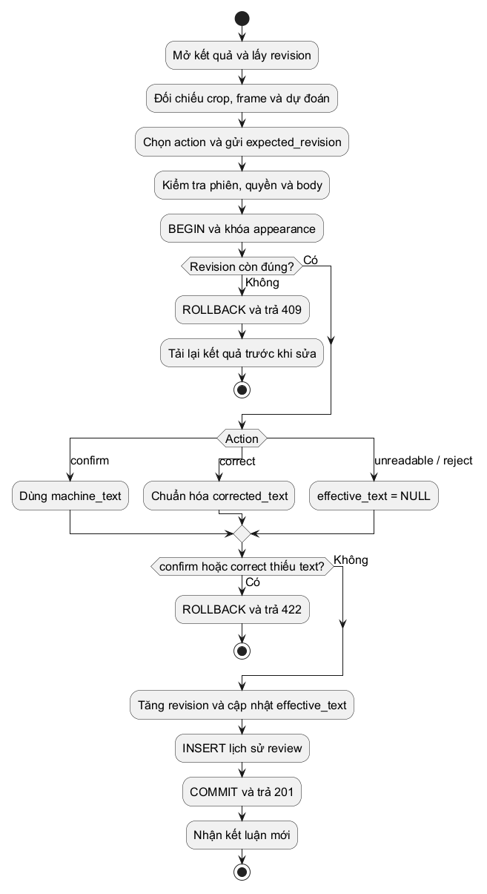

`confirm` đặt text hiệu lực bằng text máy; `correct` đặt bằng text đã chuẩn hóa do người duyệt nhập. `unreadable` và `reject` đặt text hiệu lực NULL, nhưng giữ nguyên dự đoán và lịch sử. Không có thao tác sửa hay xóa một bản ghi review riêng trong API hiện hành. Sau khi một kết quả đã bị reject, người có quyền vẫn có thể tạo review mới ở revision hiện tại để đưa ra kết luận khác.

### 7.4 Tra cứu và xuất dữ liệu

Tra cứu áp dụng quyền sở hữu trước khi trả kết quả. Với mỗi media, hệ thống chọn job v2 thành công mới nhất theo `created_at` và ID; profile prepare cũng thuộc nhóm này. Sau đó mới lọc text hiệu lực, trạng thái kiểm duyệt, nguồn và thời gian upload. Job failed/queued/running không thay thế kết quả thành công trước đó. Job thành công mới có kết quả rỗng vẫn thay thế lượt cũ trong tìm kiếm mặc định.

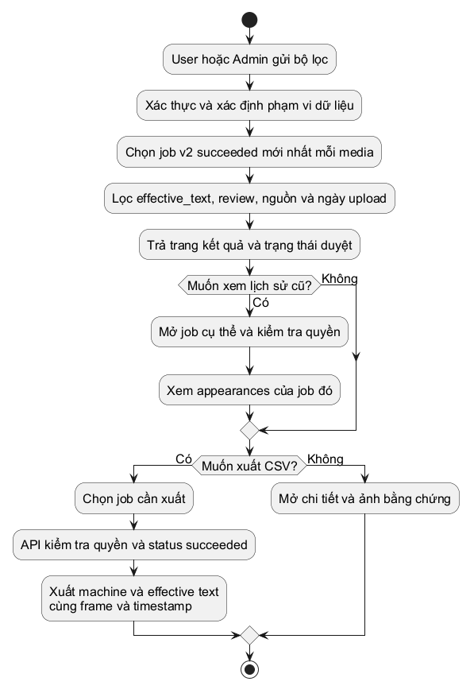

CSV xuất theo một job cụ thể và kiểm tra quyền độc lập. Mỗi dòng là một appearance, có cả text máy và text hiệu lực, trạng thái duyệt, phương pháp nhận diện, vị trí frame/timestamp. CSV không phải bộ nhãn chuẩn đánh giá model. Không sử dụng text đã sửa để báo accuracy máy một cách tự động.

Tra cứu cũng bao gồm kết quả live: mỗi track live là một job, nên mọi track đều được tính (không áp quy tắc "lượt mới nhất" của media). Bộ lọc `origin`, camera, phiên, giờ chụp, mức tin cậy; `group_by=sighting` gộp các track cùng biển trên một camera trong vài phút thành một dòng.

### 7.5 Nhận diện trên camera YouTube Live

Người dùng tạo camera (URL YouTube Live, vùng loại trừ) rồi bật phiên, hoặc bật chế độ 24/7 để worker tự mở phiên. Worker chỉ nhận phiên khi GPU rảnh (job upload và live không chạy cùng lúc trên GPU 8 GB), rồi chạy tiến trình `python -m app.live`:
- `yt-dlp` lấy URL HLS; ffmpeg giải mã với `-re` (nhịp thật) và `-copyts` (giữ timestamp gốc của segment);
- `Pacer` giới hạn tốc độ đuổi kịp sau khi kẹt mạng ở 1,3×, để buffer không phải bỏ frame giữa track;
- `TrackSession` dùng chung lõi với video upload: adaptive sampling, empty-scene gate, YOLO11l (bỏ detection trong vùng loại trừ), BoT-SORT; track quá `max_track_seconds` được chốt (xe đỗ/chờ đèn);
- mỗi track đủ 5 frame được ghi crop/keyframe, OCR joint 5 frame, gắn giờ của luồng theo `#EXT-X-PROGRAM-DATE-TIME` (hoặc giờ nhận frame) và phân loại `readable`/`low_confidence`/`unreadable` theo ngưỡng.

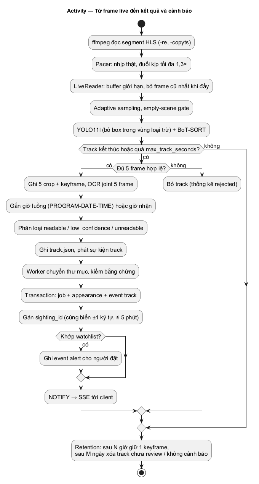

Worker nhận từng track qua stdout, chuyển thư mục bằng chứng sang `recognition/{job}`, kiểm tra bằng chứng như kết quả upload rồi ghi trong một transaction: job `succeeded`, appearance, sự kiện `track` và sự kiện `alert` nếu biển khớp watchlist. Track được gán `sighting_id` khi cùng biển (hoặc lệch một ký tự) với một track gần đây trên cùng camera. Trigger PostgreSQL gửi NOTIFY khi commit; API đẩy sự kiện tới client qua SSE.

Định kỳ, worker dọn bằng chứng theo cấu hình camera: sau một số giờ mỗi track chỉ giữ một keyframe (crop luôn còn), sau một số ngày track bị xóa; track đã kiểm duyệt, có cảnh báo hoặc nằm trong bộ mẫu gán nhãn được giữ.

**Nhiều camera.** Khi `PLATE_LIVE_MAX_SESSIONS` lớn hơn 1, worker không chạy mỗi phiên một tiến trình mà gửi lệnh `start`/`stop` (JSON) tới một host `python -m app.live --host`. Host nạp detector và OCR một lần; mỗi phiên là một `LiveRunner` trên thread riêng. Mọi lời gọi model chạy lần lượt trên một luồng GPU duy nhất, còn giải mã, tracking và ghi bằng chứng chạy song song. Job upload video dùng pipeline joint cũng chạy trong host này (lệnh `job`), dùng chung model, được giữ ở tốc độ thời gian thực khi có camera để không làm camera bỏ frame; lời gọi model của camera được ưu tiên trước batch của job. Host còn chạy thêm `PLATE_LIVE_HOST_IDLE_SECONDS` (mặc định 300 s) sau thành viên cuối nên phiên/job kế tiếp không phải nạp lại model. Lý do của luồng GPU duy nhất: detector fp16 mất khoảng 1,8 s mỗi khi gặp cỡ batch mới, tính riêng cho từng luồng. Vì vậy batch được đệm về 1, 4 hoặc 16 frame và warm-up một lần cho cả host; phiên sau dùng lại warm-up đó. Event của host mang `session` và được tách lại cho từng phiên, nên phần quản lý trạng thái phiên không đổi. Host bật cùng phiên đầu tiên và thoát sau phiên cuối để nhả GPU cho job upload.

**Ghi đệm và video.** Với camera YouTube/RTSP, ffmpeg ghi thêm một output stream copy thành đoạn MP4 10 s (không mã hóa lại); một thread lập `index.jsonl` (PTS, giờ UTC theo cùng cách tính giờ của track, keyframe) và xóa đoạn quá hạn. Track `readable` hoặc có cảnh báo được cắt clip ±3 s ngay khi bản ghi phủ hết track (thường vài giây) và lưu cùng bằng chứng của job; track khác được API cắt theo yêu cầu khi người dùng mở video. Cắt dùng `inpoint/outpoint` của concat demuxer, bắt đầu tại keyframe gần nhất trước mốc và báo giây biển xuất hiện. Camera demo cắt thẳng từ file nguồn.

**Camera IP (RTSP).** Tiến trình live mở một kết nối RTSP duy nhất bằng ffmpeg qua TCP (nhiều camera chỉ nhận một client), đọc kích thước frame từ header luồng sau khi thu nhỏ theo `max_height`, dùng giờ nhận frame làm thời gian. Sai mật khẩu (401/403) kết thúc phiên; mất kết nối hoặc 404 khi camera khởi động lại thì kết nối lại. URL có thể chứa mật khẩu nên API, sự kiện và `error_message` đều che thành `***`; chỉ `payload.json` trong thư mục dữ liệu giữ URL đầy đủ.

**Camera demo.** Admin có thể tạo camera nguồn `file` trỏ tới video trong `demo-videos`. Tiến trình live đọc file bằng OpenCV theo nhịp thật và lặp lại khi hết, PTS tăng liên tục qua các vòng; phần còn lại của luồng giống camera YouTube.

### 7.6 Gán nhãn độc lập và hiệu chỉnh ngưỡng

Admin tạo bộ mẫu từ một camera hoặc phiên: hệ thống lấy ngẫu nhiên tối đa N track có confidence ở mỗi khoảng 0-0,5, 0,5-0,7, 0,7-0,8, 0,8-0,85, 0,85-0,9, 0,9-0,95, 0,95-1, để đo được precision gần mọi ngưỡng ứng viên. Người gán nhận mẫu kế tiếp theo thứ tự xáo trộn ổn định riêng cho từng người (băm id người gán với id mẫu), chỉ thấy 5 crop và một keyframe, rồi gõ biển, chọn không đọc được hoặc bỏ qua. Nhãn được lưu riêng, không đụng review.

Báo cáo lấy nhãn đồng thuận của mỗi mẫu (mẫu bất đồng bị loại), rồi với từng ngưỡng 0,50-0,99 tính số track máy đánh dấu `readable`, số đúng (khớp chính xác sau chuẩn hóa), precision và coverage. Ngưỡng đề xuất là ngưỡng nhỏ nhất đạt precision mục tiêu. Cách tính giống `app/evaluation.calibrate_threshold`, và báo cáo xuất được file để đối chiếu bằng script.

**Hiệu chỉnh offline trên ICPR (26/10/2026).**
- **Vì sao không dùng nhãn từ camera:** crop trên camera thật quá nhỏ để gán nhãn chắc chắn (trung vị 42 px).
- **Cách làm:** `scripts/calibrate_icpr.py` chạy đúng recognizer và cách tính confidence của live trên bộ ICPR 2026 LRLPR có nhãn người:
  - tập test 3000 track, không dùng để train;
  - tập validation 1000 track.
  - Crop ICPR rộng 39-56 px, cùng cỡ với crop live.
  - Độ chính xác toàn biển trên test đạt 77,1%, khớp 77,3% của notebook.
- **Kết quả:**
  - ở ngưỡng cũ 0,85, precision chỉ 87,0%;
  - ở 0,96, precision 96,9% (khoảng tin cậy 96,1-97,6%) với 68,5% track được gắn `readable`.
- **Ngưỡng chọn:** 0,96 là ngưỡng nhỏ nhất mà cận dưới khoảng tin cậy trên hai tập gộp vẫn từ 95% trở lên. Đây là mặc định mới; migration 0009 đổi các camera đang lưu 0,85.
- **Giới hạn:** ICPR là cận trên cho camera thật, nên vẫn cần xác nhận bằng nhãn live.
- **Phạm vi ảnh hưởng:** ngưỡng chỉ đổi nhãn `readable` và bộ lọc; cảnh báo watchlist và lượt xuất hiện vẫn xét mọi track đọc ra chữ.

## 8. Sơ đồ sequence và ranh giới transaction

### 8.1. Đăng nhập và thu hồi phiên - UC01


Nguồn chỉnh sửa: [06-seq-login.puml](diagrams/06-seq-login.puml).

Client gửi email/mật khẩu qua API. Backend chuẩn hóa email, xác minh mật khẩu bằng scrypt và từ chối tài khoản không hoạt động. Sau khi tạo token ngẫu nhiên, backend khóa bản ghi tài khoản trong transaction và kiểm tra lại trạng thái/password hash trước khi ghi phiên. Bước kiểm tra lần hai ngăn một lần đăng nhập đồng thời với thao tác khóa hoặc reset mật khẩu tạo ra phiên dựa trên thông tin cũ.

Token trả về client là bí mật để sử dụng trong header Bearer; PostgreSQL chỉ lưu hash token. Guard đọc phiên còn hạn/chưa thu hồi và quyền hiện tại của tài khoản ở mỗi request. Logout thu hồi phiên đang dùng; khóa tài khoản hoặc reset mật khẩu thu hồi toàn bộ phiên của tài khoản đó. Đổi vai trò có hiệu lực khi guard đọc lại user, không đòi client đăng nhập lại để cập nhật role.

### 8.2. Upload, tạo lượt chạy và theo dõi - UC03, UC04, UC05


Nguồn chỉnh sửa: [07-seq-submit.puml](diagrams/07-seq-submit.puml).

Upload và tạo job là hai giao dịch nghiệp vụ tách biệt. Upload hợp lệ tạo `media_id`; nguồn này có thể tồn tại mà chưa được xử lý. API kiểm dung lượng, loại file, khả năng giải mã, ghi metadata và hash, rồi trả `201`. Python probe chỉ kiểm nguồn; đây không phải lần chạy detector/OCR.

Khi tạo job, API kiểm quyền nguồn trước khi resolve profile để hạn chế lộ thông tin tài nguyên. Profile chỉ được chọn bằng ID cấu hình trên server. Trong transaction tạo job, khóa `media_assets` đồng bộ với xóa nguồn, sau đó chèn job `queued` kèm snapshot. API trả `202` khi việc xếp hàng hoàn tất; không giữ HTTP request đến khi ML xử lý xong. Client dùng `status_url` để thăm dò; retry nghiệp vụ là một POST tạo job mới trên cùng nguồn.

Kaggle joint-five chỉ nhận video `scene`. Ảnh sử dụng prepare `scene` hoặc `plate_crop`; ảnh đưa vào profile joint-five trả `422`. Những nhánh lỗi này không tạo job mới. `pipelines.ready` là kiểm cấu hình/file/checksum, không thay thế việc chạy thử model thực.

### 8.3. Worker và công bố kết quả - UC04, UC05, UC06, UC12


Nguồn chỉnh sửa: [08-seq-worker.puml](diagrams/08-seq-worker.puml).

Worker Node giữ một PostgreSQL advisory lock cho toàn vòng đời để bảo đảm bản đầu chỉ có một worker quản lý queue trên DB. Khi khởi động, worker đánh dấu job `running` còn lại là `failed/WORKER_INTERRUPTED`. Nhận job dùng `FOR UPDATE SKIP LOCKED` trong một transaction ngắn; transaction đó hoàn tất trước khi chạy inference. Không giữ khóa hàng job suốt thời gian xử lý video.

Worker xác minh hash nguồn, checkpoint, mã tích hợp và interpreter của snapshot rồi chạy Python supervisor. Python thực hiện Adaptive Sampling → empty-scene gate → YOLO11l → BoT-SORT không ReID → chọn năm crop theo chất lượng và thời gian → OCR joint một lần cho mỗi track → decoder `beam_filter` → gợi ý gộp track. Track thiếu năm frame hợp lệ bị loại và ghi thống kê. Runner ghi bằng chứng, progress và manifest vào thư mục riêng của job; **Python ML không trực tiếp ghi PostgreSQL**.

Node nhận manifest, kiểm tra đường dẫn nằm trong job, file bằng chứng tồn tại, kích thước/bbox hợp lệ, năm frame và timestamp khác nhau theo thứ tự, liên kết prediction với đúng năm input. Sau đó Node mở transaction thứ hai, khóa job còn `running`, chèn toàn bộ appearance/detection/prediction và chuyển job sang `succeeded`. Nếu ghi dữ liệu lỗi, transaction rollback nên không công bố một phần kết quả.

Kết quả joint có `recognition_method=joint_multiframe`, `agreement_count=null` và một prediction cấp appearance. `frame_weights` là trọng số kết hợp đặc trưng; `ocr_score=null` vì model không có xác suất đã hiệu chuẩn; `decoding` ghi decoder, greedy text, `format_valid` và beam score chỉ để xếp hạng. Profile prepare không gọi OCR, giữ `machine_status=not_run`, `machine_text=null`, predictions rỗng. Nhánh adapter đọc từng crop còn được hỗ trợ về hợp đồng nhưng quy tắc đa số 3/5 không áp dụng cho model Kaggle hiện hành.

Timeout, gián đoạn, nguồn thay đổi, model lỗi hoặc manifest sai làm job `failed` với mã lỗi an toàn; stack trace nằm trong log máy chủ. Supervisor/dừng cây tiến trình tránh inference tiếp tục chạy khi worker mất quyền điều khiển. Không có retry tự động hoặc API hủy job trong bản đầu.

### 8.4. Kiểm duyệt và xung đột phiên bản - UC07


Nguồn chỉnh sửa: [09-seq-review.puml](diagrams/09-seq-review.puml).

Hai client có thể cùng đọc revision 0. Request review đầu khóa appearance bằng `FOR UPDATE OF a`, kiểm quyền và job thành công, so sánh `expected_revision`, cập nhật `effective_text`, `review_status`, tăng revision, rồi thêm lịch sử trong cùng transaction. Request tiếp theo đọc revision mới sau khi lấy được khóa; nếu vẫn gửi revision cũ thì nhận `409`.

Client phải tải lại kết quả và chủ động gửi quyết định mới. Không nên tự động gửi lại review với revision tăng lên vì có thể ghi đè một kết luận chưa được người dùng xem. `confirm` cần `machine_text` đọc được; `correct` cần chuỗi mới còn nội dung sau chuẩn hóa; `unreadable` hoặc `reject` đặt `effective_text=null`. Mọi action giữ nguyên dự đoán máy. Track ghép sai dùng `reject`; bản đầu chưa có công cụ tách/gộp lại track.

### 8.5. Xóa dữ liệu và phối hợp lưu trữ - UC10, UC11


Nguồn chỉnh sửa: [10-seq-delete.puml](diagrams/10-seq-delete.puml).

Xóa job v2 khóa media rồi khóa job, chỉ cho `succeeded` hoặc `failed`. Xóa nguồn khóa media và chỉ tiếp tục khi không còn job tham chiếu, kể cả job failed. Cùng thứ tự khóa giúp phối hợp với tạo job mới. FK/cascade xử lý metadata phát sinh; source của job v2 được giữ để tái sử dụng.

Trong transaction, backend rename thư mục cần xóa sang `trash/<uuid>` trước khi DELETE metadata. Nếu giao dịch lỗi, backend cố khôi phục thư mục; nếu commit thành công, purge trash là bước dọn sau cùng. Lỗi purge không biến một lần xóa đã commit thành thất bại và file trong trash không được endpoint nghiệp vụ phục vụ. Không xóa từng file frame theo detection vì nhiều detection có thể tham chiếu cùng frame.

**Giới hạn vận hành:** PostgreSQL và filesystem không tham gia transaction phân tán. Crash đúng giữa rename và commit/restore có thể cần đối chiếu DB với thư mục trash; bản đầu chưa có bộ đối soát tự động cho mọi trạng thái crash. Backup cần chứa cả DB và file tại thời điểm nhất quán.

### 8.6. Phiên live, nhập track và sự kiện real-time - UC13-UC16

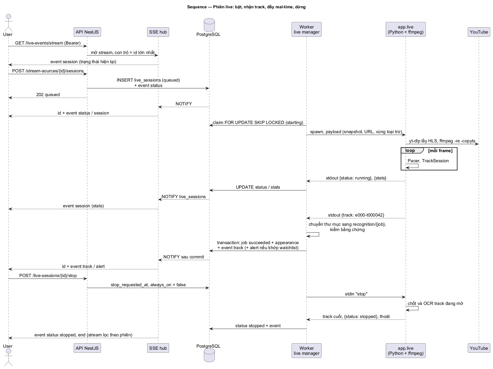

Nguồn chỉnh sửa: [17-seq-live-session.puml](diagrams/17-seq-live-session.puml).

API chỉ ghi trạng thái mong muốn: tạo phiên `queued` (có snapshot pipeline và cấu hình camera tại thời điểm bật) hoặc đặt `stop_requested_at`. Worker là nơi duy nhất điều khiển tiến trình live. Nó nhận phiên bằng `FOR UPDATE SKIP LOCKED` khi GPU rảnh, kiểm checksum snapshot như job upload, rồi spawn `python -m app.live`; dừng bằng dòng `stop` trên stdin, quá thời hạn thì kill cả cây tiến trình.

Mỗi track được nhập trong một transaction gồm: job `succeeded`, appearance, detection, prediction, cập nhật `tracks_count`, sự kiện `track` và các sự kiện `alert`. Trước transaction, thư mục bằng chứng được chuyển sang `recognition/{job}` và kiểm như kết quả upload; transaction lỗi thì chuyển lại. Trigger trên `live_session_events` và `live_sessions` gửi NOTIFY khi commit, nên SSE không bao giờ đẩy dữ liệu chưa commit. SSE hub chỉ nhận id qua NOTIFY rồi đọc lại các dòng sau con trỏ của từng stream; vì vậy nối lại bằng `Last-Event-ID` không thiếu, không trùng sự kiện, kể cả sau khi kết nối `LISTEN` bị đứt.

**Khôi phục:** worker khởi động lại chuyển các phiên đang hoạt động sang `interrupted` và nhập các track còn trên đĩa; trên Windows tiến trình live bị kill theo worker nên track đang mở dở bị mất. Camera 24/7 được bật phiên mới ở lượt kế tiếp.

**Host dùng chung (nhiều camera).** Với `PLATE_LIVE_MAX_SESSIONS > 1`, `SharedLiveHost` thay cho việc spawn từng tiến trình nhưng giữ đúng giao diện một "tiến trình con" cho mỗi phiên: stdout của phiên nhận các event mang `session` của nó, dòng `stop` trên stdin của phiên thành lệnh `{"cmd":"stop"}` gửi host, và phiên đóng khi host báo `exit`. Nhờ vậy luồng ở trên không đổi. Host bật khi phiên đầu tiên được nhận và thoát khi phiên cuối kết thúc. Phiên mới tạo đúng lúc host cũ đang thoát sẽ chờ host mới. Watchdog hoặc quá thời gian dừng thì kill cả host; các phiên còn lại kết thúc như tiến trình thoát bất thường.

### 8.7. Gán nhãn độc lập và báo cáo ngưỡng - UC19, UC20

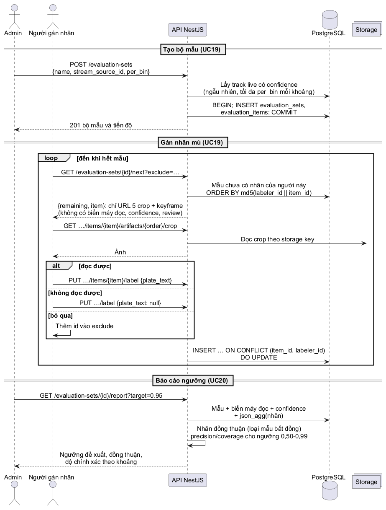

Nguồn chỉnh sửa: [20-seq-labeling.puml](diagrams/20-seq-labeling.puml).

Tạo bộ mẫu là một transaction: chèn `evaluation_sets` và các `evaluation_items` đã lấy mẫu. `next` chỉ đọc; thứ tự riêng của mỗi người gán là `md5(labeler_id || item_id)`, nên ổn định giữa các lần mở và khác nhau giữa người gán. Ảnh bằng chứng đi qua route của bộ mẫu (theo thứ tự detection), không lộ id detection hay kết quả. Gán nhãn là một `INSERT … ON CONFLICT (item_id, labeler_id) DO UPDATE`, nên sửa nhãn không cần khóa. Báo cáo gom nhãn theo mẫu bằng `json_agg` rồi tính trong API; không ghi dữ liệu.

## 9 Mô hình trạng thái

### 9.1 Trạng thái job

`status` mô tả vòng đời xử lý; `stage` cho biết bước đang chạy. Stage gồm validating, detection_tracking, recognition, persisting và kết thúc complete/failed. Prepare không có bước recognition. API không tự suy ra phần trăm tiến độ nếu worker không có số liệu.

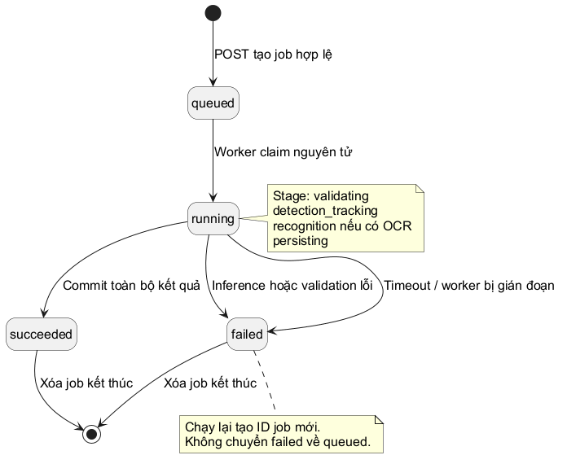

Worker đang chạy giữ advisory lock ở cấp database. Khi một worker hợp lệ khởi động lại, các job còn `running` được đánh dấu `failed` với `WORKER_INTERRUPTED`; không âm thầm tiếp tục từ file kết quả dở. Người dùng tạo job mới trên cùng media để chạy lại. Bản đầu không có retry theo cùng ID hoặc hủy job đang chạy.

### 9.2 Trạng thái kiểm duyệt và trạng thái máy

Hai trạng thái độc lập. Máy có thể `readable`, `unreadable`, `ambiguous` hoặc `not_run`. `ambiguous` có ý nghĩa ở nhánh OCR từng crop và bỏ phiếu; profile joint hiện tại không tạo trạng thái này. Review bắt đầu `pending`, sau đó phản ánh hành động mới nhất.

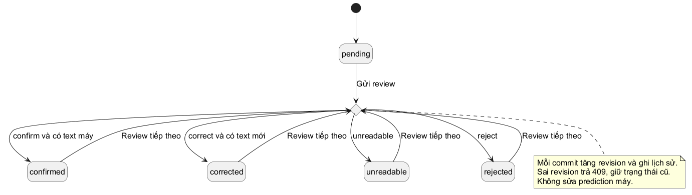

Mọi trạng thái review đều có thể nhận thao tác tiếp theo hợp lệ. Sơ đồ rút gọn các chuyển tiếp lặp bằng trạng thái lựa chọn hành động; đây không phải một trạng thái được lưu trong DB. Mỗi lần commit tăng revision một đơn vị và thêm lịch sử, không thay đổi trạng thái máy.

### 9.3 Trạng thái phiên live

Phiên bắt đầu `queued`, chuyển `starting` khi worker nhận, `running` khi có frame đầu tiên và `reconnecting` khi mất luồng. Yêu cầu dừng chuyển `stopping`; tiến trình chốt và OCR các track đang mở rồi phiên thành `stopped`. Các trạng thái kết thúc khác: `ended` (hết live, video bị gỡ), `failed` (lỗi khởi động, quá số lần kết nối lại, tiến trình im lặng quá `PLATE_LIVE_STALL_SECONDS`) và `interrupted` (worker dừng hoặc khởi động lại). Mỗi lần đổi trạng thái được ghi vào `live_session_events`.

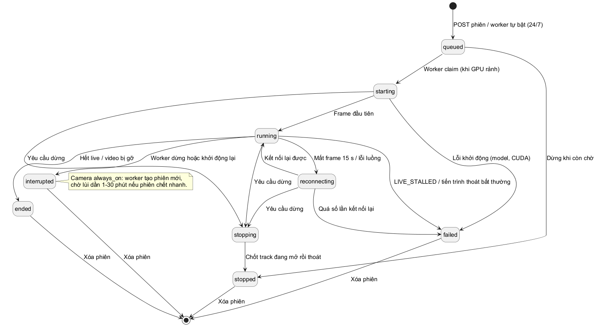

Mỗi camera chỉ có một phiên ở các trạng thái hoạt động (ràng buộc bằng unique index một phần). Camera 24/7 không có phiên hoạt động thì worker tạo phiên `queued` mới; nếu các phiên liên tiếp sống dưới hai phút, lần tạo kế tiếp chờ 1, 2, 4… tối đa 30 phút. Người dùng dừng phiên thì chế độ 24/7 tắt.

## 10. Thiết kế cơ sở dữ liệu PostgreSQL

**Ngày đối chiếu:** 27/10/2026. Đây là thiết kế vật lý đang được mã nguồn sử dụng sau mười một migration, không phải một schema đề xuất chưa triển khai: 0004-0006 bổ sung YouTube Live, 0007 camera demo, 0008 gán nhãn, 0009 chỉ cập nhật dữ liệu, 0010 thêm camera RTSP, 0011 thêm clip video của track live. Có **15 bảng nghiệp vụ và 1 bảng kỹ thuật**. Các bảng dùng tên tiếng Anh; ý nghĩa và quy tắc được giải thích bằng tiếng Việt.

### 10.1. Nguyên tắc mô hình hóa

Đơn vị nghiệp vụ trung tâm là `plate_appearances`: một lần biển số xuất hiện trong **một job cụ thể**. Ảnh tạo một appearance cho mỗi detection; video tạo một appearance cho mỗi track đủ điều kiện. Cùng văn bản biển số xuất hiện ở hai nguồn hoặc hai lượt chạy vẫn là hai bản ghi khác nhau. Không đặt unique trên `machine_text`, `effective_text` hoặc `source_track_id` toàn hệ thống.

`media_assets` tách khỏi `recognition_jobs` để chạy lại một nguồn với cấu hình khác. Quyền sở hữu đặt ở nguồn: appearance, detection và prediction truy ngược qua job đến `media_assets.owner_id`. `reviewer_id` là người thực hiện kiểm duyệt, có thể là Admin và không nhất thiết là chủ nguồn. Không có bảng phương tiện, chủ xe, giao dịch bãi xe hoặc liên kết danh tính giữa các track.

Với live, quyền sở hữu đặt ở camera (`stream_sources.owner_id`); mỗi track đã chốt là một `recognition_jobs` có `live_session_id` thay cho `media_id`, nên appearance/detection/prediction/review của track live dùng đúng các bảng và quy tắc của kết quả upload.

Ảnh/video/crop nằm trên filesystem; DB giữ metadata và storage key tương đối. Hash nguồn phục vụ đối chiếu nội dung, **không** là khóa sở hữu dùng chung giữa tài khoản. DB không chứa Base64. Snapshot pipeline là dữ liệu nội bộ và có thể chứa đường dẫn checkpoint; API lọc thông tin đó trước khi trả về client.

ID nghiệp vụ được ứng dụng sinh bằng UUID bỏ dấu gạch nối, lưu trong `varchar(32)`; cột không có default UUID và DB không có CHECK định dạng hex. `timestamptz` lưu một thời điểm tuyệt đối; client có thể hiển thị theo múi giờ người dùng. `uploaded_at` là lúc upload, không phải lúc quay. `frame_index` và `timestamp_seconds` mô tả vị trí tương đối trong video. Giá trị chưa biết để `NULL`, không thay bằng 0.

### 10.2. ERD và quan hệ


Nguồn chỉnh sửa: [12-erd.puml](diagrams/12-erd.puml). Sơ đồ thể hiện các khóa và trường chính; từ điển bên dưới là danh sách đầy đủ. Bảng kỹ thuật `schema_migrations` độc lập, không tham gia quan hệ nghiệp vụ.

- Một user có nhiều session và nguồn; mỗi nguồn có đúng một chủ sở hữu.
- Một nguồn có nhiều job; một job có từ 0 đến nhiều appearance. Job thành công có thể không phát hiện biển số nào.
- Một appearance có nhiều detection và lịch sử review; luồng hiện hành dùng một detection cho ảnh, năm detection được chọn cho video.
- OCR theo crop tham chiếu một detection. OCR joint tham chiếu một appearance và danh sách năm đầu vào có thứ tự. **Mỗi prediction chỉ thuộc đúng một nhánh**, không đồng thời cả hai.
- Một user có thể tạo nhiều review; mỗi review có đúng một người thực hiện.
- Một user sở hữu nhiều camera; một camera có nhiều phiên live, tối đa một phiên ở trạng thái hoạt động; một phiên có nhiều sự kiện và nhiều job (mỗi job một track).
- Mỗi job có **đúng một nguồn**: `media_id` (upload) hoặc `live_session_id` (live).
- Một user có nhiều mục watchlist; biển số là duy nhất trong watchlist của từng user.
- Một bộ mẫu gán nhãn có nhiều mẫu, mỗi mẫu trỏ tới đúng một job live; một job xuất hiện tối đa một lần trong mỗi bộ mẫu. Mỗi mẫu có tối đa một nhãn của mỗi người gán.

### 10.3. Quy ước từ điển dữ liệu

Cột **NULL** ghi “Không” nếu NOT NULL/PK, “Có” nếu được phép NULL. **PK** là khóa chính; **FK →** là khóa ngoại; **UQ** là unique. `D=...` là default của PostgreSQL. Nếu không ghi `D`, cột không có default khai báo; ứng dụng phải cung cấp giá trị cho cột bắt buộc. CHECK không làm một cột nullable thành NOT NULL: PostgreSQL chấp nhận kết quả CHECK là NULL.

#### 10.3.1. `users` - tài khoản

| Trường | Kiểu PostgreSQL | NULL | Ràng buộc và ý nghĩa |
|---|---|---|---|
| `id` | `varchar(32)` | Không | PK; ID tài khoản. |
| `email` | `varchar(320)` | Không | UQ; CHECK `email = lower(btrim(email))`. API chuẩn hóa email trước khi lưu. |
| `password_hash` | `text` | Không | Hash mật khẩu có salt; không lưu mật khẩu rõ. |
| `display_name` | `varchar(200)` | Không | D=`''`; tên hiển thị. |
| `role` | `varchar(16)` | Không | D=`'user'`; CHECK trong `admin`, `user`. |
| `is_active` | `boolean` | Không | D=`true`; trạng thái được phép đăng nhập/truy cập. |
| `created_at` | `timestamptz` | Không | D=`now()`; thời điểm tạo. |

Khóa tài khoản là cập nhật `is_active=false`, không xóa user. Runtime ngăn vô hiệu hóa/hạ quyền Admin hoạt động cuối cùng; không có CHECK hoặc trigger tương ứng trong DB. Email unique theo chuỗi chuẩn hóa, không dùng `citext`.

#### 10.3.2. `auth_sessions` - phiên đăng nhập

| Trường | Kiểu PostgreSQL | NULL | Ràng buộc và ý nghĩa |
|---|---|---|---|
| `id` | `varchar(32)` | Không | PK; ID phiên. |
| `user_id` | `varchar(32)` | Không | FK → `users.id`, ON DELETE CASCADE. |
| `token_hash` | `varchar(64)` | Không | UQ; SHA-256 của bearer token ngẫu nhiên, không lưu token rõ. DB không CHECK dạng hex. |
| `expires_at` | `timestamptz` | Không | Hạn phiên do ứng dụng tính. |
| `revoked_at` | `timestamptz` | Có | Lúc thu hồi; NULL nghĩa là chưa được thu hồi, không bảo đảm phiên chưa hết hạn. |
| `created_at` | `timestamptz` | Không | D=`now()`. |

Phiên có hiệu lực khi chưa thu hồi, chưa hết hạn và user còn hoạt động. Không có CHECK `expires_at > created_at`; đây là quy tắc ứng dụng. Đăng xuất thu hồi phiên hiện tại; khóa tài khoản hoặc đặt lại mật khẩu thu hồi các phiên của tài khoản trong transaction quản lý user.

#### 10.3.3. `media_assets` - nguồn ảnh/video

| Trường | Kiểu PostgreSQL | NULL | Ràng buộc và ý nghĩa |
|---|---|---|---|
| `id` | `varchar(32)` | Không | PK; `media_id` dùng cho API tạo job. |
| `owner_id` | `varchar(32)` | Không | FK → `users.id`, ON DELETE RESTRICT. |
| `original_name` | `varchar(255)` | Không | Tên file lúc upload; không dùng trực tiếp làm đường dẫn lưu. |
| `media_type` | `varchar(16)` | Không | CHECK trong `image`, `video`. |
| `storage_key` | `text` | Không | UQ; khóa file tương đối trong vùng lưu trữ quản lý. |
| `mime_type` | `varchar(100)` | Không | MIME được kiểm tra; dùng khi phục vụ file nguồn. |
| `size_bytes` | `bigint` | Không | CHECK `>= 0`; dung lượng byte. |
| `sha256` | `varchar(64)` | Không | Hash nội dung; không UQ và không CHECK dạng hex. |
| `width` | `integer` | Có | CHECK `> 0`; chiều rộng pixel khi xác định được. |
| `height` | `integer` | Có | CHECK `> 0`; chiều cao pixel khi xác định được. |
| `duration_seconds` | `double precision` | Có | CHECK `>= 0`; thời lượng video; ảnh không áp dụng. |
| `uploaded_at` | `timestamptz` | Không | D=`now()`; dùng lọc thời gian upload. |

Luồng upload hiện hành kiểm tra giải mã và metadata; các cột kích thước nullable để hỗ trợ dữ liệu lịch sử thiếu metadata. DB không tự kiểm tra MIME với nội dung file hoặc bắt buộc thời lượng NULL khi là ảnh.

#### 10.3.4. `recognition_jobs` - lượt xử lý

| Trường | Kiểu PostgreSQL | NULL | Ràng buộc và ý nghĩa |
|---|---|---|---|
| `id` | `varchar(32)` | Không | PK; ID lượt chạy. |
| `media_id` | `varchar(32)` | Có | FK → `media_assets.id`, ON DELETE RESTRICT. NULL với job live; CHECK đúng một trong `media_id`/`live_session_id`. |
| `job_kind` | `varchar(16)` | Không | D=`'recognize'`; CHECK trong `detect_only`, `recognize`. Prepare và job lịch sử dùng `detect_only`. |
| `input_mode` | `varchar(16)` | Không | D=`'scene'`; CHECK trong `scene`, `plate_crop`. |
| `pipeline_snapshot` | `jsonb` | Không | D=`'{}'::jsonb`; CHECK kiểu JSON là object. Cấu hình và phiên bản/checksum lúc chạy. |
| `status` | `varchar(16)` | Không | D=`'queued'`; CHECK trong `queued`, `running`, `succeeded`, `failed`. |
| `stage` | `varchar(32)` | Không | D=`'queued'`; giai đoạn hiện tại. DB không CHECK tập giá trị stage. |
| `statistics` | `jsonb` | Không | D=`'{}'::jsonb`; CHECK kiểu JSON là object. Số frame/track, loại bỏ và số kết quả. |
| `created_at` | `timestamptz` | Không | D=`now()`. |
| `started_at` | `timestamptz` | Có | Thời điểm worker nhận và bắt đầu xử lý. |
| `finished_at` | `timestamptz` | Có | Thời điểm kết thúc thành công/thất bại. |
| `error_code` | `varchar(100)` | Có | Mã lỗi khi có. |
| `error_message` | `text` | Có | Thông báo lỗi phù hợp để API hiển thị. |
| `live_session_id` | `varchar(32)` | Có | FK → `live_sessions.id`, ON DELETE RESTRICT. Phiên live tạo ra track này. |
| `live_track_key` | `varchar(32)` | Có | Khóa track trong phiên (`e000-t000042`); UQ `(live_session_id, live_track_key)` giữ cho việc nhập track idempotent. |
| `captured_from`, `captured_to` | `timestamptz` | Có | Giờ chụp của track live: giờ của luồng (PROGRAM-DATE-TIME) hoặc giờ nhận; nguồn giờ ghi ở `statistics.capture_clock`. |
| `confidence_status` | `varchar(16)` | Có | CHECK trong `readable`, `low_confidence`, `unreadable`; phân loại tham khảo theo ngưỡng của phiên. |
| `duplicate_of_job_id` | `varchar(32)` | Có | FK → `recognition_jobs.id`, ON DELETE SET NULL; track trước có khả năng cùng xe (tham khảo). |
| `sighting_id` | `varchar(32)` | Có | Khóa nhóm lượt xuất hiện (job id của track đầu tiên), không phải FK; xóa track đầu vẫn giữ nhóm. |
| `alerted` | `boolean` | Không | D=`false`; track khớp watchlist, được giữ khi dọn dữ liệu. |
| `evidence_bytes` | `bigint` | Có | Dung lượng bằng chứng của track live. |
| `evidence_pruned_at` | `timestamptz` | Có | Thời điểm dọn dữ liệu bỏ bớt keyframe (crop vẫn giữ). |

CHECK `recognition_jobs_live_fields`: job upload để NULL toàn bộ cột live; job live bắt buộc `live_track_key`, `captured_from`, `captured_to >= captured_from` và `confidence_status`.

Video chỉ dùng `scene`; profile Kaggle joint chỉ nhận video. Hai điều kiện này được API/worker kiểm tra, không phải CHECK xuyên bảng. `succeeded` chỉ xác nhận xử lý hoàn tất, không xác nhận accuracy. DB chưa có CHECK ghép trạng thái với các mốc thời gian.

#### 10.3.5. `plate_appearances` - kết quả trung tâm

| Trường | Kiểu PostgreSQL | NULL | Ràng buộc và ý nghĩa |
|---|---|---|---|
| `id` | `varchar(32)` | Không | PK; ID kết quả để kiểm duyệt/tra cứu. |
| `job_id` | `varchar(32)` | Không | FK → `recognition_jobs.id`, ON DELETE CASCADE. |
| `source_track_id` | `varchar(100)` | Có | ID tracker trong job; ảnh/dữ liệu lịch sử có thể NULL. Không UQ ở DB. |
| `first_frame` | `integer` | Có | CHECK `>= 0`; frame đầu phạm vi track. |
| `last_frame` | `integer` | Có | CHECK `>= first_frame`; DB không bắt buộc hai đầu cùng NULL hoặc cùng có giá trị. |
| `start_seconds` | `double precision` | Có | CHECK `>= 0`; đầu phạm vi track theo thời gian tương đối. |
| `end_seconds` | `double precision` | Có | CHECK `>= start_seconds`; cùng lưu ý NULL như hai đầu frame. |
| `machine_text` | `varchar(128)` | Có | Kết luận máy chuẩn hóa; NULL nếu không có kết luận đọc được. Không UQ. |
| `machine_status` | `varchar(16)` | Không | D=`'not_run'`; CHECK trong `readable`, `ambiguous`, `unreadable`, `not_run`. |
| `agreement_count` | `integer` | Có | D=`0` vẫn được giữ sau migration 0002; CHECK từ 0 đến 5 khi có giá trị. Joint bắt buộc NULL. |
| `effective_text` | `varchar(128)` | Có | Chuỗi đang có hiệu lực để tra cứu; lưu cùng transaction kiểm duyệt. Không UQ. |
| `review_status` | `varchar(16)` | Không | D=`'pending'`; CHECK trong `pending`, `confirmed`, `corrected`, `unreadable`, `rejected`. |
| `revision` | `integer` | Không | D=`0`; CHECK `>= 0`; tăng mỗi lần review. |
| `recognition_method` | `varchar(32)` | Có | Thêm ở 0002; CHECK trong `single_image`, `per_crop_majority`, `joint_multiframe`; NULL cho chưa OCR/dữ liệu lịch sử. |

CHECK `plate_appearances_joint_agreement` yêu cầu `recognition_method='joint_multiframe'` thì `agreement_count IS NULL`. Vì default của count vẫn là 0, thao tác insert joint phải truyền NULL rõ ràng. Kết quả joint là **một suy luận từ năm ảnh**, không có số phiếu 3/5. Không thêm ràng buộc giả định mọi appearance đều đã chạy OCR; prepare có `not_run`, text NULL và count 0.

#### 10.3.6. `plate_detections` - bằng chứng

| Trường | Kiểu PostgreSQL | NULL | Ràng buộc và ý nghĩa |
|---|---|---|---|
| `id` | `varchar(32)` | Không | PK; dùng URL artifact sau kiểm tra quyền. |
| `appearance_id` | `varchar(32)` | Không | FK → `plate_appearances.id`, ON DELETE CASCADE. |
| `selected_order` | `integer` | Không | D=`0`; CHECK `>= 0`; UQ ghép `(appearance_id, selected_order)`. Runtime mới dùng 1..N. |
| `frame_index` | `integer` | Có | CHECK `>= 0`; runtime video mới dùng chỉ số bắt đầu 1; ảnh NULL. |
| `timestamp_seconds` | `double precision` | Có | CHECK `>= 0`; timestamp video tương đối; ảnh NULL. |
| `timestamp_source` | `varchar(32)` | Có | Nguồn timestamp: runtime dùng `video_pts`, `still_image`; dữ liệu lịch sử có thể là `legacy`. DB không enum. |
| `bbox` | `jsonb` | Có | Bbox detector `[x1,y1,x2,y2]`; DB không CHECK cấu trúc JSON. |
| `crop_bbox` | `jsonb` | Có | Vùng crop thực tế, gồm padding nếu có; DB không CHECK cấu trúc JSON. |
| `detection_score` | `double precision` | Có | CHECK từ 0 đến 1; confidence detector, không phải confidence OCR. |
| `crop_storage_key` | `text` | Không | Khóa ảnh crop; không UQ ở DB. |
| `frame_storage_key` | `text` | Có | Khóa frame nguồn; nhiều detection có thể dùng chung frame. |
| `crop_width` | `integer` | Có | CHECK `> 0`; kích thước crop trước resize OCR. |
| `crop_height` | `integer` | Có | CHECK `> 0`; dùng phân nhóm chất lượng low-resolution. |
| `legacy_crop_id` | `varchar(100)` | Có | ID crop của dữ liệu lịch sử (bản FastAPI đầu); runtime hiện hành để NULL. Có index, không UQ. |

Frame nguồn không có bảng riêng trong bản đầu. Runtime lưu/xóa theo thư mục job nên không xóa file frame dùng chung theo từng detection. DB không thể xác nhận storage key trỏ tới file tồn tại; worker xác minh đường dẫn an toàn, kích thước ảnh và hình học crop trước lưu.

#### 10.3.7. `ocr_predictions` - dự đoán máy và provenance

| Trường | Kiểu PostgreSQL | NULL | Ràng buộc và ý nghĩa |
|---|---|---|---|
| `id` | `varchar(32)` | Không | PK; ID dự đoán. |
| `detection_id` | `varchar(32)` | Có | FK → `plate_detections.id`, ON DELETE CASCADE; parent của OCR một crop. Nullable từ 0002. |
| `variant` | `varchar(32)` | Không | D=`'original'`; UQ ghép `(detection_id, variant)` và `(appearance_id, variant)`. DB không CHECK tập variant. |
| `raw_text` | `text` | Có | Văn bản OCR nguyên gốc. |
| `normalized_text` | `varchar(128)` | Có | Chữ hoa, bỏ khoảng trắng/dấu gạch nối; không tự đổi `O` và `0`. |
| `ocr_score` | `double precision` | Có | Confidence nếu model cung cấp; model Kaggle hiện để NULL. DB không CHECK khoảng xác suất. |
| `character_scores` | `jsonb` | Có | Score từng ký tự khi có; DB không CHECK cấu trúc JSON. |
| `input_storage_key` | `text` | Có | Khóa một đầu vào cho OCR theo detection; nullable từ 0002 và buộc NULL cho joint. |
| `latency_ms` | `double precision` | Có | CHECK `>= 0`; thời gian suy luận được adapter đo. |
| `created_at` | `timestamptz` | Không | D=`now()`. |
| `appearance_id` | `varchar(32)` | Có | Thêm ở 0002; FK → `plate_appearances.id`, ON DELETE CASCADE; parent của joint OCR. |
| `input_storage_keys` | `jsonb` | Có | Thêm ở 0002; mảng đúng 5 khóa đầu vào cho joint, theo thứ tự thời gian. |
| `frame_weights` | `jsonb` | Có | Thêm ở 0002; NULL hoặc mảng đúng 5 phần tử. Trọng số hợp nhất model, không phải accuracy hoặc số phiếu. |
| `decoding` | `jsonb` | Có | Thêm ở 0003; NULL hoặc object: `decoder`, `beam_width`, `use_tta`, `plate_text`, `greedy_text`, `format_valid`, `greedy_symbol_confidence`, `beam_log_score`, `beam_confidence_proxy`. Score là heuristic, không phải xác suất đúng. |

Bốn CHECK bổ sung tạo hợp đồng rõ ràng:

1. `ocr_predictions_one_parent`: `(detection_id IS NOT NULL) <> (appearance_id IS NOT NULL)`; đúng một parent có giá trị.
2. `ocr_predictions_input_provenance`: nhánh detection phải có `input_storage_key`, hai trường `input_storage_keys`/`frame_weights` phải NULL. Nhánh appearance phải có mảng `input_storage_keys` dài 5 và `input_storage_key` NULL.
3. `ocr_predictions_frame_weights`: nếu có weights thì phải là mảng dài 5. DB chưa kiểm tra phần tử là số, khoảng [0,1], tổng bằng 1 hay alignment với đầu vào; worker kiểm tra các điều kiện này.
4. `ocr_predictions_decoding_object`: nếu có `decoding` thì phải là object JSON. Worker kiểm tra đủ khóa, decoder hợp lệ, `plate_text` trùng `raw_text` và các score hữu hạn.

Hai UQ ghép cho phép mỗi parent có tối đa một dự đoán cho mỗi variant. Với XOR, giá trị NULL ở khóa của nhánh còn lại không gây trùng giả. Runtime joint hiện ghi một bản ghi `variant='joint'` ở appearance; danh sách prediction của từng detection rỗng. API trả `detection_ids` có thứ tự thay storage key nội bộ.


Nguồn chỉnh sửa: [13-erd-ocr.puml](diagrams/13-erd-ocr.puml).

#### 10.3.8. `recognition_reviews` - lịch sử kiểm duyệt

| Trường | Kiểu PostgreSQL | NULL | Ràng buộc và ý nghĩa |
|---|---|---|---|
| `id` | `varchar(32)` | Không | PK; ID thao tác. |
| `appearance_id` | `varchar(32)` | Không | FK → `plate_appearances.id`, ON DELETE CASCADE. |
| `reviewer_id` | `varchar(32)` | Không | FK → `users.id`, ON DELETE RESTRICT. |
| `action` | `varchar(16)` | Không | CHECK trong `confirm`, `correct`, `unreadable`, `reject`. |
| `corrected_text` | `varchar(128)` | Có | Nội dung sửa đã chuẩn hóa; runtime chỉ lưu khi action=`correct`. |
| `note` | `text` | Có | Ghi chú; API giới hạn 2.000 ký tự, DB không giới hạn riêng. |
| `revision` | `integer` | Không | CHECK `> 0`; UQ ghép `(appearance_id, revision)`. |
| `created_at` | `timestamptz` | Không | D=`now()`. |

DB không có CHECK ghép action với corrected_text hoặc FK ghép revision đến appearance. API yêu cầu `corrected_text` chỉ cho action `correct`, giới hạn đầu vào 64 ký tự trước chuẩn hóa, đồng thời đồng bộ revision trong transaction. Không có endpoint sửa/xóa riêng lịch sử review.

#### 10.3.9. `schema_migrations` - quản lý phiên bản schema

| Trường | Kiểu PostgreSQL | NULL | Ràng buộc và ý nghĩa |
|---|---|---|---|
| `version` | `text` | Không | PK; tên file migration như `0003_ocr_decoding.sql`. |
| `checksum` | `char(64)` | Không | SHA-256 nội dung SQL đã áp dụng. |
| `applied_at` | `timestamptz` | Không | D=`now()`; thời điểm áp dụng. |

Bảng này được tạo bởi `migrate.ts`, không nằm trong file 0001. Migration chạy dưới transaction và advisory lock, chỉ áp dụng phiên bản chưa có; checksum phát hiện việc sửa một migration đã chạy. Readiness kiểm tra đủ tập phiên bản/checksum và báo lỗi nếu schema lệch. Không sửa nội dung migration đã dùng cho môi trường triển khai; thay đổi tiếp theo cần file migration mới.

#### 10.3.10. `stream_sources` - camera live

| Trường | Kiểu PostgreSQL | NULL | Ràng buộc và ý nghĩa |
|---|---|---|---|
| `id` | `varchar(32)` | Không | PK. |
| `owner_id` | `varchar(32)` | Không | FK → `users.id`, ON DELETE RESTRICT; chủ camera. |
| `name` | `varchar(200)` | Không | Tên hiển thị. |
| `source_type` | `varchar(16)` | Không | D=`'youtube'`; CHECK `youtube`, `file` (camera demo, migration 0007) hoặc `rtsp` (camera IP, migration 0010; `url` có thể chứa mật khẩu, API luôn trả bản đã che). |
| `url` | `text` | Không | URL YouTube Live (API kiểm host), hoặc với camera demo là đường dẫn tương đối trong `demo-videos` (API kiểm không ra ngoài thư mục). |
| `exclude_zones` | `jsonb` | Không | D=`'[]'`; CHECK là mảng. Hình chữ nhật chuẩn hóa `[x1,y1,x2,y2]`. |
| `always_on` | `boolean` | Không | D=`false`; worker giữ một phiên chạy liên tục. CHECK: bật thì `auto_settings` phải có `pipeline_id`. |
| `auto_settings` | `jsonb` | Không | D=`'{}'`; CHECK object; `pipeline_id`, `min_confidence`, `max_track_seconds`, `max_height` cho phiên tự bật. Migration 0009 đổi `min_confidence` từ đúng 0.85 (mặc định cũ) sang 0.96. |
| `keyframe_retention_hours` | `integer` | Có | D=24; CHECK >= 0; NULL là giữ mãi. |
| `track_retention_days` | `integer` | Có | D=7; CHECK >= 0; NULL là giữ mãi. |
| `created_at`, `updated_at` | `timestamptz` | Không | D=`now()`. |

#### 10.3.11. `live_sessions` - phiên live

| Trường | Kiểu PostgreSQL | NULL | Ràng buộc và ý nghĩa |
|---|---|---|---|
| `id` | `varchar(32)` | Không | PK. |
| `stream_source_id` | `varchar(32)` | Không | FK → `stream_sources.id`, ON DELETE RESTRICT. |
| `requested_by` | `varchar(32)` | Không | FK → `users.id`; người bật (chủ camera với phiên tự bật). |
| `pipeline_snapshot` | `jsonb` | Không | CHECK object; snapshot pipeline lúc bật, cùng dạng với job. |
| `settings` | `jsonb` | Không | D=`'{}'`; ngưỡng, `max_track_seconds`, `max_height`, vùng loại trừ lúc bật. |
| `status` | `varchar(16)` | Không | D=`'queued'`; CHECK trong `queued`, `starting`, `running`, `reconnecting`, `stopping`, `stopped`, `ended`, `failed`, `interrupted`. |
| `stop_requested_at` | `timestamptz` | Có | API đặt khi người dùng dừng; worker đọc để gửi `stop`. |
| `created_at`, `started_at`, `finished_at` | `timestamptz` | Có/Không | `created_at` D=`now()`. |
| `error_code`, `error_message` | `varchar(100)`, `text` | Có | Ví dụ `STREAM_FAILED`, `LIVE_STALLED`, `WORKER_INTERRUPTED`. |
| `stats` | `jsonb` | Không | D=`'{}'`; số liệu mới nhất của tiến trình (frame đọc/bỏ, độ trễ, track đang mở). |
| `stats_at` | `timestamptz` | Có | Lần ghi stats gần nhất. |
| `tracks_count` | `integer` | Không | D=0; số track đã nhập (lịch sử, không giảm khi xóa job). |

Unique index một phần `live_sessions_one_active (stream_source_id) WHERE status IN ('queued','starting','running','reconnecting','stopping')` bảo đảm mỗi camera tối đa một phiên hoạt động.

#### 10.3.12. `live_session_events` - lịch sử phiên

| Trường | Kiểu PostgreSQL | NULL | Ràng buộc và ý nghĩa |
|---|---|---|---|
| `id` | `bigint` | Không | PK, `GENERATED ALWAYS AS IDENTITY`; tăng dần, dùng làm `Last-Event-ID` của SSE. |
| `session_id` | `varchar(32)` | Không | FK → `live_sessions.id`, ON DELETE CASCADE. |
| `event_type` | `varchar(32)` | Không | CHECK trong `status`, `error`, `track_rejected`, `track`, `alert`. |
| `payload` | `jsonb` | Không | D=`'{}'`; CHECK object. `track`: job/result/biển/giờ/5 detection id; `alert`: mục watchlist, người đặt, khoảng cách. |
| `created_at` | `timestamptz` | Không | D=`now()`. |

Trigger `live_session_events_notify` (AFTER INSERT) và `live_sessions_notify` (AFTER UPDATE trên `live_sessions`) gọi `pg_notify` với id; NOTIFY chỉ được gửi khi transaction commit.

#### 10.3.13. `plate_watchlist` - biển số theo dõi

| Trường | Kiểu PostgreSQL | NULL | Ràng buộc và ý nghĩa |
|---|---|---|---|
| `id` | `varchar(32)` | Không | PK. |
| `owner_id` | `varchar(32)` | Không | FK → `users.id`, ON DELETE CASCADE. |
| `plate` | `varchar(16)` | Không | Đã chuẩn hóa; CHECK khác rỗng, chữ hoa, không khoảng trắng/gạch nối. UQ `(owner_id, plate)`. |
| `note` | `text` | Có | Ghi chú. |
| `created_at` | `timestamptz` | Không | D=`now()`. |

#### 10.3.14. `evaluation_sets` - bộ mẫu gán nhãn

| Trường | Kiểu PostgreSQL | NULL | Ràng buộc và ý nghĩa |
|---|---|---|---|
| `id` | `varchar(32)` | Không | PK. |
| `name` | `varchar(200)` | Không | Tên bộ mẫu. |
| `created_by` | `varchar(32)` | Không | FK → `users.id`, ON DELETE RESTRICT; Admin tạo bộ mẫu. |
| `stream_source_id` | `varchar(32)` | Có | FK → `stream_sources.id`, ON DELETE SET NULL; camera được lấy mẫu. |
| `live_session_id` | `varchar(32)` | Có | FK → `live_sessions.id`, ON DELETE SET NULL; hoặc một phiên. |
| `params` | `jsonb` | Không | D=`'{}'`; CHECK object; `per_bin`, các mốc khoảng confidence và `min_crop_width` nếu có. |
| `created_at` | `timestamptz` | Không | D=`now()`. |

#### 10.3.15. `evaluation_items` - mẫu trong bộ

| Trường | Kiểu PostgreSQL | NULL | Ràng buộc và ý nghĩa |
|---|---|---|---|
| `id` | `varchar(32)` | Không | PK. |
| `set_id` | `varchar(32)` | Không | FK → `evaluation_sets.id`, ON DELETE CASCADE. |
| `job_id` | `varchar(32)` | Không | FK → `recognition_jobs.id`, ON DELETE CASCADE; track live được lấy mẫu. UQ `(set_id, job_id)`. |
| `bin` | `smallint` | Không | CHECK >= 0; chỉ số khoảng confidence lúc lấy mẫu. |

#### 10.3.16. `evaluation_labels` - nhãn độc lập

| Trường | Kiểu PostgreSQL | NULL | Ràng buộc và ý nghĩa |
|---|---|---|---|
| `item_id` | `varchar(32)` | Không | FK → `evaluation_items.id`, ON DELETE CASCADE. PK `(item_id, labeler_id)`. |
| `labeler_id` | `varchar(32)` | Không | FK → `users.id`, ON DELETE CASCADE; người gán. |
| `plate_text` | `varchar(32)` | Có | Biển đã chuẩn hóa; CHECK khác rỗng. `NULL` nghĩa là người gán cũng không đọc được. |
| `labeled_at` | `timestamptz` | Không | D=`now()`; cập nhật khi sửa nhãn. |

Nhãn tách khỏi `recognition_reviews`: review là kết luận vận hành trên kết quả máy, còn nhãn là ground truth đo độ chính xác, được gán mà không thấy kết quả máy.

### 10.4. Thiết kế JSONB và dữ liệu bất biến

`pipeline_snapshot` lưu cấu hình server đã resolve: ID/version/task pipeline, detector, tracker, recognizer, preprocessing/fusion, device, interpreter và checksum checkpoint/code tùy nhánh. Snapshot hiện hành gồm thêm `sampling`, `tracking`, `empty_scene_gate` và `recognizer.config` (decoder, beam_width, use_tta); job lịch sử có cấu trúc riêng, không chạy lại được. Mặc dù SQL chỉ CHECK object, registry và worker xác minh cấu hình, file và checksum khi nhận/chạy job. Client gửi `pipeline_id`, không được gửi đường dẫn checkpoint hoặc interpreter tùy ý.

`statistics` là object thống kê của lần chạy, có thể chứa số frame lấy mẫu, track đủ/thiếu điều kiện và lý do loại bỏ. Không có cột phần trăm suy đoán. `bbox`/`crop_bbox` dùng tọa độ pixel của frame, không phải ảnh OCR đã resize; worker kiểm tra bốn số hữu hạn, vùng hợp lệ trong frame và kích thước crop thực tế. `character_scores` để NULL nếu model không cung cấp.

`input_storage_keys` và `frame_weights` là hai mảng đồng thứ tự với năm detection được chọn. Chẳng hạn khóa số 1 và trọng số số 1 đều nói về crop ở `selected_order=1`. Tính duy nhất, thứ tự thời gian và sự trùng khớp giữa keys với bằng chứng được worker xác minh trước transaction lưu. PostgreSQL chỉ kiểm tra hình dạng mảng cơ bản như đã liệt kê.

Prediction và snapshot được coi là bất biến qua luồng API. Đây là chính sách ứng dụng, **không phải trigger chống UPDATE** hay quyền DB chỉ append. Review cập nhật kết luận hiệu lực và tạo lịch sử mới, không sửa `raw_text`, `normalized_text`, `machine_text` hay prediction joint. Người vận hành có quyền SQL vẫn phải tuân thủ quy trình này.

### 10.5. Index đang triển khai

Mỗi PK/UQ nêu trong từ điển được PostgreSQL bảo vệ bằng unique index. Các index không unique được khai báo riêng:

| Tên index | Cột / điều kiện | Truy vấn được hỗ trợ |
|---|---|---|
| `auth_sessions_user_expiry` | `(user_id, expires_at)` | Tra phiên theo user; phục vụ quản lý/thu hồi phiên. |
| `media_assets_owner_uploaded` | `(owner_id, uploaded_at DESC)` | Danh sách nguồn theo chủ và thời gian. |
| `recognition_jobs_queue` | `(status, created_at, id)` | Claim job chờ theo thứ tự ổn định. |
| `recognition_jobs_media_created` | `(media_id, created_at DESC, id DESC)` | Lịch sử và job mới nhất của một nguồn. |
| `plate_appearances_job` | `(job_id)` | Kết quả/CSV theo job; xóa theo cascade. |
| `plate_appearances_effective_text` | `(effective_text)` | Tìm kiếm chuỗi chuẩn hóa chính xác. |
| `plate_appearances_review_status` | `(review_status)` | Lọc trạng thái duyệt. |
| `plate_detections_legacy_crop` | `(legacy_crop_id)` | Giữ từ 0001 cho dữ liệu lịch sử; API hiện hành không truy vấn. |
| `ocr_predictions_appearance` | `(appearance_id) WHERE appearance_id IS NOT NULL` | Truy vấn dự đoán joint theo appearance. |
| `recognition_reviews_reviewer` | `(reviewer_id)` | Truy vết người kiểm duyệt. |
| `stream_sources_owner_created` | `(owner_id, created_at DESC)` | Danh sách camera theo chủ. |
| `live_sessions_queue` | `(status, created_at, id)` | Worker nhận phiên `queued` theo thứ tự. |
| `live_sessions_source_created` | `(stream_source_id, created_at DESC, id DESC)` | Phiên của camera; tính lùi dần khi tự bật lại. |
| `live_session_events_session` | `(session_id, id)` | Lịch sử phiên và phát lại SSE theo id. |
| `recognition_jobs_live_captured` | `(live_session_id, captured_from) WHERE live_session_id IS NOT NULL` | Kết quả của phiên theo giờ chụp. |
| `recognition_jobs_live_captured_to` | `(live_session_id, captured_to) WHERE live_session_id IS NOT NULL` | Dọn dữ liệu theo tuổi; tìm track gần đây khi gộp lượt. |
| `recognition_jobs_sighting` | `(sighting_id) WHERE sighting_id IS NOT NULL` | Gộp và liệt kê một lượt xuất hiện. |
| `evaluation_sets_created` | `(created_at DESC, id DESC)` | Danh sách bộ mẫu. |
| `evaluation_items_job` | `(job_id)` | Retention kiểm tra track có nằm trong bộ mẫu không. |

UQ `(appearance_id, selected_order)` hỗ trợ tải detection có thứ tự. UQ `(appearance_id, revision)` hỗ trợ lịch sử review; UQ `(detection_id, variant)` hỗ trợ OCR từng crop. Không giả định PostgreSQL tự tạo index cho mọi FK. Chưa có GIN cho JSONB hoặc trigram để tìm gần đúng; chức năng hiện hành tìm bằng `effective_text = giá_trị_chuẩn_hóa`. Tối ưu thêm phải dựa trên dữ liệu và execution plan, không chỉ số lượng endpoint.

### 10.6. Transaction và cạnh tranh cập nhật

**Tạo job:** API kiểm tra quyền, resolve profile, sau đó khóa nguồn để tạo job. Nhiều job được phép tham chiếu cùng media. Bản snapshot thuộc job mới, không ghi đè lượt chạy cũ.

**Hàng đợi và lưu kết quả:** worker dùng khóa advisory cho mô hình một worker, claim queued job bằng khóa hàng với `FOR UPDATE SKIP LOCKED`. Sau inference và kiểm tra bằng chứng, transaction khóa job đang running, insert toàn bộ appearance/detection/prediction rồi chuyển sang succeeded. Nếu lưu lỗi, transaction rollback; không công bố một nửa tập kết quả thành công. Việc ghi file và commit SQL không phải distributed transaction; xử lý lỗi và dọn thư mục do runtime đảm nhiệm.

**Kiểm duyệt:** client đọc `revision=r` và gửi `expected_revision=r`. API khóa appearance bằng `FOR UPDATE`, kiểm tra quyền và trạng thái job, so sánh revision, tính kết luận mới, cập nhật appearance rồi insert review revision `r+1` trong cùng transaction. Hai người cùng sửa từ revision r: chỉ lần đầu thành công, lần sau nhận 409 và cần tải lại kết quả.

**Nhập track live:** worker chuyển thư mục bằng chứng của track sang `recognition/{job}`, kiểm bằng chứng, rồi trong một transaction insert job `succeeded` (có các cột live, `captured_from/to`, `sighting_id`, `alerted`), appearance/detection/prediction, tăng `tracks_count`, insert sự kiện `track` và `alert`. Transaction lỗi thì chuyển thư mục về chỗ cũ và ghi sự kiện `track_rejected`. UQ `(live_session_id, live_track_key)` chặn nhập trùng khi worker khởi động lại và quét track còn trên đĩa.

**Phiên live:** API và worker cùng khóa dòng phiên (`FOR UPDATE`, worker nhận bằng `SKIP LOCKED`). Dừng phiên `queued` chuyển ngay sang `stopped`; dừng phiên đang chạy chỉ đặt `stop_requested_at` và tắt `always_on` của camera, worker thực hiện phần còn lại.

`effective_text` là dữ liệu lưu sẵn có kiểm soát, giúp tra cứu không phải tổng hợp toàn bộ review mỗi lần. Lúc tạo kết quả, nó bằng `machine_text`, `review_status='pending'`, revision 0. Các action tạo trạng thái sau:

- `confirm`: lấy lại machine_text; yêu cầu máy có chuỗi đọc được; trạng thái `confirmed`.
- `correct`: lấy corrected_text đã chuẩn hóa và không rỗng; trạng thái `corrected`.
- `unreadable`: effective_text NULL; trạng thái `unreadable`.
- `reject`: effective_text NULL; trạng thái `rejected`.

Vì confirm luôn xác nhận **kết quả máy**, thực hiện confirm sau một lần correct sẽ đưa effective_text về machine_text. Kết luận mới nhất quyết định hiển thị/tra cứu; toàn bộ review cũ vẫn còn.

### 10.7. Quy tắc xóa và vòng đời dữ liệu

FK từ nguồn đến job là RESTRICT: phải xóa tất cả job tham chiếu rồi mới xóa nguồn. API chỉ cho xóa job đã succeeded/failed. Xóa job cascade đến appearances, detections, reviews và prediction ở cả hai nhánh; không xóa media. Người gọi phải có quyền trên nguồn.

Runtime khóa media theo cùng thứ tự khi tạo/xóa job hoặc xóa nguồn, đưa thư mục cần xóa vào vùng cách ly, rồi xóa dữ liệu trong transaction. Nếu SQL thất bại thì phục hồi thư mục; nếu commit thành công nhưng purge file lỗi, phần tồn dư nằm ở vùng rác không được API phục vụ và cần dọn theo quy trình vận hành. Không mô tả cơ chế này là giao dịch nguyên tử tuyệt đối giữa DB và filesystem.

Với live: camera chỉ xóa được khi không còn phiên (FK RESTRICT). `DELETE /live-sessions/{id}` xóa job của phiên (cascade xuống kết quả) và phiên (cascade sự kiện) trong một transaction, sau commit mới xóa thư mục; thư mục còn sót được dọn như thư mục mồ côi. Worker dọn bằng chứng định kỳ theo cấu hình camera: sau `keyframe_retention_hours` đặt `frame_storage_key = NULL` cho 4/5 detection (giữ detection thứ 3), xóa file và ghi `evidence_pruned_at`; sau `track_retention_days` xóa job. Track đã review (`review_status <> 'pending'`), `alerted`, hoặc nằm trong `evaluation_items` không bị dọn. Xóa bộ mẫu cascade xuống mẫu và nhãn nhưng giữ job; xóa job (ví dụ khi xóa phiên) cascade xuống mẫu và nhãn của nó.

Không có API xóa tài khoản trong bản đầu. FK owner/reviewer RESTRICT bảo vệ chủ nguồn và người đã kiểm duyệt; session CASCADE chỉ áp dụng nếu một user thực sự bị xóa bằng thao tác quản trị phù hợp. Sao lưu cần gồm **PostgreSQL và cây file bằng chứng tương ứng**, vì backup DB đơn lẻ không tái tạo ảnh/video.

### 10.8. Kiểm tra tại DB và tại API/worker

DB bảo đảm quan hệ FK, PK/UQ, tập status/role/action, các CHECK số cơ bản, hai object JSON, XOR parent OCR, số lượng phần tử mảng joint và count NULL cho joint. DB không tự thực hiện phân quyền theo tài khoản bằng Row Level Security trong schema này; `AuthGuard`/`Ownership` và câu truy vấn lọc owner thực thi quyền truy cập.

API/worker bảo đảm tài khoản còn hoạt động, Admin cuối cùng, kiểu file hợp lệ, path nằm trong storage, pipeline sẵn sàng, five-frame-joint chỉ nhận video, năm frame **khác nhau theo thứ tự thời gian**, track không bị lặp trong một job, crop/frame đúng geometry, normalized_text khớp raw_text, weights hữu hạn trong [0,1] với tổng xấp xỉ 1, và kết luận tổng hợp nhất quán với prediction. Không có CHECK đếm đúng năm detection hoặc FK từ từng phần tử `input_storage_keys` đến crop. Mọi công cụ import/ghi DB trực tiếp phải giữ những bất biến này.

Số frame ở DB cho phép 0 để tương thích dữ liệu cũ; worker video mới yêu cầu >=1. Số lần xuất hiện, thứ tự selected_order và trạng thái review không nên được suy ra từ giới hạn rộng hơn của SQL. Đây là khác biệt chủ ý giữa schema lưu trữ và hợp đồng đầu vào hiện hành.

### 10.9. Dữ liệu lịch sử

Bản FastAPI/SQLite đầu và API v1 `/api/v1/plate-jobs` đã ngừng sử dụng; công cụ nhập SQLite đã được gỡ. Job đã nhập trước đó vẫn nằm trong cùng schema với `job_kind='detect_only'`, mỗi crop là một appearance `machine_status='not_run'`, `legacy_crop_id` giữ ID crop cũ. Các bản ghi này vẫn xem, kiểm duyệt và xuất CSV qua API v2; worker từ chối chạy lại snapshot không có `task` (`PIPELINE_FAILED`). Schema giữ nguyên cột/index lịch sử vì migration đã áp dụng không được sửa.

### 10.10. Ví dụ SQL chỉ đọc

Các truy vấn sau minh họa nghiệp vụ cho công cụ backend hoặc tài khoản DB có quyền đọc. `$1`, `$2` là tham số bind, không nối trực tiếp chuỗi do người dùng nhập. Đây không phải API thay thế và không tự cấp quyền Admin.

**Nguồn của một tài khoản và số lần chạy:**

```sql
SELECT m.id, m.original_name, m.media_type, m.uploaded_at,
       count(j.id) AS job_count
FROM media_assets m
LEFT JOIN recognition_jobs j ON j.media_id = m.id
WHERE m.owner_id = $1
GROUP BY m.id
ORDER BY m.uploaded_at DESC, m.id
LIMIT 50;
```

**Tra biển số trên job thành công mới nhất của từng nguồn thuộc user:**

```sql
WITH latest AS (
    SELECT DISTINCT ON (j.media_id) j.id, j.media_id
    FROM recognition_jobs j
    JOIN media_assets m ON m.id = j.media_id
    WHERE m.owner_id = $1 AND j.status = 'succeeded'
      AND (j.job_kind = 'recognize' OR j.pipeline_snapshot->>'task' = 'prepare')
    ORDER BY j.media_id, j.created_at DESC, j.id DESC
)
SELECT a.id, a.machine_text, a.effective_text, a.review_status,
       a.recognition_method, a.revision, l.media_id
FROM latest l
JOIN plate_appearances a ON a.job_id = l.id
WHERE a.effective_text = $2
ORDER BY a.id
LIMIT 50;
```

`$2` đã được chuẩn hóa bởi cùng hàm ứng dụng. Bộ lọc `effective_text` đặt **sau** việc chọn job mới nhất: không lấy job cũ chỉ vì job mới không còn biển số cần tìm. Prepare thành công cũng được tính là lần xử lý mới nhất; dữ liệu lịch sử luôn xem được qua job cụ thể.

**Kiểm tra lịch sử một kết quả trong phạm vi user:**

```sql
SELECT r.revision, r.action, r.corrected_text, r.note, r.created_at,
       u.display_name AS reviewer_name
FROM recognition_reviews r
JOIN plate_appearances a ON a.id = r.appearance_id
JOIN recognition_jobs j ON j.id = a.job_id
JOIN media_assets m ON m.id = j.media_id
JOIN users u ON u.id = r.reviewer_id
WHERE m.owner_id = $1 AND a.id = $2
ORDER BY r.revision;
```

### 10.11. Nguồn đối chiếu và giới hạn

- [Migration 0001](../../src/database/migrations/0001_business.sql): tám bảng, FK/UQ/CHECK và index gốc.
- [Migration 0002](../../src/database/migrations/0002_joint_ocr.sql): joint OCR, nullable count, parent XOR và provenance.
- [Migration 0003](../../src/database/migrations/0003_ocr_decoding.sql): bằng chứng decoder CTC `decoding`.
- [Migration 0004](../../src/database/migrations/0004_live.sql) đến [0006](../../src/database/migrations/0006_live_ops.sql): camera, phiên, sự kiện, watchlist, vận hành live.
- [Migration 0007](../../src/database/migrations/0007_demo_sources.sql): `source_type = file` cho camera demo.
- [Migration 0008](../../src/database/migrations/0008_evaluation.sql): bộ mẫu, mẫu và nhãn độc lập.
- [Migration 0009](../../src/database/migrations/0009_live_threshold.sql): chỉ cập nhật dữ liệu, đổi `auto_settings.min_confidence` 0.85 thành 0.96; camera đặt giá trị khác giữ nguyên.
- [Migration 0010](../../src/database/migrations/0010_rtsp_sources.sql): `source_type = rtsp` cho camera IP.
- [Migration 0011](../../src/database/migrations/0011_live_clips.sql): `recognition_jobs.clip_storage_key` (clip MP4 của track live; CHECK chỉ job live). Bản ghi đệm nằm trên filesystem, không có bảng riêng.
- [Migration runner](../../src/database/migrate.ts): bảng schema_migrations, checksum và readiness.
- [Worker engine](../../src/recognition/engine.ts): claim, validation năm crop, lưu kết quả trong transaction.
- [Results controller](../../src/results/results.controller.ts): review, effective_text, tìm kiếm mới nhất, CSV và lọc storage key.
- [Jobs controller](../../src/jobs/jobs.controller.ts), [Media controller](../../src/media/media.controller.ts): tạo/xóa và khóa nguồn.
- [Ownership](../../src/common/ownership.ts): quyền truy cập xuyên quan hệ.

Tài liệu ghi nhận schema hiện tại (retention tự động chỉ áp dụng cho bằng chứng live), không khẳng định đã có chính sách retention cho dữ liệu upload, mã hóa từng file, tìm kiếm gần đúng, RLS, audit mọi hành động Admin, hay benchmark tải lớn. Khi bổ sung các yêu cầu này, cần cập nhật nghiệp vụ, migration và kiểm thử tương ứng.

## 11. Thiết kế API nghiệp vụ

### 11.1. Quy ước chung

- Prefix nghiệp vụ mới là `/api/v2`. Các đường dẫn rút gọn ở bảng dưới được ghép với prefix này.
- Login và health không cần token. Mọi endpoint dữ liệu đều xác thực `Authorization: Bearer <access_token>`.
- User thao tác nguồn của mình; Admin toàn hệ thống. Kiểm quyền áp dụng cả metadata, media, crop/frame, review và CSV. Tài nguyên không tồn tại hoặc không thuộc quyền trả `404`; chức năng chỉ Admin trả `403` khi User gọi.
- List phân trang trả `{total, limit, offset, items}`; `limit` mặc định 50, miền 1-200; `offset>=0`. `/pipelines` là danh mục cấu hình trả `{items}`, không phải list phân trang.
- Filter thời gian dùng ISO 8601 có timezone. Lịch sử job lọc theo `created_at`; tìm kết quả lọc theo `uploaded_at` của nguồn. Timestamp trong video là vị trí tương đối, không phải ngày giờ camera quay.
- Chuẩn hóa biển số: uppercase, bỏ khoảng trắng và dấu gạch nối; không tự đổi `O/0`, `I/1`. Tìm `plate` khớp chính xác chuỗi đã chuẩn hóa, chưa có fuzzy search.
- JSON công khai không trả storage key, đường dẫn model/interpreter, password hash hoặc token hash. Các API đặt `Cache-Control: private, no-store` và `X-Content-Type-Options: nosniff`.
- Body sai cấu trúc/giá trị trả `422`. Không nhận checkpoint hoặc đường dẫn nội bộ tùy ý từ client.

### 11.2. Danh mục 21 endpoint v2

Quyền “chủ sở hữu/Admin” trong bảng được tính theo owner của nguồn; các lần chạy và bằng chứng kế thừa quyền này.

| Mã | Method và đường dẫn | Input chính | Kết quả thành công | Quyền / use case |
|---|---|---|---|---|
| API01 | `POST /auth/login` | `email`, `password` | `200` token Bearer, hạn dùng | Tài khoản hoạt động; UC01 |
| API02 | `POST /auth/logout` | Bearer hiện tại | `204`, thu hồi phiên hiện tại | Đã đăng nhập; UC01 |
| API03 | `GET /auth/me` | Bearer hiện tại | `200` user công khai, role, trạng thái | Đã đăng nhập; UC01 |
| API04 | `GET /users` | `limit`, `offset` | `200` danh sách tài khoản | Admin; UC02 |
| API05 | `POST /users` | `email`, `password`, `display_name`, `role` tùy chọn | `201` tài khoản mới | Admin; UC02 |
| API06 | `PATCH /users/{id}` | Ít nhất một trường `display_name`, `role`, `is_active`, `password` | `200` tài khoản sau cập nhật | Admin; UC02 |
| API07 | `POST /media` | Multipart một `file` | `201` `media_id`, metadata, `content_url` | Đã đăng nhập, nguồn mới gán cho người upload; UC03 |
| API08 | `GET /media` | `limit`, `offset` | `200` danh sách nguồn | Chủ sở hữu/Admin; UC03 |
| API09 | `GET /media/{id}/content` | ID, header `Range` tùy chọn | `200` file hoặc `206` byte range | Chủ sở hữu/Admin; UC06 |
| API10 | `DELETE /media/{id}` | ID | `204` khi hết tham chiếu | Chủ sở hữu/Admin; UC11 |
| API11 | `GET /pipelines` | Không cần body | `200` profile, task, media_types, version, ready | Đã đăng nhập; UC04, UC12 |
| API12 | `POST /recognition-jobs` | `media_id`, `pipeline_id`, `input_mode=scene\|plate_crop` | `202` job_id, queued, status_url | Chủ sở hữu/Admin; UC04, UC12 |
| API13 | `GET /recognition-jobs` | `media_id`, `status`, `created_from/to`, phân trang | `200` lịch sử lượt chạy | Chủ sở hữu/Admin; UC05 |
| API14 | `GET /recognition-jobs/{id}` | ID | `200` status, stage, statistics, thời gian, lỗi | Chủ sở hữu/Admin; UC05 |
| API15 | `GET /recognition-jobs/{id}/results` | ID, phân trang | `200` danh sách appearance của lượt thành công | Chủ sở hữu/Admin; UC06 |
| API16 | `DELETE /recognition-jobs/{id}` | ID | `204`, xóa lượt đã kết thúc, giữ nguồn | Chủ sở hữu/Admin; UC10 |
| API17 | `GET /recognition-results` | `plate`, `media_id`, `review_status`, `uploaded_from/to`, phân trang | `200` kết quả ở job v2 thành công mới nhất mỗi nguồn | Chủ sở hữu/Admin; UC08 |
| API18 | `GET /recognition-results/{id}` | Appearance ID | `200` kết quả, detections, predictions, reviews | Chủ sở hữu/Admin; UC06 |
| API19 | `GET /detections/{id}/artifacts/{kind}` | Detection ID, `kind=crop\|frame\|enhanced` | `200` file đúng MIME nếu có | Chủ sở hữu/Admin; UC06 |
| API20 | `POST /recognition-results/{id}/reviews` | `action`, `expected_revision`, `note?`, `corrected_text` chỉ khi correct | `201` bản ghi lịch sử/revision mới | Chủ sở hữu/Admin; UC07 |
| API21 | `GET /recognition-jobs/{id}/export` | ID, `format=csv` mặc định | `200` file CSV UTF-8 BOM | Chủ sở hữu/Admin; UC09 |

`role` khi tạo user mặc định `user`; không có API đăng ký công khai, xóa tài khoản hoặc quên mật khẩu qua email. Admin bootstrap bằng CLI, reset bằng API06. Email chuẩn hóa unique; mật khẩu tạo/reset dài 12-1024 ký tự; `display_name` không rỗng, tối đa 120 ký tự.

Upload hỗ trợ JPG/PNG/MP4/AVI/MOV; mặc định tối đa 500 MiB theo cấu hình, ảnh tối đa 25 MP. API07 kiểm giải mã thực, không chỉ tin extension/MIME client. `size_bytes`, width/height và duration là metadata của nguồn; crop_width/height nằm ở detection để đánh giá độ phân giải biển số.

### 11.3. Hợp đồng kết quả và review

Appearance chứa `machine_text`, `machine_status`, `recognition_method`, `agreement_count`, `effective_text`, `review_status`, `revision` và vị trí xuất hiện. `machine_text` là kết luận máy của lượt chạy; `effective_text` ban đầu bằng machine_text nếu có, sau đó theo review. `pending` có nghĩa chưa được con người xác nhận, dù chuỗi đang xuất hiện trong kết quả tìm kiếm.

Detail joint-five trả một prediction trong `predictions[]` cấp appearance, với `raw_text`, `normalized_text`, `ocr_score`, `frame_weights`, `decoding`, `latency_ms` và `detection_ids` theo thứ tự input. Mỗi detection có `crop_url`, `frame_url`, bbox, crop_bbox, detection_score và vị trí frame; không sinh năm prediction độc lập từ một output joint. Prepare có predictions rỗng; enhanced_url chỉ có khi pipeline thực sự sinh nhánh đó, profile hiện tại chưa có SR.

Review đầu tiên gửi `expected_revision=0`. `corrected_text` bắt buộc và chỉ được phép xuất hiện khi `action=correct`; `note` tối đa 2000 ký tự, corrected_text tối đa 64 ký tự trước chuẩn hóa. Response API20 là bản ghi lịch sử mới; client có thể gọi API18 để lấy toàn bộ trạng thái hiệu lực và lịch sử.

| Action | Điều kiện riêng | Text hiệu lực sau review | review_status |
|---|---|---|---|
| `confirm` | Có machine_text | Machine text | `confirmed` |
| `correct` | Chuỗi sửa không rỗng sau chuẩn hóa | Chuỗi sửa đã chuẩn hóa | `corrected` |
| `unreadable` | Không yêu cầu chuỗi | `null` | `unreadable` |
| `reject` | Kết quả không phải biển số hoặc track ghép sai | `null` | `rejected` |

Tra cứu mặc định chỉ chọn job `succeeded` mới nhất mỗi nguồn theo `created_at DESC, id DESC`; prepare cũng là job hợp lệ. Một job queued hoặc failed mới hơn không che kết quả thành công cũ. Nếu một lượt mới thành công nhưng không có appearance, tìm kiếm nguồn đó không trả lại appearances của lượt cũ. Lượt cũ vẫn truy cập theo ID job. Quy tắc này tránh trộn kết quả rerun nhưng không có nghĩa toàn bộ source đã được nhận diện đúng.

CSV gồm ID appearance/job/track, machine/effective text, machine/review status, recognition_method, agreement_count, first/last frame, start/end seconds. Joint-five xuất agreement rỗng do DB NULL. CSV escape dấu nháy và tiền tố có thể trở thành công thức bảng tính; xuất file không thay đổi review hoặc tạo ground truth.

### 11.6. Danh mục 17 endpoint live

Quyền đi theo chủ camera; Admin xem tất cả. Track live là job nên API12-API21 (kết quả, bằng chứng, review, CSV, xóa job) dùng chung; `GET /recognition-jobs` mặc định chỉ trả job upload (`origin=upload|live|all`).

| Mã | Method và đường dẫn | Input chính | Kết quả thành công | Use case |
|---|---|---|---|---|
| API22 | `POST /stream-sources` | `name`, `url` YouTube, `exclude_zones?`; hoặc `source_type: rtsp` + `url` RTSP | `201` camera kèm `embed_url` (YouTube) hoặc URL đã che mật khẩu | UC13 |
| API23 | `GET /stream-sources` | Phân trang | `200` camera kèm phiên hoạt động | UC13 |
| API24 | `GET /stream-sources/{id}` | ID | `200` camera | UC13 |
| API25 | `PATCH /stream-sources/{id}` | `name`, `exclude_zones`, `always_on`, `auto_settings`, thời hạn lưu, `url` (chỉ camera RTSP) | `200` camera sau cập nhật | UC13, UC14 |
| API26 | `DELETE /stream-sources/{id}` | ID | `204` khi không còn phiên | UC13 |
| API27 | `GET /stream-sources/{id}/snapshot` | ID | `200` keyframe mới nhất (JPEG) | UC13 |
| API28 | `POST /stream-sources/{id}/sessions` | `pipeline_id`, `min_confidence?`, `max_track_seconds?`, `max_height?` | `202` phiên `queued` | UC14 |
| API29 | `GET /live-sessions` | `stream_source_id`, `status`, phân trang | `200` danh sách phiên | UC14 |
| API30 | `GET /live-sessions/{id}` | ID | `200` trạng thái, stats, `tracks_count`, `evidence_bytes` | UC14 |
| API31 | `POST /live-sessions/{id}/stop` | ID | `202`; tắt `always_on` | UC14 |
| API32 | `DELETE /live-sessions/{id}` | ID | `204` xóa phiên đã kết thúc cùng track và bằng chứng | UC17 |
| API33 | `GET /live-sessions/{id}/events` | ID, phân trang | `200` lịch sử theo id tăng dần | UC14, UC15 |
| API34 | `GET /live-events/stream` | `live_session_id?`, `stream_source_id?`, `after?`, header `Last-Event-ID` | `200` `text/event-stream` | UC15 |
| API35 | `GET /watchlist` | Phân trang | `200` biển đang theo dõi của mình | UC16 |
| API36 | `POST /watchlist` | `plate`, `note?` | `201`; trùng `409` | UC16 |
| API37 | `DELETE /watchlist/{id}` | ID | `204` | UC16 |
| API38 | `GET /sightings/{id}/results` | ID lượt, phân trang | `200` các track của một lượt xuất hiện | UC08 |

### 11.7. Danh mục 10 endpoint demo và gán nhãn

| Mã | Method và đường dẫn | Input chính | Kết quả thành công | Use case |
|---|---|---|---|---|
| API39 | `GET /demo-videos` | - (Admin) | `200` video trong `demo-videos`; User `403` | UC18 |
| API40 | `POST /evaluation-sets` | `name`, `stream_source_id` hoặc `live_session_id`, `per_bin?`, `min_crop_width?` (Admin) | `201` bộ mẫu kèm tiến độ; chưa có track (hoặc không track nào đủ rộng) `422` | UC19 |
| API41 | `GET /evaluation-sets` | - | `200` các bộ mẫu kèm `items`, `labelled_items`, `labelers`, `my_labels` | UC19 |
| API42 | `GET /evaluation-sets/{id}` | ID | `200` một bộ mẫu | UC19 |
| API43 | `DELETE /evaluation-sets/{id}` | ID (Admin) | `204`; xóa nhãn, giữ track | UC19 |
| API44 | `GET /evaluation-sets/{id}/next` | `exclude?` | `200` `{remaining, item}`; item chỉ có crop/keyframe và nhãn của mình | UC19 |
| API45 | `GET /evaluation-sets/{id}/items/{item}` | ID | `200` một mẫu (để sửa) | UC19 |
| API46 | `PUT /evaluation-sets/{id}/items/{item}/label` | `plate_text` hoặc `null` | `200` nhãn của mình | UC19 |
| API47 | `GET /evaluation-sets/{id}/items/{item}/artifacts/{order}/{kind}` | thứ tự detection, `crop`/`frame` | `200` ảnh | UC19 |
| API48 | `GET /evaluation-sets/{id}/report` | `target?`, `min_labels?`, `format?` (Admin) | `200` bảng ngưỡng, ngưỡng đề xuất, đồng thuận, độ chính xác theo khoảng | UC20 |
| API49 | `GET /recognition-results/{id}/video-info` | ID | `200` `{available, kind: clip/recording/media/none, url, first_seen_offset}` | UC21 |
| API50 | `GET /recognition-results/{id}/video` | ID, Range; `?token=` cho `<video>` | `200/206` MP4, header `X-Plate-First-Seen-Seconds`; `404` hết bản ghi | UC21 |
| API51 | `GET /stream-sources/{id}/recording/coverage` | ID | `200` các khoảng giờ còn bản ghi | UC21 |
| API52 | `GET /stream-sources/{id}/recording` | `from`, `to` (≤ 600 s) | `200` MP4; `400` khoảng sai; `404` không còn bản ghi | UC21 |

API22 nhận thêm dạng camera demo `{name, source_type: "file", path}` (Admin). Tổng cộng 52 endpoint v2.

API17 bổ sung bộ lọc `origin`, `stream_source_id`, `live_session_id`, `captured_from/to`, `confidence_status`, `exclude_duplicates` và `group_by=sighting`. Stream SSE gửi sự kiện bền vững có `id` (`status`, `error`, `track_rejected`, `track`, `alert`), sự kiện `session` (trạng thái và stats, không có id), heartbeat và `end` khi phiên được lọc kết thúc. `EventSource` của trình duyệt không gửi được header Bearer nên client đọc stream bằng `fetch`. Mỗi tiến trình API mở tối đa `PLATE_SSE_MAX_CLIENTS` stream (`503` khi vượt).

### 11.4. Endpoint vận hành

`GET /` trả thông tin dịch vụ; `GET /health` là liveness; `GET /health/ready` kiểm kết nối PostgreSQL và toàn bộ version/checksum migration, trả `503` khi thiếu/sai schema. Các endpoint này không tính trong 21 API nghiệp vụ. Swagger được phục vụ ở `/docs`; tài liệu API không chứng minh frontend đã xây hoặc worker/model đang chạy.

### 11.5. Mã phản hồi và lỗi

| Mã | Ý nghĩa / ví dụ |
|---|---|
| `200` | Đọc/cập nhật thành công, login hoặc download toàn file. |
| `201` | Tạo tài khoản/media/review. |
| `202` | Job đã được xếp hàng, chưa có kết quả inference. |
| `204` | Logout/xóa thành công, không có body. |
| `206` | Trả một phần file nguồn theo Range hợp lệ. |
| `401` | Thiếu/sai/hết hạn/thu hồi phiên hoặc sai thông tin đăng nhập. |
| `403` | Tài khoản không có role Admin cho API quản trị. |
| `404` | Không tồn tại hoặc không thuộc quyền; artifact chưa có. |
| `409` | Revision cũ; kết quả job chưa succeeded; job chưa kết thúc; media còn tham chiếu; email trùng; khóa/hạ quyền Admin cuối cùng. |
| `413` | File vượt giới hạn upload, hoặc body JSON quá lớn. |
| `429` | Đăng nhập sai quá nhiều lần; xem `Retry-After`. |
| `415` | Loại file/extension không hỗ trợ. |
| `416` | Range nằm ngoài file; kèm `Content-Range: bytes */<size>`. |
| `422` | Body/filter sai; file hỏng; input mode không phù hợp; ảnh đơn vào joint-five; confirm khi chưa có text; correction rỗng. |
| `503` | Model/config chưa sẵn sàng; probe không chạy được; readiness DB/schema lỗi. |
| `500` | Lỗi máy chủ ngoài các trường hợp đã ánh xạ; không trả stack trace/đường dẫn nội bộ. |

Body lỗi có dạng `{detail: ...}`. Lỗi xử lý sau khi đã nhận job không đổi response POST cũ: client quan sát `status=failed` cùng `error_code`, `error_message` qua API14. Các mã worker hiện gồm `INPUT_CHANGED`, `CHECKPOINT_MISSING`, `ENVIRONMENT_ERROR`, `JOB_TIMEOUT`, `WORKER_INTERRUPTED`, `INVALID_VIDEO`, `CUDA_ERROR`, `CUDA_UNAVAILABLE`, `RESULT_INVALID`, `PIPELINE_FAILED`.

## 12 Kiến trúc hệ thống và triển khai

### 12.1 Ranh giới hệ thống

Client gọi API NestJS bằng Bearer token. API chịu trách nhiệm xác thực, phân quyền, validation, upload, query, review, camera/phiên live và watchlist; một SSE hub trong API giữ một kết nối PostgreSQL riêng để `LISTEN` và đẩy sự kiện live. Worker Node là tiến trình riêng, lấy việc từ PostgreSQL và điều khiển subprocess Python: job upload qua supervisor, phiên live qua tiến trình `app.live` (stdin để dừng, stdout là JSON lines), hoặc qua một host `app.live --host` dùng chung cho nhiều phiên. Worker cũng dọn bằng chứng live. Python chạy detector, tracking và OCR; không trực tiếp quản lý tài khoản hoặc ghi bảng nghiệp vụ.

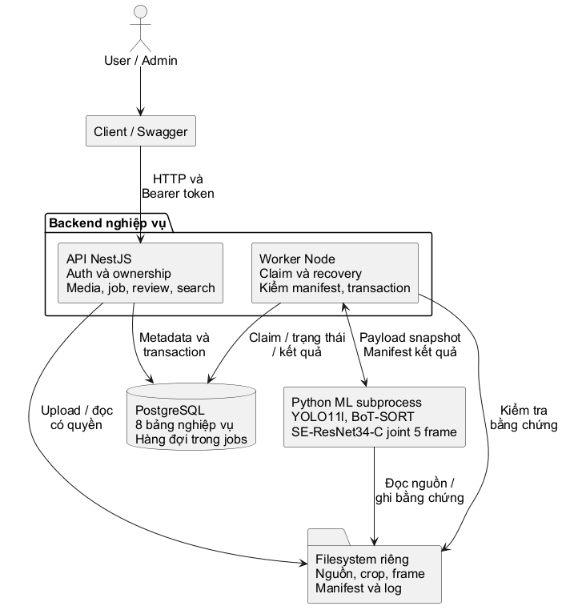

PostgreSQL giữ trạng thái hàng đợi và metadata; filesystem riêng giữ media, crop, keyframe, log và manifest. Nhóm bảng `plate_appearances`, `plate_detections`, `ocr_predictions`, `recognition_reviews` phân biệt lần xuất hiện, bằng chứng, kết luận máy và kết luận con người. Không xây bảng phương tiện hoặc chủ xe vì vượt phạm vi hiện hành.

### 12.2 Thành phần triển khai

API và worker có thể chạy hai terminal trên một host ở bản đầu, cùng truy cập database và storage. Máy phải có Node.js, PostgreSQL, môi trường Python tương thích và các checkpoint được cấu hình trước. File JSON profile là cấu hình quản trị phía server; client chỉ gửi `pipeline_id`.

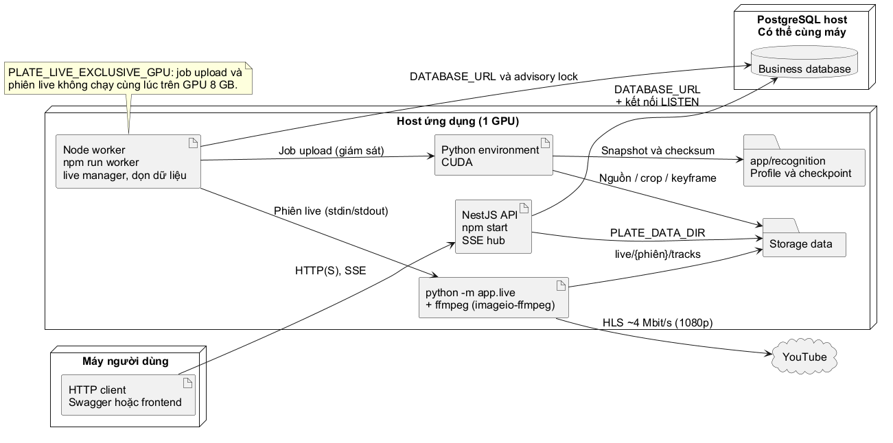

**Docker Compose** (`docs/DOCKER.md`): `docker compose --profile app up` chạy bốn container:
- `postgres`;
- `api`: migrate rồi mới phục vụ, báo healthy theo `/health/ready`;
- `worker`: PyTorch CUDA, nhận GPU qua NVIDIA Container Toolkit / WSL 2;
- `web`: bản build FE trên nginx, chuyển `/api` và SSE sang `api`.

Không có profile thì chỉ PostgreSQL chạy, như `start-all`. `data/` và `models/` được mount, không đóng vào image. Code nằm ở `/app` trong cả hai image vì snapshot ghim đường dẫn code. Worker trong Docker chạy một job một lúc, vì VM WSL 2 mặc định (7,4 GB) không đủ RAM cho hai job nạp model song song.

Khi đóng gói hoặc chuyển host, phải đưa theo migration SQL, mã `app/recognition`, checkpoint detector/OCR đúng checksum, đồng thời cấu hình storage dùng chung giữa API/worker. Đường dẫn local trong snapshot phục vụ tái lập trên môi trường đã cấu hình; không trả ra API. `ready=true` của profile chỉ xác nhận file/cấu hình/checksum, không thay thế một job smoke test để kiểm chứng Python/CUDA và model load.

### 12.3 An toàn dữ liệu và vận hành

- Session token được sinh ngẫu nhiên và DB chỉ lưu hash; password dùng scrypt. Khóa tài khoản hoặc đổi mật khẩu thu hồi các phiên của tài khoản.
- Nguồn và bằng chứng chỉ được đọc qua endpoint kiểm tra quyền. Không public thư mục data. Media content hỗ trợ Range, `206` và `416`; lỗi trả JSON và không lộ path server.
- Review và nhập kết quả dùng transaction PostgreSQL. Xóa sử dụng quarantine file rồi commit DB, restore khi transaction lỗi. PostgreSQL và filesystem không tạo thành transaction phân tán; cần kiểm tra rác/dữ liệu sau sự cố nguồn điện hoặc ổ đĩa.
- `/health` là liveness. `/health/ready` kiểm tra database cùng tập version/checksum migration. Không endpoint health nào hiện xác nhận worker đang sống hoặc GPU đủ bộ nhớ.
- Backup phải ghép một bản database nhất quán với storage tương ứng. Khôi phục cần đối chiếu các storage key và checkpoint trước khi mở lại job; đây là quy trình vận hành đề xuất, chưa có API backup/restore.
- Logging không được ghi password hoặc access token. Quyền đọc log/checkpoint chỉ dành cho người vận hành host. API chỉ trả thông báo lỗi an toàn; log giữ chi tiết để chẩn đoán.

### 12.4 Các quyết định thiết kế

| Quyết định | Lý do và hệ quả |
|---|---|
| NestJS cho API và worker điều phối | Gom nghiệp vụ TypeScript, tách xử lý ML nặng ra Python subprocess. |
| PostgreSQL thay SQLite nghiệp vụ | FK, transaction và khóa hỗ trợ nhiều tài khoản cùng kiểm duyệt. Dữ liệu SQLite của bản FastAPI đầu đã ngừng sử dụng. |
| Upload tách tạo job | Nhiều lượt chạy trên cùng media; giữ lịch sử và snapshot độc lập. |
| Một worker với hàng đợi DB | Đủ phạm vi bản đầu, chưa cần Redis/Celery; advisory lock chặn hai worker cùng điều phối. |
| Prediction bất biến ở tầng ứng dụng | Giữ bằng chứng đánh giá; `effective_text` là bản chiếu cập nhật theo review trong cùng transaction. |
| Joint OCR lưu ở appearance | Biểu diễn đúng model nhận năm frame đồng thời, không tạo năm kết quả giả. |
| File ngoài DB | Tránh ảnh/video Base64 trong bảng; phải quản lý sao lưu và xóa file cùng metadata. |
| Mỗi track live là một job | Dùng lại xem, kiểm duyệt, tra cứu, CSV, xóa; quyền đi theo chủ camera; không cần bảng kết quả live riêng. |
| Tiến trình live thường trú, không cắt clip | Tracking liên tục qua ranh giới clip, độ trễ vài giây; worker giám sát, kết nối lại và tự bật lại. |
| LISTEN/NOTIFY + SSE | Không thêm message broker; NOTIFY chỉ gửi id, client đọc lại dòng đã commit nên nối lại theo `Last-Event-ID` không mất sự kiện. |
| Chia GPU giữa upload và live | Đo được hai tiến trình cùng nạp model làm tràn VRAM 8 GB và cả hai gần như đứng. Job video joint chạy trong host live (một bản model); các job khác vẫn chờ khi camera chạy. |
| Job trong host giữ tốc độ thời gian thực | Hai camera cộng một job chạy hết tốc độ: camera bỏ 2,3% và 5,4% frame (CPU/GIL, ưu tiên GPU không đủ); giữ thời gian thực: 0% và 0,88%, job 3 phút mất 195 s. |
| Che mật khẩu camera RTSP | URL camera thường chứa mật khẩu; che ở mọi đầu ra (API, sự kiện, lỗi), chỉ thư mục dữ liệu của người vận hành giữ bản đầy đủ. |
| Dừng ffmpeg ghi hình bằng lệnh `q` thay vì kill | Kill làm đoạn MP4 đang ghi (tối đa 10 s cuối) không được đóng, nên track cuối phiên không có video. ffmpeg ghi hình đọc stdin; khi dừng, frame còn lại được đọc bỏ để pipe không nghẽn; quá 10 s mới kill. Camera không ghi hình vẫn kill ngay. |
| Giới hạn đăng nhập sai trong bộ nhớ API | Đủ cho một tiến trình API trên máy demo, không cần bảng hay Redis. Đánh đổi: khởi động lại API thì bộ đếm về 0; nhiều tiến trình API sẽ cần bộ đếm dùng chung. Khóa theo email + địa chỉ, nên người khác không khóa được tài khoản của mình từ máy khác. |
| Bộ mẫu chỉ gồm crop đủ rộng (`min_crop_width`) | Trên camera Camboriú, 180/280 track của bộ mẫu thường có crop dưới 51 px, không đọc được ký tự nào. Gán chúng tốn công mà không thêm thông tin. Kết quả chỉ đại diện cho biển đủ lớn, cũng là nhóm duy nhất máy có thể xếp `readable` đúng. |
| Track 4 frame là tùy chọn, mặc định tắt | Trên ICPR, đọc 4 frame (lặp crop nét nhất) vẫn đạt precision khoảng 96,7% ở 0,97. Nhưng trên ba video thật chỉ 1/11 track bị loại có đúng 4 lần thấy, phần còn lại chỉ 1-3 lần. Vì vậy code hỗ trợ `tracking.min_frames: 4` (bằng chứng 4 crop thật, ngưỡng live cộng 0,01) nhưng config vẫn để 5. |
| Chọn crop bỏ biển bị che/cụt | Trên camera thật, crop bị cột đèn che vẫn được chọn vì to và nét, kéo confidence cả biển xuống. Bỏ lần thấy có box co đột ngột, tỷ lệ lệch hoặc chạm mép, và ưu tiên crop lớn: 7,7 phút Camboriú 1080p có 8 thay vì 4 track `readable`. Đánh đổi: một biển trước đây bị chặn ở `low_confidence` có thể thành `readable` sai, nên precision live vẫn cần nhãn người. TTA chỉ thêm dưới 1 điểm % mà OCR chậm khoảng 3 lần nên không bật. |
| Ghi đệm bằng stream copy, clip có chọn lọc | Ghi toàn bộ video vĩnh viễn tốn khoảng 43 GB/ngày mỗi camera; stream copy gần như không tốn CPU (2 camera bật ghi vẫn 0 frame bỏ). Clip mọi track sẽ khoảng 4 GB/giờ ở Camboriú nên chỉ giữ lâu dài clip của track đọc rõ hoặc có cảnh báo; track khác cắt theo yêu cầu trong 4 giờ. |
| Tối đa 3 camera mỗi GPU | 4 camera bỏ 4-30% frame dù GPU chỉ bận 62%; giảm việc CPU mỗi frame (đọc stderr ffmpeg qua buffer, bỏ checksum showinfo) và tùy chọn giải mã NVDEC đã có, chưa đo lại vì thiếu RAM khi đo. |
| Nhiều phiên trong một host dùng chung model | Đo được VRAM mỗi tiến trình chủ yếu là CUDA context và bộ đệm allocator; dùng chung thì hai camera tốn như một. GPU chỉ bận 31-38% nên giữ nguyên tần suất lấy mẫu. Đánh đổi: phiên treo làm cả host bị kill; mọi phiên phải cùng pipeline. |
| Một luồng GPU, batch 1/4/16 | Đo được mỗi cỡ batch mới tốn khoảng 1,8 s cho mỗi luồng; hai camera bật cùng lúc trước đây bỏ 17 và 73 frame, nay 0. Đánh đổi: frame đệm làm kết quả fp16 dao động rất nhỏ. |
| Giữ lấy mẫu 8/12/15 fps | Thử 15/20/25 fps: số track gần gấp đôi nhưng không thêm biển đọc được, hai camera bỏ 12-17% frame; profile này chỉ để thử nghiệm. |
| Ngưỡng 0,96 từ dữ liệu ICPR có nhãn | Precision mục tiêu 95% với cận dưới khoảng tin cậy; đánh đổi: ít track `readable` hơn (Camboriú 158 → 51 trong 45 phút). |
| Docker Compose theo profile | Máy khác chạy được không cần cài Node/Python/CUDA; `start-all` không đổi. Đánh đổi: image worker khoảng 13 GB, job chậm hơn native. |
| Nhãn đánh giá tách khỏi review | Review là kết luận vận hành, có thể bị ảnh hưởng bởi kết quả máy; nhãn mù mới đo được độ chính xác. |
| Giờ chụp theo PROGRAM-DATE-TIME | PTS gốc của segment (`-copyts`) ứng với PDT theo độ lệch không đổi; giờ nhận frame chỉ là phương án dự phòng. |

## 13. Nghiệm thu, truy vết và đánh giá đề tài

### 13.1. Ma trận nghiệm thu chức năng

Các tình huống dưới đây là tiêu chí có thể thực hiện lại; một dòng không đồng nghĩa có một test tự động riêng. Test API có fixture không thay thế nghiệm thu model trên nguồn thật.

| Mã | Tình huống / dữ liệu | Kết quả mong đợi | Truy vết |
|---|---|---|---|
| AT01 | Login đúng, sai, tài khoản khóa; logout và dùng lại token | Chỉ phiên hợp lệ được dùng; token sau logout bị từ chối | UC01; FR01; NFR01 |
| AT02 | Admin tạo email trùng, reset, đổi vai trò, khóa Admin cuối | Unique 409; reset/khóa thu hồi phiên; không mất Admin cuối | UC02; FR02; NFR02 |
| AT03 | User B truy cập media/job/result/crop/review/CSV của A | Từ chối cả metadata và file; Admin đọc được | UC02-UC12; FR03; NFR01 |
| AT04 | Upload ảnh/video hợp lệ, file rỗng/hỏng/giả loại/quá lớn | Metadata đúng; 413/415/422 tương ứng; không để nguồn hợp lệ giả | UC03; FR04-05 |
| AT05 | Đọc nguồn toàn bộ, Range hợp lệ, Range ngoài file | 200/206 đúng MIME; 416 đúng Content-Range | UC06; FR05 |
| AT06 | Tạo job khi model thiếu; gửi đường dẫn lạ, mode sai | Không xếp hàng cấu hình tùy ý; 503/422 theo nguyên nhân | UC04; FR06-07 |
| AT07 | Chạy lại cùng media với profile/snapshot khác | Hai ID và kết quả độc lập; nguồn không upload lại | UC04; FR07; NFR03 |
| AT08 | Prepare ảnh không/một/nhiều biển số; plate_crop | 0/1/n appearances theo detector; plate_crop bỏ detector; chưa có OCR | UC12; FR09 |
| AT09 | Video track đủ/thiếu 5 frame; frame lặp hoặc sai thứ tự | Đủ 5 crop thật được xử lý; thiếu bị loại có thống kê; manifest sai bị từ chối | UC04, UC12; FR10 |
| AT10 | Model joint-five đọc được hoặc trả chuỗi rỗng | Một prediction/appearance; readable/unreadable; agreement NULL; không có OCR từng crop giả | UC04, UC06; FR11-12 |
| AT11 | Ảnh đơn gửi profile Kaggle; ảnh prepare nhập tay | OCR joint từ chối 422; prepare cho correct, chưa có model ảnh đơn | UC04, UC12; FR09, FR13 |
| AT12 | Worker timeout/crash/restart, source hoặc checkpoint thay đổi | Failed với mã lỗi; không công bố một phần; tạo job mới để chạy lại | UC05; FR08; NFR05 |
| AT13 | Xem crop, frame, position, prediction, lịch sử | Đúng appearance/track; giữ thứ tự input; enhanced thiếu trả 404 | UC06; FR12; NFR03 |
| AT14 | Confirm/correct/unreadable/reject rồi tìm kiếm | Prediction/machine không đổi; text hiệu lực và lịch sử đúng action | UC07-08; FR13-14 |
| AT15 | Hai review cùng expected_revision | Chỉ một revision được chấp nhận; bên còn lại 409 | UC07; FR13; NFR02 |
| AT16 | Latest succeeded, queued/failed mới hơn, prepare | Tra cứu chọn đúng job thành công mới nhất; ID cũ vẫn xem được | UC08; FR15 |
| AT17 | CSV có ký tự Unicode, dấu nháy, tiền tố công thức, 0 kết quả | UTF-8 BOM; escape đúng; không lộ nguồn khác; 0 kết quả còn header | UC09; FR16 |
| AT18 | Xóa job running, terminal và nguồn còn/hết tham chiếu | Running 409; terminal xóa dữ liệu phát sinh; v2 giữ nguồn; media có job 409 | UC10-11; FR17 |
| AT19 | Chạy migration, FK/cascade, rollback | Schema đúng checksum; migration đã áp dụng không bị sửa; rollback không để dữ liệu dở | FR18; NFR02-03 |
| AT20 | DB mất kết nối/thiếu migration và API còn chạy | Liveness 200, readiness 503; không suy ra model đã sẵn sàng | NFR07 |
| AT21 | Camera không phải YouTube, vùng sai, phiên thứ hai, người khác truy cập | 422/409/404 tương ứng; một camera một phiên hoạt động | UC13-UC14; FR19-FR20 |
| AT22 | Phiên live trên luồng thật 60 phút | Không crash, bộ nhớ không tăng dần, bỏ frame thấp, dừng sạch | UC14; NFR09-NFR10 |
| AT23 | Track live: xem, review, tra cứu theo biển, CSV, xóa job | Hành vi như kết quả upload; giờ chụp theo luồng | UC06-UC09; FR22 |
| AT24 | SSE: mở, nối lại `Last-Event-ID`, cắt kết nối LISTEN | Không thiếu/trùng sự kiện; cảnh báo chỉ tới người đặt | UC15-UC16; FR23-FR24 |
| AT25 | Camera 24/7, kill worker, dừng qua API | Tự bật lại; dừng thì tắt 24/7; không còn tiến trình con | UC14; FR21 |
| AT26 | Kẹt mạng 12 s; chạy job upload khi camera chạy | Đuổi kịp không bỏ frame; job video joint chạy trong host cùng camera, job khác chờ GPU rảnh | NFR09, NFR11; BR27 |
| AT27 | Dọn dữ liệu, xóa phiên | Còn 1 keyframe/track, crop còn; track review/cảnh báo được giữ; phiên đang chạy 409 | UC17; FR25 |
| AT28 | Camera demo: Admin, User, đường dẫn `../`, file không tồn tại; chạy qua nhiều vòng | 201/403/422/422; PTS liên tục, watchlist cảnh báo khi clip lặp | UC18; FR26; BR29 |
| AT29 | Bộ mẫu: lấy mẫu phân tầng, `next` không lộ kết quả máy, sửa nhãn, retention | Mỗi khoảng tối đa N mẫu; key trả về chỉ gồm evidence; nhãn ghi đè; track trong bộ mẫu không bị xóa | UC19; FR27; BR30-BR31 |
| AT30 | Báo cáo trên nhãn có đồng thuận và bất đồng | Mẫu bất đồng bị loại; số liệu khớp `scripts.calibrate_threshold`; User 403 | UC20; FR28 |
| AT31 | Hai camera 24/7 trong 30 phút; kill worker; dừng cả hai | Một host; bỏ frame dưới 1%; tự bật lại; host thoát và nhả GPU | UC14; FR29; NFR12 |
| AT32 | Bật hai camera cùng lúc, và bật camera thứ hai khi camera đầu đang chạy | 60 s đầu không bỏ frame; phiên sau không warm-up lại; không phiên nào bị từ chối nhầm | UC14; FR29; NFR12 |
| AT33 | `docker compose --profile app up` trên DB riêng | `api` healthy; job upload chạy trên GPU trong container; camera demo gửi track qua SSE đi qua nginx | NFR07; vận hành |
| AT34 | Camera RTSP: sai mật khẩu, đúng mật khẩu, tắt camera 20 s rồi bật lại | Sai mật khẩu kết thúc ngay (401); chạy và có track; tự kết nối lại; không file sự kiện/log nào chứa mật khẩu; API trả URL đã che | UC13-UC14; FR19 |
| AT35 | Hai camera chạy, gửi job video 3 phút | Job chạy trong host, kết quả như chạy riêng; camera bỏ dưới 1% frame | UC14; BR27; NFR12 |
| AT36 | 2, 3, 4 camera trong một host | 3 camera bỏ dưới 1% frame; 4 camera vượt mức (khuyến nghị tối đa 3) | NFR12 |
| AT37 | Hai camera bật ghi 5 phút | 0 frame bỏ; bản ghi có index đúng giờ; đoạn quá hạn bị xóa | FR30; BR33 |
| AT38 | Track đọc rõ và track có cảnh báo | Có clip lưu cùng job; mở video tua đúng giây biển xuất hiện (khung hình trùng box biển số) | UC21; FR30 |
| AT39 | Track không clip, rồi sau thời gian giữ | Cắt từ bản ghi trong khoảng 0,5 s; hết hạn trả 404; khoảng bản ghi > 600 s trả 400 | UC21; BR33 |
| AT40 | Cùng video, chọn crop cũ và mới (`scripts/eval_crops.py`) | Không mất track; ít track dính crop bị che hơn; số `readable` không giảm; soát ảnh ghép các track đổi trạng thái | FR11-FR12 |
| AT41 | Pipeline joint đặt `tracking.min_frames: 4`, track có 4 lần thấy | Lưu 4 detection; prediction có 5 `input_storage_keys`, chỉ lặp một crop liền kề; pipeline không bật thì từ chối; live cần confidence ≥ ngưỡng + 0,01 | FR11-FR12 |
| AT42 | Bộ mẫu gán bằng tài khoản AI labeller | Báo cáo tính được precision theo ngưỡng; kết quả ghi rõ nguồn nhãn AI và không dùng để đổi ngưỡng mặc định | UC19; BR30 |
| AT43 | Dừng phiên khi đoạn ghi hình đang mở (giây thứ 12 của đoạn 10 s thứ hai) | Đoạn cuối được đóng, có trong index, phát được; YouTube thật: 3/3 đoạn, ffmpeg thoát sau 0,2 s | UC21; FR30 |
| AT44 | Bộ mẫu với `min_crop_width` lớn hơn / bằng cỡ crop | `422` / lấy đủ mẫu và ghi vào `params` | UC19; FR27 |
| AT45 | Đăng nhập sai 6 lần liên tiếp, rồi đúng mật khẩu; tài khoản khác cùng địa chỉ | 401 × 5, rồi 429 kèm `Retry-After`; đúng mật khẩu vẫn 429; tài khoản khác 200 | UC01; NFR01 |
| AT46 | Body JSON 2 MB, JSON hỏng, NUL trong query, chuỗi `ffi` × 64 khi sửa biển, PNG khai 20000 × 10000, ảnh JPEG có EXIF xoay | 413, 400, 422, 422, 422; nhận diện trên ảnh đã xoay thẳng | UC03, UC07, UC08; NFR06 |
| AT47 | `npm run smoke` trên stack đang chạy, kèm `--upload` và `--live` | Kiểm tra nhanh khoảng 1 s; clip 15 s xong trong 39 s, có bằng chứng, rồi xóa; camera demo chạy sau 26 s, 16 track trong 60 s, không bỏ frame | NFR07 |

### 13.2. Ma trận liên kết yêu cầu với thành phần thực hiện

| Nhóm yêu cầu | API liên quan | Dữ liệu chính | Nơi kiểm chứng |
|---|---|---|---|
| FR01-02: phiên, quản trị tài khoản | API01-06 | users, auth_sessions | `tests/api.test.ts`, `src/auth` |
| FR03: phân quyền xuyên tài nguyên | API04-10, API12-21 | owner nguồn và quan hệ FK | `tests/api.test.ts`, `src/common/ownership.ts` |
| FR04-05: nguồn và file | API07-10 | media_assets, source filesystem | `tests/api.test.ts`, `scripts/probe_media.py` |
| FR06-08: cấu hình, queue, vòng đời | API11-16 | recognition_jobs, snapshot, statistics | `tests/recognition.test.ts`, registry/engine/worker |
| FR09-11: prepare, tracking, OCR | API12, API15, API18 | appearances, detections, predictions | `tests/test_ml_adapter.py`, `tests/test_icpr_adapter.py`, joint worker tests |
| FR12-13: bằng chứng và review | API15, API18-20 | detections, predictions, reviews, revision | `tests/joint-results.test.ts`, `tests/api.test.ts` |
| FR14-16: tra cứu và CSV | API17, API21 | effective_text, latest job | `tests/api.test.ts`, `tests/joint-results.test.ts` |
| FR17-18: xóa, migration | API10, API16 | FK/cascade, storage, schema_migrations | `tests/db.test.ts`, `tests/api.test.ts` |
| NFR07: hợp đồng API/schema | Health, Swagger | schema_migrations | `tests/openapi.test.ts`, `tests/db.test.ts` |
| NFR08: chất lượng nghiên cứu | Đánh giá offline | Ground truth độc lập, output đã cố định | [EVALUATION.md](../EVALUATION.md), evaluator tests |
| FR19-FR22: camera, phiên, track live | API22-API33 | stream_sources, live_sessions, recognition_jobs (live) | `tests/live.test.ts`, `tests/live-ops.test.ts`, `tests/test_live.py` |
| FR23-FR24: SSE, watchlist | API34-API37 | live_session_events, plate_watchlist | `tests/live-events.test.ts`, `tests/db.test.ts` |
| FR25, NFR09-NFR11: vận hành live | API25, API32, API38 | sighting_id, evidence_bytes, retention | `tests/live-ops.test.ts`, [TESTING.md](../../TESTING.md) (đo trên luồng thật) |
| FR26: camera demo | API22, API39 | stream_sources (`source_type = file`) | `tests/live.test.ts`, `tests/test_live.py` |
| FR27-FR28: gán nhãn, báo cáo ngưỡng | API40-API48 | evaluation_sets, evaluation_items, evaluation_labels | `tests/evaluation.test.ts` |
| FR29, NFR12: nhiều camera | API28 (qua worker) | live_sessions | `tests/live-host.test.ts`, `tests/live.test.ts`, `tests/test_live_host.py`, [TESTING.md](../../TESTING.md) |

### 13.3. Mức bằng chứng kiểm thử đã có

Baseline đã ghi nhận trong các lượt triển khai là **48 test Node và 98 test Python đạt**; một lượt kiểm tra API/OpenAPI tiếp theo ghi nhận **24 test có mục tiêu đạt**, kèm build/format. Hai số Node không cộng thành 72 vì lượt 24 là chạy lại một phần phạm vi. Đây là bằng chứng đã ghi nhận của các lượt trước, không phải tuyên bố vừa chạy lại toàn bộ test khi soạn tài liệu.

Test Node dùng NestJS/HTTP và PostgreSQL thật trong DB/cluster tạm; nhiều kết quả ML hoàn tất được tạo bằng fixture để kiểm quyền, transaction và hợp đồng. Test adapter/runner kiểm số frame, preprocessing, output và lỗi nhưng không đo accuracy. Đã ghi nhận smoke inference checkpoint/video thực trong quá trình tích hợp; smoke chứng minh đường chạy thực hiện được trên mẫu đó, không chứng minh chất lượng toàn tập hoặc khả năng tổng quát sang biển số Việt Nam.

Sau khi bổ sung live (giai đoạn 1-5a), lượt chạy ghi nhận **64 test Node và 112 test Python đạt** cùng format check. Sau giai đoạn 6 (camera demo, gán nhãn, nhiều camera), lượt chạy ngày 25/10/2026 ghi nhận **69 test Node và 118 test Python đạt**. Sau giai đoạn 8 (26/10/2026): **72 test Node và 123 test Python đạt** (1 test bỏ qua). Sau giai đoạn 9 (27/10/2026): **76 test Node và 134 test Python đạt**. Sau giai đoạn 10 (ghi đệm và video): **79 test Node và 143 test Python đạt**. Sau giai đoạn 11 (chọn crop): **146 test Python đạt**. Sau giai đoạn 12 (track 4 frame): **80 test Node và 150 test Python đạt**. Sau giai đoạn 13 (ghi hình, bảo mật, smoke check): **82 test Node và 155 test Python đạt**. CI GitHub chạy test Node/Python cho backend, và lint/test/build cho FE ở mỗi pull request; các phép đo trên luồng YouTube thật (60 phút, kẹt mạng, 24/7, dọn dữ liệu, giờ luồng) được ghi trong [TESTING.md](../../TESTING.md) kèm ngày và phần cứng.

Để tái lập xác minh kỹ thuật, dùng [TESTING_NEST.md](../TESTING_NEST.md) và lệnh trong [README](../../README.md). Cần lưu commit, dependency, cấu hình, phần cứng, ngày chạy và log từng đợt nếu dùng các con số này trong báo cáo nghiệm thu. Sau một thay đổi runtime mới, chỉ báo test là hiện hành khi đã chạy lại phạm vi chịu ảnh hưởng.

### 13.4. Thiết kế đánh giá low-resolution

Đánh giá recognizer trên crop và toàn pipeline trên ảnh/video nguồn là hai thí nghiệm khác nhau. Trong thí nghiệm recognizer, đầu vào đã có crop và đúng nhóm năm frame. Trong thí nghiệm toàn pipeline, việc bỏ sót detection, không đủ frame hoặc ghép sai track cũng là lỗi nghiệp vụ cần đếm/báo cáo; không chỉ chấm các appearance pipeline đã tạo thành công.

Các metric tối thiểu:

- **Exact plate accuracy:** số mẫu có chuỗi dự đoán chuẩn hóa khớp toàn bộ nhãn / số mẫu hợp lệ trong tập đánh giá đã định nghĩa. Chốt trước cách xử lý nhãn mơ hồ và ký tự ngoài alphabet.
- **Character error rate (CER):** tổng khoảng cách Levenshtein trên chuỗi dự đoán/nhãn chia tổng số ký tự nhãn. Không coi detector score, frame weight hoặc tỷ lệ review confirm là accuracy.
- **Unreadable rate và coverage:** tỷ lệ dự đoán rỗng/không đọc được; tỷ lệ mẫu tạo được kết quả. Với pipeline cần báo riêng số nguồn/biển số bỏ sót, track bị loại vì thiếu frame và track ghép sai.
- **Latency:** thời gian recognizer và end-to-end tách riêng; ghi cả thời gian chờ queue nếu báo thời gian người dùng phải đợi. Báo thiết bị, batch, độ dài video, số track và warm-up, thay vì một số thời gian thiếu điều kiện.
- **Chất lượng theo kích thước crop:** nhóm theo crop width/height hoặc quy tắc phân nhóm đã công bố. Độ phân giải toàn video không đủ mô tả độ khó của vùng biển số.

Thí nghiệm chính hiện phù hợp là checkpoint Kaggle joint-five trên đúng nhóm năm crop thật và toàn pipeline đã tích hợp. So sánh một ảnh với năm ảnh cần recognizer/baseline một ảnh có preprocessing/checkpoint hợp lệ; không lặp một crop năm lần rồi gọi đó là baseline ảnh đơn của model hiện tại. Nếu bổ sung SR thật, so sánh cùng mẫu trước/sau SR; hiện tại chưa có nhánh SR nên không ghi kết quả SR giả định.

Train/validation/test nên tách theo nguồn và danh tính biển số khi có metadata; các frame gần nhau/crop của cùng track không được chia ngẫu nhiên sang hai tập. Nhãn chuẩn phải độc lập với output máy và lịch sử người dùng xác nhận. Chốt rule chuẩn hóa, ghép output với ground truth, xử lý bỏ sót và khoảng tin cậy trước khi xem test set. Các rule/threshold mới chỉ điều chỉnh trên validation; test dùng cho lần báo cáo cuối.

Model đang phục vụ biển số Brazil. Dữ liệu Việt Nam cần tập đánh giá và công bố riêng; không diễn giải việc model trả được một chuỗi là xác nhận hỗ trợ đúng biển số Việt Nam. Tài liệu này không đặt một mục tiêu accuracy/SLA chưa được đo hoặc phê duyệt.

### 13.5 Ma trận nghiệm thu nghiệp vụ

Các tình huống dưới đây là tiêu chí để nghiệm thu hệ thống. Chúng không thay thế báo cáo chạy test và không khẳng định đã đo chất lượng OCR trên tập nhãn chuẩn.

| Mã | Tình huống | Kết quả cần quan sát | Truy vết |
|---|---|---|---|
| AC01 | User A biết ID nguồn/job/result của User B | Metadata, file, bằng chứng và CSV đều bị chặn; Admin hợp lệ xem được theo quyền. | FR03; UC03, UC05-UC11 |
| AC02 | Admin khóa hoặc đặt lại mật khẩu; hạ quyền Admin cuối cùng | Các phiên đối tượng bị thu hồi khi khóa/reset; thao tác làm mất Admin hoạt động cuối cùng bị từ chối. | FR01-02; UC01-UC02 |
| AC03 | File hợp lệ, quá dung lượng, sai loại và hỏng | Chỉ nguồn hợp lệ được ghi nhận; các lỗi lần lượt trả mã theo UC03, không tự tạo job. | FR04-05; UC03 |
| AC04 | Ảnh không có, một, nhiều biển số và ảnh crop sẵn chạy prepare | Số appearance theo detection; plate_crop bỏ detector; không có OCR giả; có thể nhập tay trên appearance hợp lệ. | FR09; UC12 |
| AC05 | Video có track đủ/thiếu năm frame hoặc track ghép sai | Chỉ track đủ năm frame khác nhau đi tiếp; track thiếu có thống kê loại; người kiểm duyệt có thể reject track sai. | FR10, FR13; UC04, UC07 |
| AC06 | Chạy Kaggle joint-five | Lưu một prediction theo appearance, liên kết đúng năm crop; agreement_count và OCR score không được model cung cấp đều null. | FR11-12; UC04, UC06 |
| AC07 | Chạy lại cùng nguồn hoặc model/worker lỗi giữa lượt chạy | ID/snapshot mới độc lập; job lỗi có trạng thái failed; không làm mất kết quả cũ; running bị gián đoạn được phục hồi thành failed khi worker khởi động lại. | FR07-08; UC04-UC05 |
| AC08 | Hai người gửi review từ cùng revision | Chỉ một thao tác thành công; thao tác còn lại 409; machine text và predictions giữ nguyên. | FR13; UC07 |
| AC09 | Confirm, correct, unreadable, reject rồi tra cứu | effective_text và review_status đúng hành động; text được chuẩn hóa mà không đổi O/0; lịch sử chứa từng revision. | FR13-14; UC07-UC08 |
| AC10 | Nguồn có nhiều lượt succeeded/queued/failed | Tìm kiếm chỉ dùng lượt v2 succeeded mới nhất theo created_at rồi ID, bao gồm prepare; job khác trạng thái không che lượt thành công cũ. | FR15; UC08 |
| AC11 | Export có ký tự phân cách, dấu nháy, tiền tố công thức hoặc không có kết quả | CSV đọc được, escape đúng, có các cột nguồn kết quả/vị trí; không có kết quả vẫn có header. | FR16; UC09 |
| AC12 | Xóa job kết thúc và nguồn còn/không còn tham chiếu | Không xóa queued/running; xóa job giữ nguồn; nguồn còn job bị chặn 409; xóa hợp lệ không ảnh hưởng nguồn độc lập khác. | FR17; UC10-UC11 |
| AC13 | Tạo camera, bật phiên, dừng phiên | Camera theo chủ sở hữu; phiên thứ hai trên cùng camera bị 409; dừng phiên chốt track đang mở, không còn tiến trình con. | FR19-FR20; UC13-UC14 |
| AC14 | Track live đủ 5 frame | Thành job succeeded có 5 crop, giờ chụp và mức tin cậy; xem, kiểm duyệt, tra cứu và CSV dùng như kết quả upload; người khác không thấy. | FR22; UC06-UC09 |
| AC15 | Mở stream SSE, nối lại bằng `Last-Event-ID` | Nhận trạng thái/stats/track theo thời gian thực; nối lại không thiếu, không trùng sự kiện. | FR23; UC15 |
| AC16 | Watchlist khớp biển đọc được | Cảnh báo đến người đặt; người khác (kể cả Admin không đặt) không nhận. | FR24; UC16 |
| AC17 | Camera 24/7, worker bị kill rồi khởi động lại | Phiên cũ `interrupted`; worker tự bật phiên mới; dừng qua API thì 24/7 tắt và không bật lại. | FR21; UC14 |
| AC18 | Dọn dữ liệu và xóa phiên | Keyframe giảm còn 1/track, crop còn; track đã review/có cảnh báo được giữ; xóa phiên đang chạy bị 409. | FR25; UC17 |
| AC19 | Camera demo | Admin tạo được, User thường bị 403, đường dẫn `../` bị 422; phiên phát lại liên tục qua nhiều vòng, watchlist cảnh báo khi clip lặp lại. | FR26; UC18 |
| AC20 | Gán nhãn mù | Mẫu trả về không chứa biển máy đọc, confidence hay review; hai người gán song song; sửa được nhãn; track trong bộ mẫu không bị retention xóa. | FR27; UC19 |
| AC21 | Báo cáo ngưỡng | Mẫu bất đồng bị loại; số liệu khớp `scripts.calibrate_threshold` trên cùng dữ liệu; User thường bị 403. | FR28; UC20 |
| AC23 | Xem video của kết quả | Kết quả có clip phát được và tua đúng lúc biển xuất hiện; kết quả không clip phát được đoạn cắt khi còn bản ghi, hết hạn thì báo không còn video; người khác bị 404. | FR30; UC21 |
| AC22 | Hai camera cùng lúc | Một host cho cả hai phiên; dừng một phiên không ảnh hưởng phiên kia; host crash thì các phiên `failed`; kill worker thì camera 24/7 tự bật lại. | FR29; UC14 |

Với nghiệm thu low-resolution, cần thêm tập ground truth độc lập, danh sách split và cấu hình thiết bị. Báo cáo riêng chất lượng OCR trên crop và chất lượng toàn pipeline; checkpoint đã chạy được không đồng nghĩa đã đạt accuracy mục tiêu. Các yêu cầu tương lai về OCR ảnh đơn, SR, client hoàn chỉnh hoặc vận hành đa worker cần được bổ sung thành phạm vi và tiêu chí riêng trước khi nghiệm thu.

## 14. Nguồn đối chiếu, giới hạn và hướng mở rộng

### 14.1. Sổ nguồn dùng để lập tài liệu

| Nguồn | Vai trò / mức sử dụng |
|---|---|
| [auth.controller.ts](../../src/auth/auth.controller.ts), [auth.guard.ts](../../src/auth/auth.guard.ts), [security.ts](../../src/auth/security.ts) | Hành vi login/logout, quản trị, khóa tài khoản, token/password và role thực. |
| [media.controller.ts](../../src/media/media.controller.ts), [storage.ts](../../src/media/storage.ts), [probe_media.py](../../scripts/probe_media.py) | Upload, metadata, file access, giới hạn/giải mã, quarantine/restore/purge. |
| [jobs.controller.ts](../../src/jobs/jobs.controller.ts), [ownership.ts](../../src/common/ownership.ts) | Queue request, snapshot, scope sở hữu, readiness kết quả và điều kiện xóa. |
| [registry.ts](../../src/recognition/registry.ts), [engine.ts](../../src/recognition/engine.ts), [worker.ts](../../src/worker.ts) | Profile được phép, kiểm hash, claim/recover, supervisor, manifest validation, atomic persist. |
| [runner.py](../../app/recognition/runner.py), [icpr_adapter.py](../../app/recognition/icpr_adapter.py), [icpr_model.py](../../app/recognition/icpr_model.py) | Tích hợp ML, preprocessing và inference joint-five hiện hành. |
| [results.controller.ts](../../src/results/results.controller.ts) | Prediction detail, thứ tự detection_ids, review/revision, latest succeeded search và CSV. |
| [video_tracking.py](../../app/recognition/video_tracking.py), [icpr_adapter.py](../../app/recognition/icpr_adapter.py), [ctc_decoders.py](../../app/recognition/ctc_decoders.py) | Tracking, chọn 5 crop, model OCR và decoder port từ notebook. |
| [0001_business.sql](../../src/database/migrations/0001_business.sql), [0002_joint_ocr.sql](../../src/database/migrations/0002_joint_ocr.sql), [0003_ocr_decoding.sql](../../src/database/migrations/0003_ocr_decoding.sql) đến [0011_live_clips.sql](../../src/database/migrations/0011_live_clips.sql) | Schema và ràng buộc vật lý; nguồn chính cho phần thiết kế DB. |
| [src/live](../../src/live), [app/live](../../app/live) | Camera, phiên, live manager, host dùng chung, nhập track, SSE hub, watchlist, dọn dữ liệu; tiến trình live và host (yt-dlp, ffmpeg, Pacer, giờ luồng). |
| [src/evaluation](../../src/evaluation), [EVALUATION.md](../EVALUATION.md) | Lấy mẫu phân tầng, gán nhãn mù, báo cáo hiệu chỉnh ngưỡng. |
| [main.ts](../../src/main.ts), [app.module.ts](../../src/app.module.ts), [http.ts](../../src/common/http.ts) | Bootstrap, Swagger, response headers, health và ánh xạ lỗi. |
| [API.md](../API.md), [MODEL_INTEGRATION.md](../MODEL_INTEGRATION.md), [OCR_KAGGLE.md](../OCR_KAGGLE.md), [OPERATIONS.md](../OPERATIONS.md) | Hướng dẫn tích hợp/vận hành hỗ trợ; đối chiếu với mã nguồn khi có khác biệt. |
| [Notebook PBL6 PIPELINE](https://www.kaggle.com/code/trnvnhun/pbl6-pipeline) | Nguồn pipeline, model, preprocessing và decoder; đã đối chiếu checksum checkpoint với báo cáo lần chạy 13/10/2026; không dùng chỉ số trong notebook như accuracy của backend. Provenance cục bộ ở [icpr-source.json](../../models/icpr-source.json). |

Các sơ đồ PlantUML và SVG đi kèm là sản phẩm mô hình hóa mã nguồn; người đọc có thể chỉnh `.puml` rồi render lại. Vai trò client thể hiện hợp đồng cần cho frontend, không xác nhận đã triển khai giao diện. Phần DB phải đọc cùng migration, vì business rule như đúng năm frame và tổng frame_weights còn có kiểm tra trong worker, không được bảo đảm hoàn toàn chỉ bằng FK/JSONB check.

### 14.2. Các giới hạn đã xác định

1. **OCR ảnh đơn chưa có model tương thích được cấu hình.** Endpoint ảnh và prepare hoạt động; người dùng kiểm duyệt thủ công. Model joint-five hiện có không được ép đọc bằng cách nhân bản ảnh.
2. **Tracking không phải định danh xe.** Track có thể ghép sai; reject ghi lại kết luận nhưng không tự sửa track. Cùng biển số ở nhiều nguồn vẫn là nhiều appearance.
3. **Một worker và filesystem riêng.** Advisory lock chủ động giới hạn một worker trên DB. Chưa có hàng đợi phân tán, object storage, scale nhiều worker hoặc cơ chế tự reconcile mọi crash giữa DB/file.
4. **Readiness có phạm vi.** Health kiểm DB/schema, pipelines.ready kiểm file/config/checksum; chỉ job thực mới kiểm được toàn runtime/model/thiết bị. Chưa có endpoint xác nhận heartbeat worker đang sống.
5. **Đánh giá chất lượng còn tách riêng.** Test và smoke không thay ground truth độc lập; chưa xác nhận accuracy Việt Nam, SLA hoặc tải đồng thời production.
6. **Live trên một GPU.** Host dùng chung chạy được ba camera trên GPU 8 GB (đo được); bốn camera bỏ 4-30% frame vì CPU/GIL. Job video joint chạy cùng camera nhưng bị giữ ở tốc độ thời gian thực; job khác phải chờ khi có camera chạy. Camera YouTube 720p cho confidence thấp hơn hẳn 1080p (2/318 track `readable` ở ngưỡng 0,96). Camera RTSP mới thử với camera giả lập (mediamtx), chưa thử camera thật. Chất lượng phụ thuộc băng thông (1080p cần khoảng 4 Mbit/s). Nhãn `readable` dựa trên ngưỡng 0,96, hiệu chỉnh offline trên ICPR (precision 96,9% trên test). Kết quả này là cận trên; trên camera thật chưa xác nhận bằng nhãn người gán độc lập. Lượt xuất hiện là gợi ý theo chuỗi đọc được.
7. **Phạm vi nghiệp vụ giới hạn.** Chưa có bãi xe, chủ phương tiện, xử phạt, hủy job, chia sẻ dữ liệu, public signup, email reset, giao diện đầy đủ hoặc SR. Đây không phải các API bị bỏ sót trong 52 endpoint hiện có.

### 14.3. Thứ tự mở rộng đề xuất

Trước hết hoàn thiện client theo use case, triển khai API/worker/DB cùng chính sách backup và kiểm chứng với bộ dữ liệu Brazil có nhãn chuẩn. Tiếp theo bổ sung adapter/checkpoint ảnh đơn nếu nghiệp vụ cần, giữ nguyên cách lưu dự đoán máy/lịch sử kiểm duyệt. Khi có số đo tải và độ trễ, mới quyết định nhiều worker/queue riêng/object storage; thay đổi kiến trúc đó cần thiết kế lại quyền nhận job, heartbeat/recovery và lưu artifact. SR hoặc dữ liệu Việt Nam là thí nghiệm mới cần validation riêng, không là điều kiện ngầm để đánh dấu endpoint hoàn thành.
